**SKRIPSI**

**DETEKSI CACAT PCB DENGAN *EXPLANATION* YANG *FAITHFUL* MELALUI ARSITEKTUR *NEURO-SYMBOLIC FASTER* R-CNN DAN *SPARSE OBLIQUE DECISION TREE***

*Diajukan untuk memenuhi persyaratan mendapatkan gelar Strata Satu*

Disusun Oleh :

HANDI DWI CAHYO\
L0122072

**PROGRAM STUDI INFORMATIKA**

**FAKULTAS TEKNOLOGI INFORMASI DAN SAINS DATA**

**UNIVERSITAS SEBELAS MARET**

**2026**

# PERSETUJUAN

**SKRIPSI**

**DETEKSI CACAT PCB DENGAN *EXPLANATION* YANG *FAITHFUL* MELALUI ARSITEKTUR *NEURO-SYMBOLIC FASTER* R-CNN DAN *SPARSE OBLIQUE DECISION TREE***

Disusun Oleh:

HANDI DWI CAHYO\
L0122072

Skripsi ini telah disetujui untuk dipertahankan di hadapan dewan penguji pada tanggal:

Pembimbing II

Prof. Dr. Wiharto, S.T., M.Kom.\
NIP. 197502102008011005

Pembimbing I

Esti Suryani, S.Si., M.Kom\
NIP. 19761129008122001

# PENGESAHAN

**SKRIPSI**

**DETEKSI CACAT PCB DENGAN *EXPLANATION* YANG *FAITHFUL* MELALUI ARSITEKTUR *NEURO-SYMBOLIC FASTER* R-CNN DAN *SPARSE OBLIQUE DECISION TREE***

Disusun Oleh:

HANDI DWI CAHYO

L0122072

telah dipertahankan di hadapan Dewan Penguji\
pada tanggal:

Susunan Penguji Seminar Proposal

1.  Nama Pembimbing 1 ( <u>ttd</u> )

NIP .....

2.  Nama Pembimbing 2 ( <u>ttd</u> )

NIP .....

3.  Nama Penguji Utama ( <u>ttd</u> )

NIP .....

**DETEKSI CACAT PCB DENGAN *EXPLANATION* YANG *FAITHFUL* MELALUI ARSITEKTUR *NEURO-SYMBOLIC* *FASTER* R-CNN DAN *SPARSE OBLIQUE DECISION TREE***

**Handi Dwi Cahyo**

Program Studi Informatika, Fakultas Teknologi Informasi dan Sains Data, Universitas Sebelas Maret

# ABSTRAK

Inspeksi cacat Printed Circuit Board (PCB) berbasis deep learning mampu mencapai akurasi tinggi, namun bersifat black-box sehingga keputusannya tidak dapat divalidasi. Metode Explainable Artificial Intelligence (XAI) post-hoc seperti Grad-CAM telah memberikan penjelasan (explanation) pada keputusan model, tetapi hanya berupa perkiraan dan tidak sesuai (tidak faithful) dengan keputusan model yang sesungguhnya. Untuk menghadirkan explanation yang faithful, penelitian ini mengusulkan arsitektur neuro-symbolic (NeSy) yang mengintegrasikan Faster R-CNN dengan Sparse Oblique Decision Tree (SODT) untuk menggantikan classification head, sehingga setiap keputusan dapat ditelusuri melalui decision path yang transparan. Pada penggantian tersebut ditambahkan class weighting pada pelatihan SODT, skor deteksi berbasis routing margin, dan heatmap per node yang memberikan explanation yang faithful. Pada dataset DeepPCB dengan enam kelas cacat, SODT dapat mempertahankan kinerja yang setara dengan Faster R-CNN dengan mAP@0,5 sebesar 0,982 berbanding 0,987 dan precision 0,912 berbanding 0,903, sehingga explanation yang faithful berhasil diperoleh tanpa mengorbankan akurasi meskipun classification head neural digantikan oleh model simbolik. Dari sisi penjelasan, Uji faithfulness membuktikan explanation SODT lebih andal daripada Grad-CAM dengan skor Necessity 0,961 berbanding 0,687. Dengan demikian, heatmap per node memungkinkan teknisi menelusuri alasan keputusan langkah demi langkah sehingga mendukung validasi di lini produksi.

***Kata Kunci:** Explainable Artificial Intelligence, Faster R-CNN, Neuro-Symbolic, Sparse Oblique Decision Tree, Deteksi Cacat PCB, Faithfulness*

***PCB DEFECT DETECTION WITH FAITHFUL EXPLANATION THROUGH A NEURO-SYMBOLIC FASTER R-CNN AND\
SPARSE OBLIQUE DECISION TREE ARCHITECTURE***

**Handi Dwi Cahyo**

Informatics Study Program, Faculty of Information Technology and Data Science, Universitas Sebelas Maret

# ABSTRACT

*Deep-learning-based Printed Circuit Board (PCB) defect detection achieves high accuracy, yet remains a black box whose decisions cannot be validated. Post-hoc Explainable Artificial Intelligence (XAI) methods such as Grad-CAM provide explanations for model decisions, but these are only approximations that are not faithful to the model's actual reasoning. To produce a faithful explanation, this study proposes a neuro-symbolic (NeSy) architecture integrating Faster R-CNN with a Sparse Oblique Decision Tree (SODT) to replace the classification head, so that every decision can be traced through a transparent decision path. Three additions are made to this replacement, namely class weighting in SODT training, a detection score based on the routing margin, and per-node heatmaps that provide a faithful explanation. On the six-class DeepPCB dataset, the SODT maintains detection performance on par with Faster R-CNN at an mAP@0.5 of 0.982 versus 0.987 and a precision of 0.912 versus 0.903, demonstrating that a faithful explanation is obtained without sacrificing accuracy even though the neural classification head is replaced by a symbolic model. In terms of explanation quality, faithfulness evaluation proves the SODT explanation is more reliable than Grad-CAM with a Necessity score of 0.961 versus 0.687. The per-node heatmap thus enables technicians to trace the reasoning behind each decision step by step, supporting validation in production lines.*

***Keywords:** Explainable Artificial Intelligence, Faster R-CNN, Neuro-Symbolic, Sparse Oblique Decision Tree, PCB Defect Detection, Faithfulness*

# MOTTO

*“Sesungguhnya Allah tidak akan mengubah keadaan suatu kaum sebelum mereka mengubah keadaan yang ada pada diri mereka sendiri.”*\
*(QS. Ar-Ra'd: 11)*

*“You don't have to be great to start, but you have to start to be great.”*\
*(Zig Ziglar)*

*“Strive not to be a success, but rather to be of value.”*\
*(Albert Einstein)*

# PERSEMBAHAN

Skripsi ini dipersembahkan kepada orang tua penulis yang telah berjuang untuk penulis dan senantiasa tetap mendukung penulis dalam keadaan apapun.

Serta kepada diri penulis yang tetap berjuang dan pantang menyerah dalam menjalani tantangan dalam kehidupan.

# KATA PENGANTAR

Segala pujian dan syukur penulis panjatkan kepada Tuhan Yang Maha Esa atas karunia-Nya dan penyertaan-Nya selama proses pengerjaan Tugas Akhir dengan judul “DETEKSI CACAT PCB DENGAN *EXPLANATION* YANG *FAITHFUL* MELALUI ARSITEKTUR *NEURO-SYMBOLIC* *FASTER* R-CNN DAN *SPARSE OBLIQUE DECISION TREE*” sehingga dapat terselesaikan dengan baik.

Penulis juga sadar akan kemampuan penulis yang terbatas dalam pengerjaan Tugas Akhir ini. Maka dari itu, penulis sangat menghargai orang-orang yang senantiasa membantu penulis dalam menyelesaikan skripsi ini. Dengan rendah hati, penulis mengucapkan terima kasih yang tulus dari hati kepada:

# DAFTAR ISI

BAB I PENDAHULUAN

1.1 Latar Belakang

1.2 Rumusan Masalah

1.3 Batasan Masalah

1.4 Tujuan Penelitian

1.5 Manfaat Penelitian

BAB II TINJAUAN PUSTAKA

2.1 Dasar Teori

2.1.1 *Printed Circuit Board* (PCB)

2.1.2 Computer Vision

2.1.3 Deep Learning

2.1.4 Convolution Neural Network (CNN)

2.1.5 *Faster* R-CNN

2.1.6 *Explainable Artificial Intelligence* (XAI)

2.1.7 *Neuro-Symbolic* AI (NeSy)

2.1.8 *Sparse Oblique Decision Tree* (SODT)

2.1.9 Metrik Evaluasi

2.2 Penelitian Terkait

BAB III METODOLOGI PENELITIAN

3.1 Persiapan Dataset

3.2 Pra-pemrosesan *Dataset*

3.3 Model Neuro (*Faster* R-CNN)

3.4 Pelatihan dan Evaluasi Model Neuro

3.5 Ekstraksi Fitur RoI dan Hasil Klasifikasi *Faster* R-CNN

3.6 Model Simbolik (SODT)

3.7 Pelatihan dan Evaluasi Model Simbolik

3.8 Integrasi *Faster* R-CNN dan SODT

3.8.1 Hybrid Inference

3.8.2 Heatmap per Node

3.9 Evaluasi Model *Neuro-Symbolic*

3.9.1 Evaluasi Deteksi

3.9.2 Evaluasi Penjelasan

BAB IV HASIL DAN PEMBAHASAN

4.1 Hasil Persiapan Dataset

4.2 Hasil Pra-Pemrosesan Dataset

4.3 Hasil dan Evaluasi *Faster* R-CNN sebagai *Teacher*

4.4 Hasil Ekstraksi Fitur *Teacher* (*Faster* R-CNN)

4.5 Evaluasi Model Simbolik (*Sparse Oblique Decision Tree*)

4.5.1 Pelatihan, Fidelitas, dan Struktur Pohon

4.5.2 Pengaruh *Class Weighting* (Kontribusi 1)

4.5.3 Pengaruh *Negative Ratio*

4.6 Hasil dan Evaluasi Deteksi *Neuro-Symbolic*

4.6.1 Kinerja Deteksi *Neuro-Symbolic*

4.6.2 Mengapa *Precision* Naik dan *Recall* Turun

4.6.3 *Routing Margin* (Kontribusi 2)

4.7 Hasil dan Evaluasi *Explanation* pada *Neuro-Symbolic* (Kontribusi 3)

4.7.1 *Faithfulness*

4.7.2 Studi Kasus pada Satu PCB

BAB V PENUTUP

5.1 Kesimpulan

5.2 Saran

DAFTAR PUSTAKA

# DAFTAR GAMBAR

Gambar 2.1 Perbandingan Klasifikasi, Deteksi Objek, dan Segmentasi

Gambar 2.2 Anatomi dan Representasi Koordinat *Bounding Box*

Gambar 2.3 Perbedaan cara kerja *Machine Learning* dan *Deep Learning*

Gambar 2.4 Ilustrasi Arsitektur *Convolutional Neural Network* (CNN)

Gambar 2.5 Ilustrasi Stride dan Receptive Field

Gambar 2.6 Arsitektur *Faster* R-CNN Standar

Gambar 2.7 Arsitektur modifikasi *Faster* R-CNN dengan SF-PSPyramid

Gambar 2.8 Hasil penjelasan dari Grad-CAM (Selvaraju et al., 2017)

Gambar 2.9 Arsitektur *Neuro-Symbolic*

Gambar 2.10 Ilustrasi SODT dan perbedaan dengan Decision Tree biasa

Gambar 3.1 Diagram Alur Penelitian

Gambar 3.2 Contoh sampel dataset PCB beserta anotasinya

Gambar 3.3 Pengambilan *RoI Align* dan Hasil dari *Faster* R-CNN

Gambar 3.4 Diagram integrasi Neuro-Symbolic

Gambar 3.5 Ilustrasi Routing Margin pada SODT

Gambar 3.6 Alur Pembentukan Heatmap per Node

Gambar 4.1 Distribusi anotasi per kelas pada *training set*

Gambar 4.2 Distribusi anotasi per kelas pada *test set*

Gambar 4.3 Sampel acak citra PCB dengan anotasi *bounding box ground truth*

Gambar 4.4 Hasil visualisasi augmentasi pembalikan horizontal pada citra PCB

Gambar 4.5 Hasil visualisasi penskalaan multi-resolusi dalam arsitektur model

Gambar 4.6 *Training Loss Faster* R-CNN selama 15 *Epoch*

Gambar 4.7 *Confusion Matrix Faster* R-CNN pada Data Uji

Gambar 4.8 Grafik *Mimic Accuracy* dan *Nonzero Weight*

Gambar 4.9 Perbandingan Struktur Pohon Penuh dan SODT Terpilih

Gambar 4.10 Hasil deteksi *ground truth*, *Faster* R-CNN, dan *Neuro-Symbolic* pada empat PCB uji

Gambar 4.11 *False positive Faster* R-CNN yang ditolak NeSy

Gambar 4.12 Cacat yang terdeteksi *Faster* R-CNN tetapi terlewat NeSy

Gambar 4.13 Keyakinan *root* pada deteksi benar, *false positive* yang ditolak, dan cacat terlewat NeSy: (a) keyakinan *root* dan (b) arah *root* per kelas

Gambar 4.14 *Confusion Matrix Neuro-Symbolic* (ambang 0,35): (a) tanpa *Routing Margin* dan (b) dengan *Routing Margin*

Gambar 4.15 Penjelasan pada PCB 1: (a) peta M (NeSy) dan (b) peta Grad-CAM pada proposal yang sama

Gambar 4.16 Perbandingan (a) peta M, (b) peta Grad-CAM pada proposal yang sama, dan (c) peta per *node* sepanjang *decision path* untuk deteksi #1 (*mouse_bite*, skor 0,833) pada PCB 1

Gambar 4.17 Perbandingan (a) peta M, (b) peta Grad-CAM pada proposal yang sama, dan (c) peta per *node* sepanjang *decision path* untuk deteksi #2 (*spur*, skor 0,801) pada PCB 1

# DAFTAR TABEL

Tabel 2.1 Kategori Cacat Visual Umum pada PCB

Tabel 2.2 Ringkasan dan Perbandingan Penelitian Terkait

Tabel 3.1 Pembagian *dataset* berdasarkan kategori

Tabel 3.2 Parameter Normalisasi dan Standardisasi *Input*

Tabel 3.3 Konfigurasi Augmentasi Data Pelatihan

Tabel 3.4 Parameter utama *Faster* R-CNN

Tabel 3.5 *Hyperparameter* pelatihan model *Faster* R-CNN

Tabel 3.6 Konfigurasi struktur dan inisialisasi SODT

Tabel 3.7 *Hyperparameter* pelatihan SODT

Tabel 4.1 Statistik Partisi *Dataset* DeepPCB

Tabel 4.2 Kinerja Deteksi *Faster* R-CNN pada Data Uji

Tabel 4.3 Kinerja *Faster* R-CNN per Kelas Cacat

Tabel 4.4 Distribusi Label *Teacher* pada RoI Hasil Ekstraksi

Tabel 4.5 Ringkasan Struktur dan Fidelitas SODT Terpilih

Tabel 4.6 Agreement per Kelas Pohon SODT dengan dan tanpa *Class Weighting* pada Data Uji

Tabel 4.7 Pengaruh *Negative Ratio* terhadap Fidelitas SODT

Tabel 4.8 Kinerja Deteksi pada Data Uji

Tabel 4.9 *Precision*, *Recall*, dan AP@0,5:0,95 per Kelas Cacat pada Data Uji

Tabel 4.10 Jenis *False Positive* pada Data Uji

Tabel 4.11 Cacat Terlewat (*False Negative*) per Kelas

Tabel 4.12 Pengaruh *Routing Margin* pada Deteksi *Neuro-Symbolic*

Tabel 4.13 Jenis *False Positive* tanpa dan dengan *Routing Margin*

Tabel 4.14 *Faithfulness* Metode *Explanation* terhadap *Random Control*

# DAFTAR ALGORITMA

Algoritma 3.1 Pembentukan Dataset Simbolik

Algoritma 3.2 Pelatihan SODT dengan TAO

Algoritma 3.3 *Hybrid Inference* dengan *Routing Margin*

Algoritma 3.4 Pembentukan Heatmap per Node

Algoritma 3.5 Evaluasi Penjelasan

# BAB I PENDAHULUAN

## 1.1 Latar Belakang

Perkembangan teknologi elektronik meningkatkan kebutuhan terhadap komponen yang andal dan berkualitas tinggi, khususnya *Printed Circuit Board* (PCB). PCB berfungsi sebagai penopang sekaligus penghubung antar-komponen yang menentukan keandalan operasional sistem elektronik. Untuk memenuhi tuntutan keandalan tersebut, PCB kemudian dikembangkan dengan arsitektur yang semakin kompleks. Namun, kompleksitas ini justru meningkatkan risiko munculnya cacat pada PCB akibat kesalahan manusia maupun gangguan mesin selama proses produksi (Chen et al., 2023; Fung et al., 2024). Keberadaan cacat tersebut dapat berdampak pada penurunan kualitas produk, peningkatan biaya produksi, hingga risiko keselamatan manusia (Fung et al., 2024; Xiao et al., 2024). Dengan demikian, metode inspeksi menjadi tahapan krusial untuk mendeteksi keberadaan cacat pada PCB.

Tahap inspeksi PCB selama ini bertumpu pada metode konvensional seperti pemeriksaan visual manual dan pengujian kelistrikan. Namun, metode-metode tersebut kerap dinilai tidak efisien, memakan biaya tinggi, dan rentan terhadap kesalahan akibat faktor manusia (Chen et al., 2023; Fung et al., 2024; Hoffmann & Reich, 2023). Keterbatasan tersebut mendorong pengembangan solusi otomatis berbasis *Artificial Intelligence* (AI), khususnya pendekatan *deep learning*. Berbagai model *deep learning* seperti *You Only Look Once* (YOLO), *Single Shot MultiBox Detector* (SSD), dan *Faster* *Region-based Convolutional Neural Network* (R-CNN) telah banyak diterapkan untuk deteksi cacat PCB dan menunjukkan performa yang tinggi dalam berbagai studi (Chen et al., 2023). Sebagai contoh, Wang et al. (2024) mengembangkan YOLO-RLC, yaitu YOLOv5 dengan jaringan konvolusi kernel besar residual yang meningkatkan akurasi deteksi cacat PCB. Bahkan, penelitian oleh Fung et al. (2024) menunjukkan bahwa optimasi pada arsitektur *Faster* R-CNN dapat meningkatkan performa deteksi cacat PCB, terutama pada cacat yang berukuran kecil. Hasil beberapa penelitian tersebut menunjukkan bahwa pendekatan berbasis *deep learning* merupakan pendekatan yang dapat diandalkan untuk tahap inspeksi.

Meskipun pendekatan *deep learning* menunjukkan performa deteksi tinggi, model ini memiliki kelemahan berupa sifat *black-box,* yakni ketidakmampuan model dalam memberikan penjelasan (*explanation*) atas setiap keputusan yang dihasilkannya. Padahal, dalam industri manufaktur berisiko tinggi seperti produksi PCB, *explanation* tersebut diperlukan teknisi untuk memvalidasi dan mempertanggungjawabkan hasil deteksi (Tzionis et al., 2026). Tanpa *explanation* yang memadai, proses validasi menjadi sulit dilakukan sehingga berpotensi menurunkan kepercayaan teknisi terhadap model (Tziolas et al., 2025). Oleh karena itu, kemampuan model dalam *menjelaskan keputusan (explainability)* menjadi kebutuhan esensial guna mendukung proses validasi teknisi dalam inspeksi cacat PCB (Hoffmann & Reich, 2023).

Untuk merespons kebutuhan *explainability* tersebut, *Explainable Artificial Intelligence* (XAI) menjadi pendekatan yang dominan diterapkan dalam sistem inspeksi manufaktur (Tzionis et al., 2026). Pendekatan XAI menghadirkan *explainability* dengan membuat proses pengambilan keputusan model AI dapat ditelusuri dan dipahami. Dalam inspeksi PCB, penelitian Tziolas et al. (2025) menunjukkan bahwa *Deep* *Shapley Additive Explanations* (SHAP) dan *Gradient-weighted Class Activation Mapping* (Grad-CAM) dapat menyoroti area visual yang memengaruhi keputusan model CNN, sehingga meningkatkan interpretabilitas model bagi teknisi. Secara lebih luas, tinjauan sistematis Hoffmann dan Reich (2023) terhadap penerapan AI dan XAI pada *visual quality assurance* di industri manufaktur menunjukkan bahwa integrasi XAI meningkatkan transparansi, interpretabilitas, dan kepercayaan terhadap sistem AI yang digunakan dalam inspeksi. Dengan demikian, XAI mampu memenuhi kebutuhan *explainability* pada inspeksi PCB melalui justifikasi visual atas keputusan model.

Meskipun informatif, metode XAI Grad-CAM dan SHAP pada studi Tziolas et al. (2025) masih memiliki keterbatasan berupa sifat *post-hoc*, yaitu *explanation* yang baru diberikan setelah model *black-box* menghasilkan prediksinya. Mekanisme ini menyebabkan *explanation* yang dihasilkan tidak memenuhi *faithfulness*, yaitu kemampuannya dalam merepresentasikan keputusan model yang sesungguhnya, sehingga *explanation* tersebut hanyalah berupa perkiraan (Rudin, 2019). Pada domain berisiko tinggi, peta *saliency* *post-hoc*, termasuk Grad-CAM, terbukti belum sepenuhnya dapat diandalkan (Saporta et al., 2022), sehingga validasi teknisi yang bertumpu padanya dalam inspeksi PCB berpotensi mengarah pada keputusan yang salah. Dengan demikian, ketiadaan *faithfulness* dalam *explanation* *post-hoc* justru mengurangi kualitas *explainability* yang dibutuhkan untuk validasi teknisi (Rudin, 2019).

Untuk mengatasi keterbatasan *faithfulness* dalam *explanation* model, arsitektur *neuro-symbolic* hadir dengan menggabungkan ekstraksi fitur dari *deep learning* dan penalaran transparan berbasis simbolik. Dalam arsitektur ini, komponen simbolik terintegrasi langsung ke dalam mekanisme pengambilan keputusan sehingga *explanation* yang dihasilkan bersifat *faithful* (d'Avila Garcez & Lamb, 2023). Tinjauan sistematis Michel-Delétie dan Sarker (2026) menunjukkan bahwa metode *neuro-symbolic* berpotensi besar meningkatkan *trustworthiness* model, khususnya interpretabilitas, melalui struktur simbolik yang dimanfaatkannya. Sejalan dengan arah tersebut, Hada et al. (2024) serta Kairgeldin dan Carreira-Perpiñán (2025) mengembangkan integrasi CNN dengan *sparse oblique decision tree* (SODT) yang membuat proses pengambilan keputusan model lebih dapat diinterpretasikan dan divisualisasikan. Dengan demikian, ketiga penelitian tersebut berpotensi menghadirkan *faithfulness* sehingga meningkatkan kualitas *explainability* pada inspeksi PCB.

Untuk mewujudkan *explainability* yang *faithful*, penelitian ini mengusulkan integrasi *Faster* R‑CNN dengan SODT sebagai sistem deteksi cacat berbasis arsitektur *neuro‑symbolic*. *Faster* R‑CNN dipilih karena terbukti efektif mendeteksi cacat berukuran kecil pada PCB melalui optimalisasi SF‑PSPyramid (Fung et al., 2024), sehingga berperan sebagai komponen ekstraksi fitur visual dan deteksi objek. Sementara itu, SODT dipilih karena kemampuannya dalam meniru (*mimic)* keputusan jaringan saraf *teacher* dengan akurasi tinggi, namun dengan mekanisme eliminasi fitur (*sparsity*) yang menghasilkan struktur pohon lebih sederhana (Hada et al., 2024; Kairgeldin & Carreira‑Perpiñán, 2025). Integrasi ini dirancang untuk mempertahankan performa deteksi tinggi dari *Faster* R‑CNN sekaligus menghadirkan *explanation* yang *faithful*. Dengan demikian, sistem ini ditujukan untuk mendukung validasi teknisi dalam inspeksi cacat PCB.

## 1.2 Rumusan Masalah

Berdasarkan latar belakang yang telah diuraikan, rumusan masalah dalam penelitian ini adalah sebagai berikut.

1.  Bagaimana model dapat mendeteksi cacat dengan performa deteksi tinggi pada inspeksi PCB sekaligus mengatasi sifat *black‑box* yang menghambat validasi teknisi?

2.  Bagaimana arsitektur *neuro‑symbolic* yang mengintegrasikan *Faster* R‑CNN dengan *Sparse Oblique Decision Tree* (SODT) dapat dikembangkan untuk menghadirkan sistem deteksi cacat PCB yang akurat sekaligus menyediakan *explainability* yang *faithful*?

## 1.3 Batasan Masalah

Agar penelitian ini tetap terarah dan fokus sesuai dengan tujuan yang telah ditetapkan, ruang lingkup permasalahan dibatasi pada hal-hal sebagai berikut.

1.  Objek Penelitian

Penelitian difokuskan pada deteksi enam jenis cacat visual PCB, yaitu *open*, *short*, *mousebite*, *spur*, *pinhole*, dan *spurious copper*, menggunakan pendekatan *deep learning* dan *neuro‑symbolic*.

2.  Arsitektur Model

Model merupakan integrasi Faster R‑CNN (mengacu pada implementasi Fung et al., 2024) dengan *Sparse Oblique Decision Tree* (SODT) dengan modifikasi terbatas, yaitu kanal *neck* diperkecil menjadi 64, ukuran *anchor* disesuaikan, dan *classification head* digantikan oleh SODT.

3.  Sumber Data

Data yang digunakan berasal dari dataset publik DeepPCB yang memuat 1.500 pasang citra beserta anotasi posisi dan kelas cacat.

4.  Metode Evaluasi *Explainability*

Evaluasi kualitas *explainability* dilakukan secara kuantitatif melalui perbandingan dengan Grad‑CAM sebagai *baseline post‑hoc* yang telah teruji, tanpa melibatkan studi pengguna atau wawancara teknisi.

## 1.4 Tujuan Penelitian

1.  Mengembangkan sistem deteksi cacat PCB berbasis integrasi Faster R CNN dan Sparse Oblique Decision Tree (SODT) yang mampu mempertahankan performa deteksi tinggi sekaligus menyediakan penjelasan yang faithful guna mendukung proses validasi teknisi.

2.  Mengevaluasi apakah sistem yang diusulkan mampu menghasilkan penjelasan yang *faithful* dan lebih baik dibandingkan pendekatan *post-hoc* Grad-CAM.

## 1.5 Manfaat Penelitian

1.  Mendukung proses validasi teknisi di industri manufaktur elektronik melalui sistem deteksi cacat PCB yang tidak hanya akurat, tetapi juga menyediakan penjelasan yang *faithful* dan dapat dipertanggungjawabkan.

2.  Memberikan bukti empiris bahwa integrasi Faster R CNN dan *Sparse Oblique Decision Tree* (SODT) mampu mengatasi keterbatasan *faithfulness* yang melekat pada pendekatan XAI *post-hoc*.

# BAB II TINJAUAN PUSTAKA

## 2.1 Dasar Teori

### 2.1.1 *Printed Circuit Board* (PCB)

*Printed Circuit Board* (PCB) adalah papan berbahan isolator berlapis tembaga yang berfungsi sebagai penghubung listrik sekaligus penopang komponen elektronik (Coombs & Holden, 2016; Khandpur, 2005).

Dalam industri, inspeksi PCB mengacu pada standar *Association Connecting Electronics Industries* (IPC), terutama IPC-A-600 dan IPC-6012 (IPC, 2015, 2020). Suatu kondisi dikategorikan sebagai cacat apabila melampaui batas toleransi, misalnya jalur konduktor terlalu sempit atau jarak antar jalur yang terlalu dekat. Dalam *Computer Vision*, pelanggaran toleransi tersebut dipandang sebagai cacat visual yang polanya dapat dipelajari oleh model *deep learning* (Tang et al., 2019; Chen et al., 2023). Enam jenis cacat visual yang umum digunakan dalam penelitian deteksi PCB dirangkum pada Tabel 2.1 mengikuti kategorisasi dataset DeepPCB (Tang et al., 2019).

**Tabel 2.1 Kategori Cacat Visual Umum pada PCB**

| **Jenis Cacat** | **Definisi & Karakteristik Visual** |
|:----------:|-----------------------------------------------------------|
| *Open* | Jalur tembaga terputus sehingga terbentuk celah yang memutus jalur. |
| *Short* | Dua jalur yang seharusnya terpisah justru tersambung dan membentuk jembatan tembaga. |
| *Mousebite* | Tepi jalur terkikis seperti gigitan sehingga lebar jalur berkurang secara tidak merata. |
| *Spur* | Tonjolan tembaga kecil yang keluar dari tepi jalur menuju area yang seharusnya kosong. |
| *Pinhole* | Lubang kecil berbentuk lingkaran pada area tembaga yang seharusnya padat. |
| *Spurious Copper* | Tembaga liar yang muncul terpisah di area non-konduktif dan tidak terhubung ke jalur utama. |

Keenam cacat tersebut terbagi menjadi dua kelompok pola. Kelompok pertama adalah pengurangan material (*open*, *mousebite*, *pinhole*), yaitu hilangnya sebagian tembaga. Kelompok kedua adalah penambahan material liar (*short*, *spur*, *spurious copper*), yaitu munculnya tembaga di tempat yang seharusnya tidak ada.

### 2.1.2 Computer Vision

*Computer Vision* (CV) adalah cabang ilmu komputer yang memungkinkan komputer memahami isi gambar secara otomatis (Szeliski, 2022). Berbeda dari pengolahan citra yang hanya memanipulasi piksel, CV bertujuan menghasilkan makna atau keputusan dari konten gambar (Prince, 2023). Berdasarkan kedetailan keluarannya, CV mencakup tiga tugas utama, yaitu klasifikasi citra yang memberi satu label untuk seluruh gambar (Prince, 2023), deteksi objek yang menentukan kelas sekaligus posisi objek melalui kotak pembatas (*bounding box*) (Szeliski, 2022), dan segmentasi citra yang memberi label pada setiap piksel (Minaee et al., 2021). Perbandingan ketiganya ditunjukkan pada Gambar 2.1.

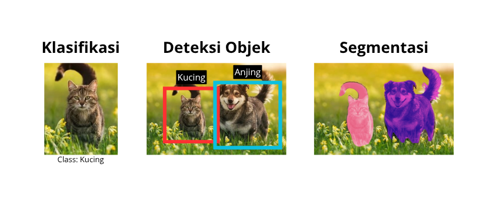

**Gambar 2.1 Perbandingan Klasifikasi, Deteksi Objek, dan Segmentasi**

Deteksi objek merupakan tugas yang relevan untuk inspeksi visual karena tidak hanya mengenali jenis cacat, tetapi juga menunjukkan lokasinya. Representasi dan sistem koordinat *bounding box* ditunjukkan pada Gambar 2.2.

**Gambar 2.2 Anatomi dan Representasi Koordinat *Bounding Box***

### 2.1.3 Deep Learning

*Deep Learning* adalah cabang dari *machine learning* yang mempelajari representasi data dengan banyak lapisan pemrosesan (Goodfellow et al., 2016). *Machine learning* konvensional membutuhkan ekstraksi fitur secara *manual*, sedangkan *deep learning* memperoleh fitur secara otomatis dari data mentah (Han et al., 2017). Perbedaan alur kerja keduanya ditunjukkan pada Gambar 2.3.

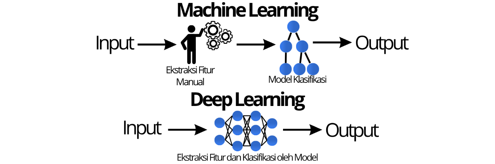

**Gambar 2.3 Perbedaan cara kerja *Machine Learning* dan *Deep Learning***

Jaringan saraf tiruan dilatih melalui siklus propagasi maju dan mundur. Pada propagasi maju (*forward propagation*), keluaran lapisan sebelumnya dikalikan matriks bobot, ditambah bias, lalu dilewatkan ke fungsi aktivasi untuk menghasilkan prediksi (Goodfellow et al., 2016). Fungsi aktivasi memberikan sifat non-linear agar model mampu memodelkan hubungan yang kompleks. Fungsi yang umum adalah *Rectified Linear Unit* (ReLU) pada Persamaan 2.1, karena ringan secara komputasi dan mengurangi masalah *vanishing gradient* (LeCun et al., 2015).

$$
f(x) = \max(0,x)
$$

(2.1)

dengan $x$ nilai masukan dan $f(x)$ nilai keluaran *neuron*.

Selisih antara prediksi dan nilai sebenarnya (*ground truth*) diukur oleh *loss function*. Untuk klasifikasi banyak kelas, fungsi yang umum digunakan adalah *Cross-Entropy Loss* pada Persamaan 2.2 (Goodfellow et al., 2016).

$$
L = - \sum_{i = 1}^{K}y_{i}\log\left( p_{i} \right)
$$

(2.2)

dengan $K$ jumlah kelas, $y_{i}$ label sebenarnya kelas ke-*i* dalam bentuk *one-hot encoding*, dan $p_{i}$ probabilitas prediksi kelas ke-*i*.

Pada propagasi mundur (*back propagation*), gradien *loss function* terhadap setiap parameter dihitung dengan aturan rantai dari lapisan keluaran menuju lapisan masukan (LeCun et al., 2015). *Stochastic Gradient Descent* (SGD) kemudian memperbarui parameter sesuai Persamaan 2.3 (Goodfellow et al., 2016). Siklus ini diulang hingga model konvergen.

$$
w \leftarrow w - \eta\frac{\partial L}{\partial w}
$$

(2.3)

dengan $w$ parameter bobot, $\eta$ laju pembelajaran (*learning rate*), dan $\frac{\partial L}{\partial w}$ gradien fungsi kerugian terhadap bobot.

### 2.1.4 Convolution Neural Network (CNN)

*Convolutional Neural Network* (CNN) adalah jaringan saraf tiruan yang dirancang untuk data berbentuk *grid*, seperti citra (Goodfellow et al., 2016; LeCun et al., 2015). Efisiensinya terletak pada penerapan konektivitas lokal dan penggunaan parameter filter yang sama pada berbagai bagian citra (LeCun et al., 2015). Arsitektur umum CNN ditunjukkan pada Gambar 2.4.

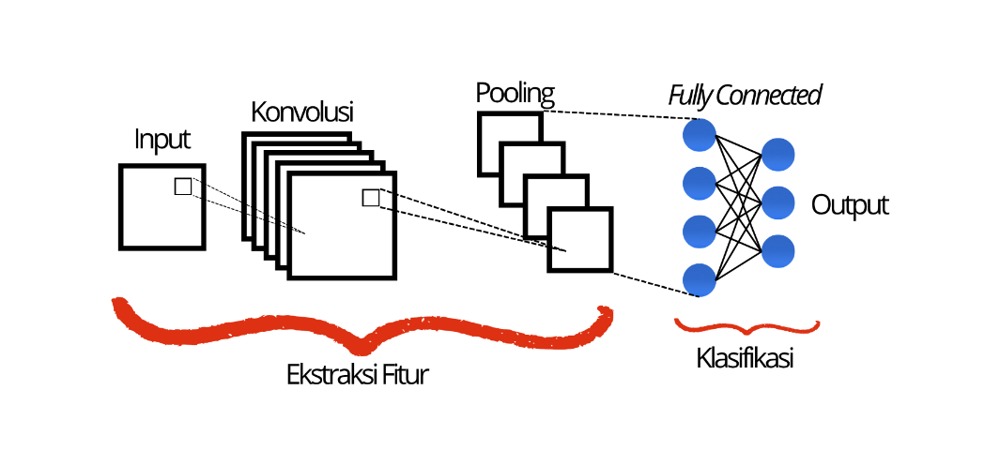

**Gambar 2.4 Ilustrasi Arsitektur *Convolutional Neural Network* (CNN)**

Pada Gambar 2.4, arsitektur CNN terdiri atas tiga jenis lapisan utama. *Convolutional layer* mengekstraksi fitur lokal dengan menggeser filter (*kernel*) di atas citra atau peta fitur (*feature map*), dan setiap filter mengenali pola tertentu seperti tepi, sudut, atau tekstur (Zhao et al., 2024; Goodfellow et al., 2016). *Pooling layer* memperkecil dimensi spasial *feature map* (*downsampling*) sehingga beban komputasi berkurang dan model lebih tahan terhadap pergeseran kecil. *Fully connected layer* berupa *Multi-Layer Perceptron* (MLP) yang menggabungkan fitur tingkat tinggi menjadi keputusan akhir (*classifier*), dengan masukan berupa *flatten vector* dari *feature map*. Skor mentah (*logit*) keluaran kepala klasifikasi diubah menjadi probabilitas oleh fungsi *softmax* pada Persamaan 2.4.

$$
p_{i} = \frac{e^{z_{i}}}{\sum_{j = 1}^{K}e^{z_{j}}}
$$

(2.4)

dengan $p_{i}$ probabilitas kelas ke-*i*, $z_{i}$ *logit* kelas ke-*i*, dan $K$ jumlah kelas.

Lapisan konvolusi dan *pooling* menghasilkan *feature map* berukuran $C \times H \times W$, dengan setiap kanal merepresentasikan hasil satu filter dan posisi $(h,w)$ menunjukkan lokasinya (Goodfellow et al., 2016). *Stride* menyatakan langkah pergeseran filter, sedangkan *stride* total lapisan ke-*l* dan koordinat citra yang berkorespondensi dengan posisi $(h,w)$ dinyatakan pada Persamaan 2.5 dan 2.6 (Araujo et al., 2019).

$$
S_{l} = \prod_{i = 1}^{l}s_{i}
$$

(2.5)

$$
(u,v) = \left( S_{l} \cdot w,S_{l} \cdot h \right)
$$

(2.6)

dengan $S_{l}$ *stride* total lapisan ke-*l*, $s_{i}$ *stride* lapisan ke-*i*, $\left( h,w \right)$ indeks baris dan kolom pada *feature map*, dan $\left( u,v \right)$ koordinat pada citra.

Luas daerah citra yang memengaruhi nilai satu sel *feature map* disebut *Receptive Field*, yang membesar seiring kedalaman jaringan (Goodfellow et al., 2016; Luo et al., 2016; Araujo et al., 2019). *Stride* total menentukan posisi pusat *region* citra yang diwakili setiap sel, sedangkan *receptive field* menentukan luas *region* tersebut, dan *receptive field* antarsel dapat saling tumpang-tindih seperti ditunjukkan pada Gambar 2.5. Keduanya memungkinkan setiap sel dipetakan kembali ke *region* citra, sehingga bobot pada *feature map* dapat diterjemahkan menjadi *explanation* spasial pada citra, sebagaimana digunakan pada Subbab 2.1.8.

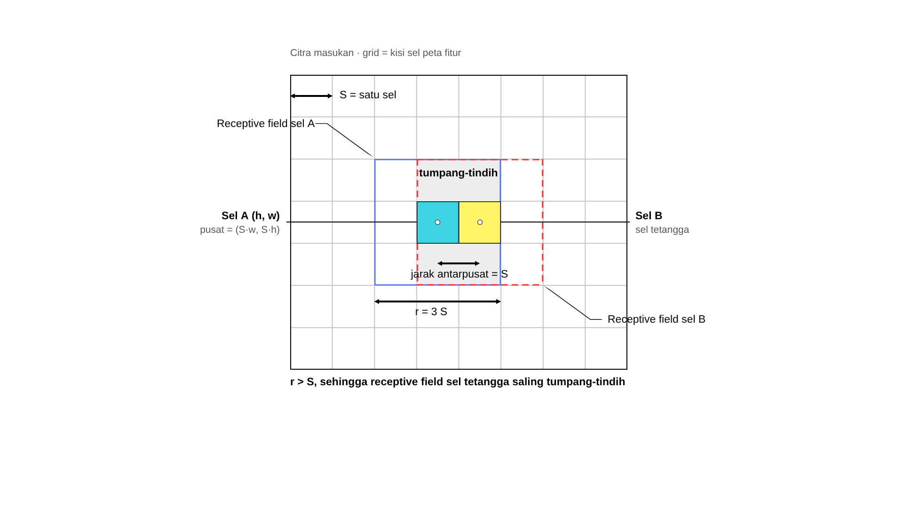

**Gambar 2.5 Ilustrasi Stride dan Receptive Field**

### 2.1.5 *Faster* R-CNN

*Faster* R-CNN adalah arsitektur deteksi objek dua tahap (*two-stage*) yang menyatukan pengusulan area dan klasifikasi dalam satu jaringan yang dilatih secara *end-to-end* (Ren et al., 2017). Keunggulannya terletak pada *Region Proposal Network* (RPN) yang menggantikan metode pencarian area eksternal, sehingga seluruh komponen berbagi *feature map* yang sama. Arsitektur standarnya ditunjukkan pada Gambar 2.6.

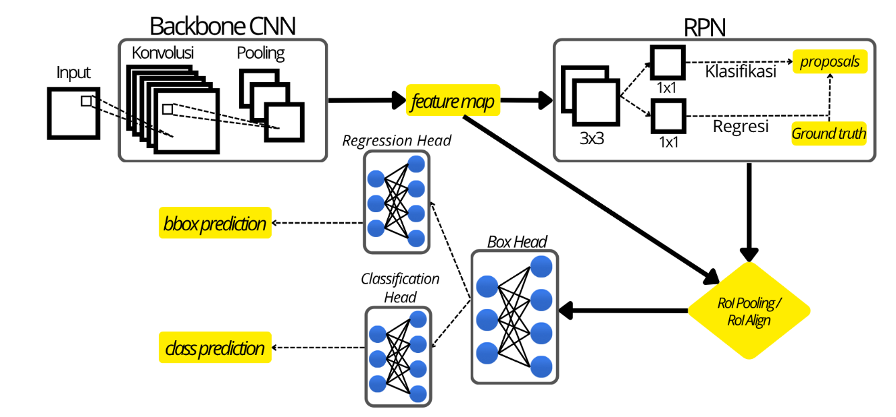

**Gambar 2.6 Arsitektur *Faster* R-CNN Standar**

Salah satu varian *Faster* R-CNN untuk PCB adalah SF-PSPyramid (Fung et al., 2024), yaitu *Faster* R-CNN dengan *neck* yang dirancang untuk cacat berukuran mikro, sebagaimana ditunjukkan pada Gambar 2.7. Bagian ini hanya menjelaskan komponen yang digunakan pada penelitian ini.

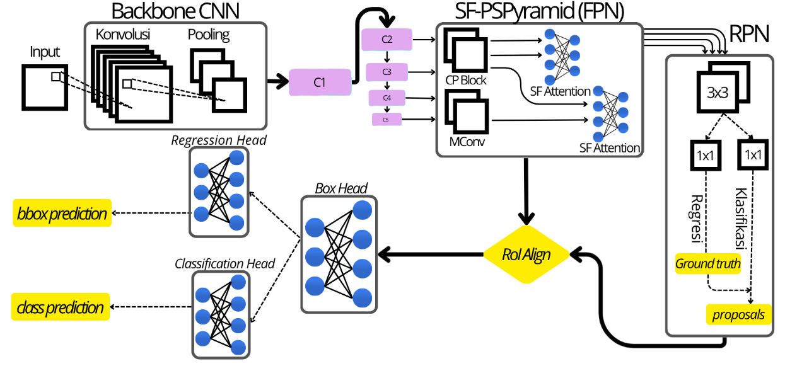

**Gambar 2.7 Arsitektur modifikasi *Faster* R-CNN dengan SF-PSPyramid**

1.  ***Backbone* dan *Neck* (SF-PSPyramid)**

*Backbone* adalah jaringan CNN yang mengubah citra menjadi *feature map*. SF-PSPyramid menggunakan ResNet-50 yang menghasilkan empat tingkat fitur $C_{2}$ hingga $C_{5}$ dengan *stride* total 4, 8, 16, dan 32 piksel (He et al., 2016). *Neck* menggabungkan fitur berbagai skala menjadi piramida fitur. Dasarnya adalah *Feature Pyramid Network* (FPN) (Lin et al., 2017), yang disempurnakan SF-PSPyramid dengan pembesaran resolusi terpelajar melalui *pixel shuffle* (Shi et al., 2016), penggabungan antartingkat dengan *selective feature attention* (Li et al., 2019), dan pembentukan $P_{2}'$ serta $P_{3}'$ langsung dari gabungan $C_{2}$ hingga $C_{5}$ tanpa koneksi lateral agar tetap beresolusi tinggi namun memuat informasi semantik penuh (Fung et al., 2024). Piramida yang dihasilkan terdiri atas $P_{2}'$, $P_{3}'$, $P_{4}$, $P_{5}$, dan $P_{6}$ dengan *stride* 4, 8, 16, 32, dan 64 piksel serta jumlah kanal $C$ yang sama.

2.  ***Region Proposal Network* (RPN)**

RPN mengusulkan area kandidat objek (proposal). Untuk setiap *anchor box*, yaitu kotak acuan dengan beragam ukuran dan rasio pada setiap posisi *feature map*, RPN memprediksi skor objektivitas dan empat nilai koreksi koordinat (Ren et al., 2017). RPN dilatih dengan *multi-task loss* pada Persamaan 2.7 (Ren et al., 2017).

$$
L = \frac{1}{N_{cls}}\sum_{i}^{}L_{cls}\left( p_{i},p_{i}^{*} \right) + \lambda\frac{1}{N_{reg}}\sum_{i}^{}p_{i}^{*}L_{reg}\left( t_{i},t_{i}^{*} \right)
$$

(2.7)

dengan $p_{i}$ probabilitas *anchor* ke-*i* memuat objek, $p_{i}^{*}$ label sebenarnya (1 positif, 0 negatif), $t_{i}$ dan $t_{i}^{*}$ koreksi koordinat prediksi dan sebenarnya, $N_{cls},N_{reg}$ jumlah sampel tiap suku, $L_{cls}$ *binary cross-entropy*, $L_{reg}$ *loss* regresi, dan $\lambda$ faktor penyeimbang. *Loss* regresi pada SF-PSPyramid adalah L1 pada Persamaan 2.8 (Fung et al., 2024).

$$
L_{reg}\left( t,t^{*} \right) = \sum_{j}^{}\left| t_{j} - t_{j}^{*} \right|
$$

(2.8)

dengan *j* merentang pada keempat komponen koordinat, yaitu *x*, *y*, *w*, dan *h*.

3.  ***RoI Align***

*RoI Align* menyeragamkan setiap proposal menjadi *tensor* berukuran tetap tanpa pembulatan koordinat (He et al., 2020). Nilai *feature map* pada koordinat pecahan diperoleh dengan interpolasi *bilinear* pada Persamaan 2.9.

$$
f(x,y) = \sum_{i = 1}^{4}w_{i}f_{i}
$$

(2.9)

dengan $f_{i}$ nilai fitur pada empat titik grid terdekat dan $w_{i}$ bobot interpolasi yang berbanding terbalik dengan jarak.

Keluaran *RoI Align* berupa grid $G \times G$ *bin*, dengan nilai setiap *bin* didefinisikan sebagai rata-rata beberapa titik sampel di dalamnya (He et al., 2020), sebagaimana dinyatakan pada Persamaan 2.10.

$$
x_{c,p,q} = \frac{1}{N}\sum_{n = 1}^{N}{\sum_{i = 1}^{4}{w_{n,i}\, F_{c}\left( h_{n,i},v_{n,i} \right)}}
$$

(2.10)

dengan $x_{c,p,q}$ keluaran kanal ke-*c* pada *bin* $(p,q)$, $N$ jumlah titik sampel per *bin*, $w_{n,i}$ bobot interpolasi titik sampel ke-*n*, dan $F_{c}\left( h_{n,i},v_{n,i} \right)$ nilai *feature map* kanal ke-*c* pada titik grid terdekat. Dalam bentuk matriks, Persamaan 2.10 dapat ditulis sebagai Persamaan 2.11.

$$
x_{c} = A\, F_{c}
$$

(2.11)

dengan $x_{c}$ vektor keluaran kanal ke-*c* ($G \times G$ nilai), $F_{c}$ vektor nilai *feature map* kanal ke-*c*, dan $A$ matriks koefisien interpolasi yang hanya bergantung pada proposal dan sama untuk setiap kanal. Karena bersifat linear terhadap $F_{c}$, *RoI Align* memungkinkan keputusan yang dihitung dari keluarannya ditelusuri kembali ke *feature map*, sebagaimana dimanfaatkan pada Subbab 3.8.2.

Pada piramida fitur, tingkat piramida (*pyramid level*) asal fitur setiap proposal ditentukan oleh ukurannya melalui Persamaan 2.12 (Lin et al., 2017).

$$
k = \left\lfloor k_{0} + \log_{2}\left( \frac{\sqrt{wh}}{224} \right) \right\rfloor
$$

(2.12)

dengan $k$ tingkat terpilih, $k_{0} = 4$ tingkat acuan untuk proposal 224×224 piksel, serta $w,h$ lebar dan tinggi proposal.

4.  ***Box Head***

*Box Head* adalah MLP dengan dua lapisan terhubung penuh yang memetakan keluaran *RoI Align* yang telah diratakan menjadi representasi RoI, dengan dua cabang keluaran yang bekerja berdampingan (Girshick, 2015; Ren et al., 2017). Cabang klasifikasi (*classification head*) menghasilkan skor untuk $K + 1$ kelas, termasuk *background*, melalui *softmax* pada Persamaan 2.4 dan dilatih dengan *cross-entropy* pada Persamaan 2.2. Cabang regresi (*regression head*) menghasilkan empat koreksi koordinat untuk setiap kelas dan dilatih dengan *loss* L1 pada Persamaan 2.8. Cabang klasifikasi inilah yang digantikan oleh SODT pada penelitian ini.

5.  ***Soft-*NMS**

*Soft*-NMS menyaring deteksi tumpang-tindih dengan menurunkan skor kandidat secara bertahap, bukan membuangnya (Bodla et al., 2017), sebagaimana dinyatakan pada Persamaan 2.13.

$$
s_{i} = \left\{ \begin{matrix}
s_{i}, & IoU\left( M,b_{i} \right) < N_{t} \\
s_{i}\left( 1 - IoU\left( M,b_{i} \right) \right), & IoU\left( M,b_{i} \right) \geq N_{t}
\end{matrix} \right.\
$$

(2.13)

dengan $s_{i}$ dan $b_{i}$ skor dan kotak kandidat ke-*i*, $M$ kandidat berskor tertinggi, dan $N_{t}$ ambang IoU. Karena urutan pengurangan bergantung pada skor, *Soft*-NMS memerlukan skor yang berbeda antardeteksi untuk bekerja.

### 2.1.6 *Explainable Artificial Intelligence* (XAI)

*Explainable Artificial Intelligence* (XAI) adalah bidang yang mengembangkan cara agar keputusan model kecerdasan buatan dapat dipahami manusia (Ali et al., 2023). XAI dibutuhkan karena model *deep learning* bersifat *black-box* (Samek et al., 2019). Berdasarkan waktu *explanation* dibentuk, XAI terbagi atas dua pendekatan. Pendekatan *post-hoc* menghasilkan *explanation* setelah model memprediksi tanpa mengubah struktur model, misalnya LIME, SHAP, dan Grad-CAM, sehingga *explanation* bersifat aproksimasi dan tidak dijamin mencerminkan keputusan internal model (Rudin, 2019; Rudin et al., 2022). Pendekatan *ante-hoc* menanamkan kemampuan menjelaskan ke dalam struktur model, misalnya pohon keputusan, model linear, dan arsitektur *neuro-symbolic* (Ali et al., 2023; Rudin et al., 2022).

*Explanation* untuk citra umumnya berupa peta atribusi (*attribution map*), yaitu peta besar kontribusi setiap posisi terhadap skor kelas (Bach et al., 2015). *Attribution map* yang divisualisasikan dengan skala warna di atas citra disebut *heatmap*. Dua metode atribusi yang relevan dijelaskan berikut.

1.  ***Gradient-weighted Class Activation Mapping* (Grad-CAM)**

Grad-CAM menghasilkan *attribution map* spesifik-kelas tanpa mengubah maupun melatih ulang model (Selvaraju et al., 2017). Bobot kepentingan *feature map* ke-*k* terhadap kelas *c* dan *attribution map* dinyatakan pada Persamaan 2.14 dan 2.15.

$$
\alpha_{k}^{c} = \frac{1}{Z}\sum_{i}^{}{\sum_{j}^{}\frac{\partial y^{c}}{\partial A_{ij}^{k}}}
$$

(2.14)

$$
L_{Grad\text{-}CAM}^{c} = ReLU\left( \sum_{k}^{}{\alpha_{k}^{c}A^{k}} \right)
$$

(2.15)

dengan $y^{c}$ skor kelas *c* sebelum *softmax*, $A^{k}$ *feature map* ke-*k* pada lapisan konvolusi acuan, $A_{ij}^{k}$ nilainya pada posisi $\left( i,j \right)$, dan $Z$ jumlah posisi spasial. Contoh hasil Grad-CAM ditunjukkan pada Gambar 2.8.

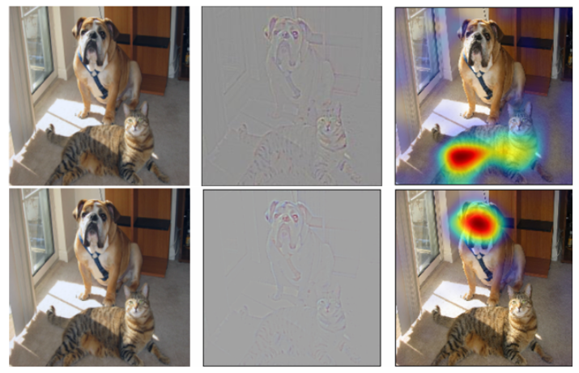

**Gambar 2.8 Hasil penjelasan dari Grad-CAM (Selvaraju et al., 2017)**

2.  **Gradient *×* Input**

*Gradient × Input* menghitung kontribusi setiap elemen masukan sebagai hasil kali nilai elemen dan gradien keluaran terhadap elemen tersebut (Shrikumar et al., 2017; Ancona et al., 2019), sebagaimana dinyatakan pada Persamaan 2.16.

$$
R_{j}(x) = x_{j} \cdot \frac{\partial f(x)}{\partial x_{j}}
$$

(2.16)

dengan $R_{j}$ kontribusi elemen ke-*j*, $x_{j}$ nilai elemen ke-*j*, dan $f(x)$ keluaran model.

Metode atribusi yang baik diharapkan memenuhi sifat *completeness*, yaitu jumlah seluruh atribusi sama dengan selisih keluaran model pada masukan dan pada masukan acuan (*baseline*) $\overline{x}$ (Sundararajan et al., 2017), sebagaimana dinyatakan pada Persamaan 2.17.

$$
\sum_{j}^{}{R_{j}(x)} = f(x) - f\left( \overline{x} \right)
$$

(2.17)

*Gradient × Input* umumnya tidak memenuhi sifat ini pada model non-linear, tetapi memenuhinya secara eksak pada model linear dengan *baseline* nol (Ancona et al., 2019), sebagaimana ditunjukkan pada Persamaan 2.18.

$$
\sum_{j}^{}{w_{j}x_{j}} = w^{T}x = f(x) - f(0)
$$

(2.18)

### 2.1.7 *Neuro-Symbolic* AI (NeSy)

*Neuro-Symbolic* AI (NeSy) menggabungkan pembelajaran statistik jaringan saraf dengan penalaran berbasis aturan pada sistem simbolik (d'Avila Garcez & Lamb, 2023), untuk menyatukan kemampuan mengenali pola dari data mentah dengan transparansi penalaran (Kautz, 2022). Arsitektur NeSy ditunjukkan pada Gambar 2.9.

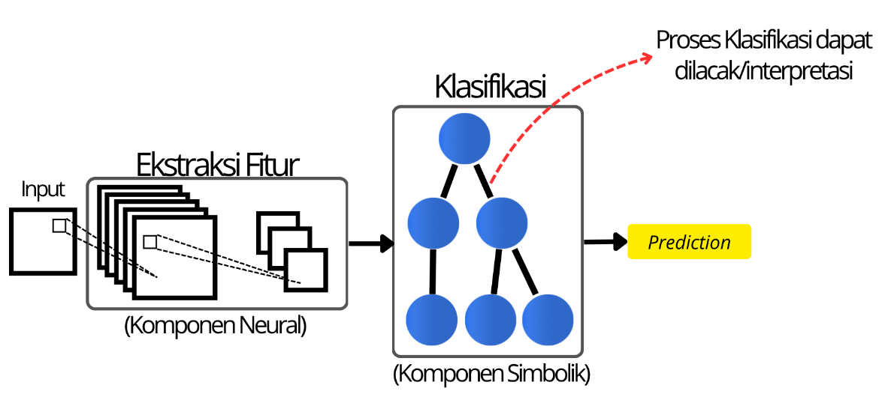

**Gambar 2.9 Arsitektur *Neuro-Symbolic***

Arsitektur NeSy terdiri atas dua komponen utama. Komponen *neural* mengubah data mentah menjadi representasi fitur numerik (d'Avila Garcez & Lamb, 2023). Komponen simbolik mengolah representasi fitur melalui aturan yang dapat ditelusuri sehingga *explanation* yang dihasilkan bersifat *faithful*, yaitu merepresentasikan proses keputusan model itu sendiri, bukan aproksimasi (Rudin, 2019). Komponen simbolik dapat dibentuk melalui *model mimicking*, yaitu melatih model sederhana untuk meniru keluaran model kompleks (*teacher*) menggunakan prediksi *teacher* sebagai label pelatihan (Buciluǎ et al., 2006; Hinton et al., 2015).

Kedua komponen menghasilkan keluaran dalam bentuk yang berbeda. Keluaran komponen *neural* bersifat kontinu, sedangkan keluaran komponen simbolik bersifat diskrit karena berupa label kelas. Diskritisasi ini memetakan banyak nilai kontinu ke label yang sama sehingga informasi tingkat keyakinan hilang (Provost & Domingos, 2003). Informasi tersebut tetap tersimpan pada nilai keputusan sebelum diskritisasi dan dapat dinyatakan melalui dua konsep berikut.

1.  *Margin*

Pada fungsi keputusan bernilai riil, tanda keluaran menyatakan label, sedangkan besarnya menyatakan *confidence*. Keluaran yang dekat dengan nol berarti *confidence* rendah, dan yang jauh dari nol berarti *confidence* tinggi (Schapire & Singer, 1999). Besar *margin* dinyatakan pada Persamaan 2.19.

$$
m(x) = \left| f(x) \right|
$$

(2.19)

dengan $f(x)$ fungsi keputusan linear.

2.  Fungsi *Sigmoid*

Fungsi *sigmoid* adalah fungsi monoton naik yang memetakan nilai riil ke selang 0 dan 1 (Platt, 1999), sebagaimana dinyatakan pada Persamaan 2.20.

$$
\sigma(z) = \frac{1}{1 + e^{- z}}
$$

(2.20)

dengan $z$ nilai masukan dan $e$ bilangan Euler.

### 2.1.8 *Sparse Oblique Decision Tree* (SODT)

*Sparse Oblique Decision Tree* (SODT) adalah pohon keputusan yang melakukan pemisahan linear multivariat (*oblique split*) pada setiap *node* internal, berbeda dengan pohon *axis-aligned* yang hanya memakai satu fitur per pemisahan (Hada et al., 2024). Setiap *node* internal meneruskan masukan ke salah satu dari dua anaknya, dan label pada *leaf* yang dicapai menjadi prediksi pohon. Fungsi keputusan *node* internal ke-*i* dinyatakan pada Persamaan 2.21.

$$
f_{i}(x) = w_{i}^{T}x + b_{i}
$$

(2.21)

dengan $x$ vektor fitur berdimensi $D$, $w_{i}$ vektor bobot, dan $b_{i}$ bias *node* ke-*i*. Nilai $f_{i}(x) \geq 0$ mengarahkan masukan ke anak kiri, sedangkan $f_{i}(x) < 0$ ke anak kanan. Rangkaian *node* dari *root* hingga *leaf* membentuk jalur keputusan (*decision path*) (Hada et al., 2024; Kairgeldin & Carreira-Perpiñán, 2025). Ilustrasinya ditunjukkan pada Gambar 2.10.

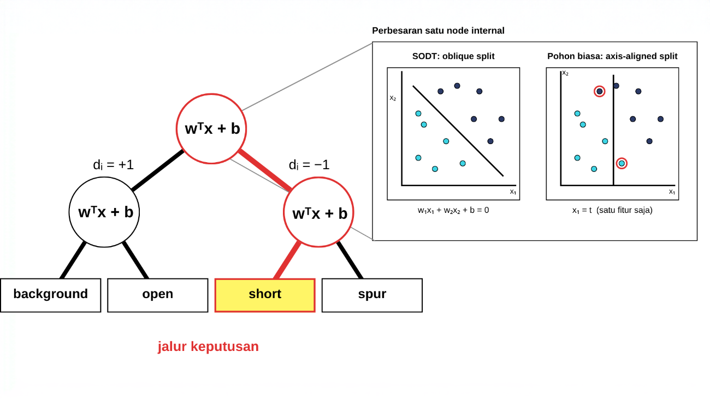

**Gambar 2.10 Ilustrasi SODT dan perbedaan dengan Decision Tree biasa**

Apabila $x$ berasal dari perataan *feature map* $C \times H \times W$ sesuai Subbab 2.1.4, setiap elemennya berkorespondensi dengan kanal dan posisi spasial tertentu. Karena bobot $w_{i}$ dikalikan pada indeks yang sama pada Persamaan 2.21, bobot tersebut dapat disusun kembali menjadi grid $C \times H \times W$ untuk menunjukkan fitur yang digunakan *node* (Hada et al., 2024; Kairgeldin & Carreira-Perpiñán, 2025). SODT memiliki lima aspek utama yang berkaitan dengan pembentukan, optimasi, dan interpretasi keputusan.

1.  **Regularisasi L1 dan Sparsitas**

Sifat *sparse* diperoleh melalui regularisasi L1 pada fungsi tujuan pelatihan pada Persamaan 2.22, yang membuat bobot fitur tidak relevan bernilai tepat nol (Hada et al., 2024).

$$
E(\Theta) = \sum_{n = 1}^{N}L\left( \mathbf{y}_{n},T\left( \mathbf{x}_{n};\Theta \right) \right) + \lambda\sum_{i \in \mathcal{D}}^{}\left\| \mathbf{w}_{i} \right\|_{1}
$$

(2.22)

dengan $\Theta$ parameter pohon, $N$ jumlah sampel, $x_{n}$ dan $y_{n}$ fitur serta label sampel ke-*n*, $T\left( x_{n};\Theta \right)$ prediksi pohon, $L$ *loss function* klasifikasi, $\mathcal{D}$ himpunan *node* internal, dan $\lambda$ pengontrol sparsitas. *Node* dengan seluruh bobot nol hanya ditentukan oleh bias sehingga selalu mengarahkan masukan ke sisi yang sama. Jumlah bobot bukan nol (*nonzero weight*) mencerminkan kompleksitas pohon, dan sparsitas dinyatakan sebagai proporsi bobot nol terhadap seluruh bobot *node* internal (Hada et al., 2024).

2.  ***Tree Alternating Optimization (TAO)***

Persamaan 2.22 tidak dapat dioptimasi dengan metode berbasis gradien karena keputusan pohon diskrit. *Tree Alternating Optimization* (TAO) memecahnya menjadi masalah klasifikasi biner yang diselesaikan terpisah untuk setiap *node* (Carreira-Perpiñán & Tavallali, 2018), sebagaimana dinyatakan pada Persamaan 2.23.

$$
E_{i}(w_{i},b_{i}) = \sum_{n \in \mathcal{R}_{i}}^{}\overset{‾}{L}({\bar{y}}_{n},g_{i}(x_{n};w_{i},b_{i})) + \lambda \parallel w_{i} \parallel_{1}
$$

(2.23)

dengan $\mathcal{R}_{i}$ sampel yang mencapai *node* ke-*i* (*reduced set*), ${\overline{y}}_{n}$ *pseudo-label* arah kiri atau kanan, $g_{i}$ keputusan biner *node*, dan $\overline{L}$ *loss* 0/1.

Pada setiap *node*, sampel yang menghasilkan prediksi sama pada kedua arah diabaikan, sedangkan sisanya (*care set*) diberi *pseudo-label* berdasarkan arah yang menghasilkan prediksi benar. Klasifikasi biner ini disebut *reduced problem* dan diselesaikan dengan regresi logistik berregularisasi L1 sebagai *surrogate* *loss* 0/1. Setiap *leaf* diberi label kelas mayoritas dari sampel yang mencapainya. TAO menyelesaikan setiap *node* secara bergantian dari yang terdalam menuju *root*, dan pembaruan hanya diterima apabila memperbaiki *reduced problem* pada *node* tersebut sehingga fungsi tujuan tidak pernah meningkat (Carreira-Perpiñán & Tavallali, 2018; Hada et al., 2024; Kairgeldin & Carreira-Perpiñán, 2025).

Pada TAO standar, penalti $\lambda$ sama untuk setiap *node*, sehingga *node* dengan lebih banyak sampel cenderung kurang *sparse*. Kairgeldin dan Carreira-Perpiñán (2025) mengatasinya dengan membobot penalti berdasarkan jumlah sampel pada *node* melalui parameter $\alpha$, sebagaimana dinyatakan pada Persamaan 2.24 dan 2.25.

$$
E(\Theta) = \sum_{n = 1}^{N}{L(}\mathbf{y}_{n},T(\mathbf{x}_{n};\Theta)) + \lambda\sum_{i \in \mathcal{D}}^{}h_{\alpha}( \mid \mathcal{R}_{i} \mid ) \parallel \mathbf{w}_{i} \parallel_{1}
$$

(2.24)

$$
h_{\alpha}(t) = \left\{ \begin{matrix}
1, & t = 0 \\
t^{\alpha}, & t > 0
\end{matrix} \right.\
$$

(2.25)

dengan $\left| \mathcal{R}_{i} \right|$ jumlah sampel yang mencapai *node* ke-*i*. Nilai $\alpha > 0$ memperbesar penalti pada *node* yang menangani lebih banyak sampel dibandingkan TAO standar ($\alpha = 0$), sedangkan $\alpha = 1$ menghasilkan penalti yang sama per sampel pada setiap *node* (Kairgeldin & Carreira-Perpiñán, 2025).

3.  ***Class Weighting***

Pada *model mimicking* sesuai Subbab 2.1.7, label pelatihan SODT adalah prediksi *teacher*. Apabila sebagian kelas lebih sulit ditiru atau lebih jarang, pohon cenderung mengabaikannya demi kelas yang dominan (He & Garcia, 2009). *Cost-sensitive learning* mengatasinya dengan memberi biaya kesalahan yang berbeda antarkelas (Elkan, 2001; He & Garcia, 2009), sebagaimana dinyatakan pada Persamaan 2.26.

$$
E_{\omega}(\Theta) = \sum_{n = 1}^{N}{\omega_{y_{n}}L\left( y_{n},T\left( x_{n};\Theta \right) \right)}
$$

(2.26)

dengan $\omega_{y_{n}} \geq 0$ biaya kesalahan kelas $y_{n}$. Kelas dengan $\omega$ lebih besar membuat kesalahan pada kelas tersebut lebih mahal sehingga pohon lebih berhati-hati terhadapnya. Penerapan *class weighting* pada TAO dijelaskan pada Subbab 3.7.

4.  **Probabilitas Jalur pada *Soft Decision Tree***

*Soft decision tree* meneruskan masukan ke kedua anak setiap *node* dengan probabilitas *routing* berupa *sigmoid* dari fungsi keputusan *node*, sehingga probabilitas mencapai suatu *leaf* adalah hasil kali probabilitas *routing* sepanjang jalur dari *root* (Kontschieder et al., 2015). Bentuk perkalian sepanjang jalur ini menjadi dasar skor deteksi berbasis *routing margin* pada Subbab 3.8.1.

5.  ***Explanation* melalui *Weight Node***

Setiap *node* bersifat linear dan *sparse*, sehingga bobot $w_{i}$ menunjukkan fitur yang digunakan *node*. Bobot nol menunjukkan fitur yang tidak digunakan, sedangkan tanda dan besarnya bobot menunjukkan arah dan kekuatan pengaruh. Hada et al. (2024) memvisualisasikan bobot tersebut untuk menelusuri fitur yang membedakan antarkelas.

Kairgeldin dan Carreira-Perpiñán (2025) menerapkannya pada model hibrida CNN dan SODT. Karena setiap fitur berasal dari sel *feature map* CNN dengan *Receptive Field* sesuai Subbab 2.1.4, bobot *node* dapat dipetakan ke citra melalui peta kepadatan *Receptive Field* (RF *density map*) untuk setiap *node*, sebagaimana dinyatakan pada Persamaan 2.27.

$$
\rho_{i}(u) = \sum_{j = 1}^{D}{\left| w_{ij} \right| \cdot \mathbb{1}\left\lbrack u \in {RF}_{j} \right\rbrack}
$$

(2.27)

dengan $\rho_{i}(u)$ kepadatan pada posisi citra $u$ untuk *node* ke-*i*, $w_{ij}$ bobot fitur ke-*j*, $RF_{j}$ *Receptive Field* fitur ke-*j*, dan $\mathbb{1}\lbrack \cdot \rbrack$ fungsi indikator. Kepadatan nol menunjukkan *region* tersebut tidak digunakan oleh *node* (Kairgeldin & Carreira-Perpiñán, 2025). Peta ini disusun untuk setiap *node* dan hanya bergantung pada bobot, sehingga bersifat statis.

### 2.1.9 Metrik Evaluasi

Evaluasi dibagi menjadi evaluasi kinerja deteksi objek, fidelitas SODT, dan kualitas *explanation*.

1.  **Metrik Evaluasi Deteksi Objek**

*Intersection over Union* (IoU) mengukur rasio luas irisan terhadap luas gabungan *bounding box* prediksi dan *ground truth* pada Persamaan 2.28. Berdasarkan ambang IoU, prediksi dikelompokkan menjadi *True Positive* (TP), *False Positive* (FP), dan *False Negative* (FN), yang menjadi dasar *Precision* dan *Recall* pada Persamaan 2.29 dan 2.30.

$$
IoU = \frac{\text{Area~Prediksi} \cap \text{Area~Ground~Truth}}{\text{Area~Prediksi} \cup \text{Area~Ground~Truth}}
$$

(2.28)

$$
\text{Precision} = \frac{TP}{TP + FP}\text{ }
$$

(2.29)

$$
\text{Recall} = \frac{TP}{TP + FN}
$$

(2.30)

*Precision* mengukur ketepatan prediksi positif, sedangkan *Recall* mengukur kelengkapan deteksi. F1-*score* adalah rata-rata harmonik keduanya (Persamaan 2.31) (Sokolova & Lapalme, 2009).

$$
F1 = \frac{2 \cdot Precision \cdot Recall}{Precision + Recall}
$$

(2.31)

*Precision*, *Recall*, dan F1 dihitung pada satu ambang skor tertentu, yaitu hanya deteksi berskor di atas ambang yang dihitung. Sebaliknya, *Average Precision* (AP) mengevaluasi seluruh deteksi menurut urutan skornya sehingga tidak bergantung pada ambang skor. Penelitian ini menghitung AP dengan protokol PASCAL VOC (Everingham et al., 2010) seperti pada Fung et al. (2024), yaitu AP sebagai luas di bawah kurva *Precision-Recall* dengan interpolasi pada seluruh titik, sebagaimana dinyatakan pada Persamaan 2.32, dan *mean Average Precision* (mAP) sebagai rata-rata AP seluruh kelas pada Persamaan 2.33.

$$
AP = \sum_{k}^{}\left( r_{k + 1} - r_{k} \right)\, p_{interp}\left( r_{k + 1} \right),\quad p_{interp}(r) = \max_{\tilde{r} \geq r}p\left( \tilde{r} \right)
$$

(2.32)

$$
mAP = \frac{1}{K}\sum_{i = 1}^{K}{AP}_{i}
$$

(2.33)

dengan $r_{k}$ nilai *Recall* pada titik ke-*k* kurva, $p(\tilde{r})$ *Precision* pada *Recall* $\tilde{r}$, $K$ jumlah kelas, dan ${AP}_{i}$ AP kelas ke-*i*. mAP@0,5 dihitung pada ambang IoU 0,5, sedangkan mAP@0,5:0,95 merupakan rata-rata mAP pada ambang IoU 0,5 hingga 0,95 dengan kenaikan 0,05 (Lin et al., 2014). Fung et al. (2024) melaporkan AP50, AP75, dan AP@50:5:85, yaitu rata-rata AP pada ambang IoU 0,50 hingga 0,85 dengan kenaikan 0,05, sehingga ketiganya juga dipakai pada penelitian ini.

2.  **Metrik Evaluasi Fidelitas SODT**

Fidelitas SODT terhadap *teacher* diukur menggunakan *mimic accuracy*, *macro*-F1, dan *agreement* per kelas. *Mimic accuracy* merupakan proporsi RoI yang memiliki label sama dengan *teacher*, sedangkan *agreement* per kelas merupakan proporsi RoI yang diberi suatu kelas oleh *teacher* dan juga diberi kelas tersebut oleh SODT.

3.  **Metrik Evaluasi *Explainability***

Evaluasi XAI yang tidak melibatkan pengguna dilakukan melalui ukuran kuantitatif (*functionally-grounded*) (Doshi-Velez & Kim, 2017; Nauta et al., 2023). Penelitian ini berfokus pada *faithfulness*, yaitu seberapa tepat *explanation* mencerminkan keputusan model. *Faithfulness* umumnya diuji melalui perturbasi, yaitu menghapus (*masking*) atau mempertahankan bagian masukan yang disorot *explanation* dan mengamati perubahan keluaran model (Petsiuk et al., 2018).

*Necessity* (DeYoung et al., 2020; Canha et al., 2025) menguji apakah bagian yang disorot diperlukan dengan menghapusnya lalu mengamati perubahan prediksi, sebagaimana Persamaan 2.34. Sebaliknya, *Sufficiency* menguji apakah bagian tersebut cukup dengan hanya mempertahankannya lalu mengamati apakah prediksi tetap, sebagaimana Persamaan 2.35.

$$
\text{Necessity~Flip~Rate} = \frac{1}{N}\sum_{n = 1}^{N}{\mathbb{1}\left\lbrack \widehat{y}\left( x_{n}^{- S} \right) \neq \widehat{y}\left( x_{n} \right) \right\rbrack}
$$

(2.34)

$$
\text{Sufficiency~Preservation} = \frac{1}{N}\sum_{n = 1}^{N}{\mathbb{1}\left\lbrack \widehat{y}\left( x_{n}^{S} \right) = \widehat{y}\left( x_{n} \right) \right\rbrack}
$$

(2.35)

dengan $S$ himpunan bagian masukan yang disorot paling penting oleh *explanation*, $x_{n}^{- S}$ masukan tanpa $S$ (dinolkan), $x_{n}^{S}$ masukan yang hanya mempertahankan $S$, $\widehat{y}$ keluaran model, dan $\mathbb{1}\lbrack \cdot \rbrack$ fungsi indikator. Nilai tinggi pada kedua metrik menunjukkan *explanation* yang *faithful*.

*Faithfulness* juga dapat diukur secara bertahap dengan *Deletion* AUC dan *Insertion* AUC (Petsiuk et al., 2018), yaitu luas di bawah kurva skor seiring bagian masukan dihapus atau ditambahkan dalam $K$ tahap seperti pada Persamaan 2.36.

$$
AUC = \sum_{k = 1}^{K - 1}{\frac{s_{k} + s_{k + 1}}{2} \cdot \Delta x_{k}}
$$

(2.36)

dengan $s_{k}$ skor ternormalisasi pada tahap ke-*k* dan $\Delta x_{k}$ proporsi area yang dimodifikasi antartahap. Pada *Deletion*, bagian terpenting dihapus lebih dulu, sehingga AUC rendah menandakan *necessity* yang baik. Pada *Insertion*, bagian terpenting ditambahkan lebih dulu, sehingga AUC tinggi menandakan *sufficiency* yang baik.

## 2.2 Penelitian Terkait

Penelitian terkait yang menjadi landasan penelitian ini dirangkum pada Tabel 2.2.

**Tabel 2.2 Ringkasan dan Perbandingan Penelitian Terkait**

| **No.** | **Judul / Penulis** | **Masalah** | **Tujuan** | **Metode** | **Hasil** | **Keterkaitan** |
|:--:|--------------|------------|-------------|------------|----------|---------|
| 1\. | *Improving PCB defect detection using selective feature attention and pixel shuffle pyramid (Fung et al., 2024)* | Deteksi cacat mikroskopis pada sirkuit PCB memiliki tingkat *false negative* yang tinggi pada model deteksi standar. | Meningkatkan kemampuan model melokalisasi target berukuran kecil pada citra PCB. | *Faster* R-CNN dengan *Feature Pyramid Network* (FPN), *Pixel Shuffle Pyramid* (PSPyramid), *Selective Feature Attention*, dan *Soft*-NMS. | Terjadi peningkatan *Mean Average Precision* (mAP) yang signifikan pada pengujian *dataset* DeepPCB. | Penelitian ini menjadi referensi utama arsitektur dasar (*baseline*) komponen *neural* (ekstraktor fitur dan lokalisasi) yang digunakan dalam tugas akhir ini. |
| 2\. | *Neuro-Symbolic Methods for Trustworthy AI: A Systematic Review With a Focus on Interpretability (Michel-Delétie & Sarker, 2026)* | Kemajuan *deep learning* memunculkan kekhawatiran terhadap *trustworthiness* model, terutama karena keputusannya sulit diinterpretasikan. | Meninjau cara metode *neuro-symbolic* digunakan untuk meningkatkan *trustworthiness* model, dengan fokus pada interpretabilitas. | Tinjauan sistematis terhadap artikel terbaru dari konferensi utama, lalu pengategorian kontribusinya berdasarkan struktur simbolik yang dimanfaatkan dan jenis interpretabilitas yang dihasilkan. | Metode *neuro-symbolic* menunjukkan potensi besar bagi *trustworthiness*, khususnya interpretabilitas, dengan kontribusi yang terpetakan menurut struktur simbolik dan jenis interpretabilitasnya. | Memberikan landasan konseptual bahwa integrasi komponen simbolik ke dalam model *deep learning* dapat menghadirkan interpretabilitas, yang mendasari pemilihan arsitektur *neuro-symbolic* pada penelitian ini. |
| 3\. | *Sparse oblique decision trees: a tool to understand and manipulate neural net features (Hada et al., 2024)* | Fitur internal jaringan *deep learning* sulit diinterpretasikan sehingga tidak diketahui fitur mana yang menentukan suatu kelas (*black-box*). | Memahami dan memanipulasi fitur internal jaringan saraf dengan meniru (*mimic*) bagian *classifier*-nya menggunakan pohon keputusan yang akurat sekaligus *interpretable*. | *Sparse Oblique Decision Tree (SODT)* dengan regularisasi L1 yang dilatih menggunakan TAO untuk meniru *classifier* jaringan saraf*.* | Menghasilkan pohon yang ramping dengan akurasi mendekati jaringan saraf yang ditiru, serta mengungkap subset fitur yang menentukan kelas tertentu. | Menjadi landasan teoritis komponen simbolik untuk menggantikan MLP pada *box head* jaringan *Faster* R-CNN. |
| 4\. | *Neurosymbolic models based on hybrids of convolutional neural networks and decision trees (Kairgeldin & Carreira-Perpiñán, 2025)* | Model *end-to-end* berbasis jaringan saraf tidak menyediakan penalaran yang dapat ditelusuri, sedangkan sparsitas SODT hasil TAO standar tidak merata antar-*node* (*node* dekat *root* kurang *sparse*). | Membangun model *neurosymbolic* berupa lapisan CNN yang dikomposisikan dengan SODT, serta mengatur distribusi sparsitas antar-*node*. | CNN (LeNet) dan SODT yang dilatih dengan TAO termodifikasi (*hyperparameter* α untuk membobot penalti L1 berdasarkan jumlah sampel *node*), serta *RF density map* per *node*. | SODT yang lebih *sparse* dengan akurasi kompetitif; sekelompok kecil neuron menentukan kelas tertentu dan *receptive field*-nya terpusat pada *region* citra yang diskriminatif. | Menjadi dasar arsitektur hibrida CNN–SODT, pembobotan penalti L1 pada Persamaan 2.24 dan 2.25, serta dasar gagasan *heatmap* per *node* (*RF density map*). |
| 5\. | *A Systematic Literature Review on Artificial Intelligence and Explainable Artificial Intelligence for Visual Quality Assurance in Manufacturing (Hoffmann & Reich, 2023)* | Proses *quality assurance* manual di manufaktur mahal dan memakan waktu, sedangkan sistem AI yang menggantikannya perlu dapat dipahami oleh penggunanya. | Meninjau pendekatan AI dan XAI untuk *visual quality assurance* (VQA) di manufaktur serta mengidentifikasi celah penelitiannya. | Tinjauan pustaka sistematis (*systematic literature review*) terhadap penelitian AI dan XAI untuk VQA di berbagai industri manufaktur. | Sistem AI didominasi *visual quality control* untuk deteksi cacat berbasis CNN, sedangkan penelitian yang memanfaatkan XAI paling jarang. Integrasi XAI meningkatkan transparansi, interpretabilitas, dan kepercayaan terhadap sistem AI. | Menunjukkan peran XAI dalam inspeksi visual manufaktur untuk mendukung kepercayaan teknisi, sekaligus menunjukkan bahwa penerapan XAI pada inspeksi visual masih jarang diteliti. |
| 6\. | *Explainable AI Methods for Identification of Glue Volume Deficiencies in Printed Circuit Boards (Tziolas et al., 2025)* | Inspeksi volume lem pada PCB sulit dilakukan secara manual dan model *deep learning* yang digunakan tidak memberikan *explanation* atas deteksi defisiensi. | Mengidentifikasi defisiensi volume lem pada PCB menggunakan model *deep learning* dan menyediakan *explanation* visual atas prediksi model. | CenterNet-MobileNetV2 untuk lokalisasi PCB dan CNN *custom* (GlueVolNet) untuk klasifikasi volume lem ke dalam tiga kelas, dengan Grad-CAM dan *Deep* SHAP untuk menghasilkan *heatmap*. | GlueVolNet mencapai akurasi 92,2% dalam mengklasifikasikan volume lem, dan Grad-CAM/Deep SHAP berhasil menyoroti area dengan volume lem tidak memadai yang menjadi dasar keputusan model. | Memperkuat justifikasi penggunaan Grad-CAM sebagai metode *post-hoc* yang telah teruji dalam inspeksi visual PCB, serta menunjukkan keterbatasan *post-hoc* yang mendorong kebutuhan pendekatan *faithful*. |
| 7\. | *Benchmarking saliency methods for chest X-ray interpretation (Saporta et al., 2022)* | Peta *saliency* sering disajikan kepada klinisi sebagai alat bantu keputusan diagnosis, tetapi akurasi dan keandalannya belum diuji secara ketat. | Mengevaluasi secara kuantitatif kemampuan metode *saliency* dalam melokalisasi patologi pada citra *chest X-ray* dibandingkan dengan *benchmark* manusia. | Tujuh metode *saliency*, termasuk Grad-CAM, diuji pada beberapa arsitektur jaringan saraf dengan dua metrik evaluasi, lalu dibandingkan dengan *benchmark* segmentasi dari ahli. | Grad-CAM melokalisasi patologi paling baik di antara metode *saliency* yang diuji, tetapi ketujuh metode berkinerja jauh di bawah *benchmark* manusia, terutama pada patologi berukuran kecil dan berbentuk kompleks. | Menunjukkan bahwa *explanation* *post-hoc*, termasuk Grad-CAM, belum dapat diandalkan pada domain berisiko tinggi. |

# BAB III METODOLOGI PENELITIAN

Penelitian ini membangun, mengintegrasikan, dan mengevaluasi sistem deteksi cacat PCB berbasis arsitektur *neuro-symbolic*. Alur penelitian ditunjukkan pada Gambar 3.1.

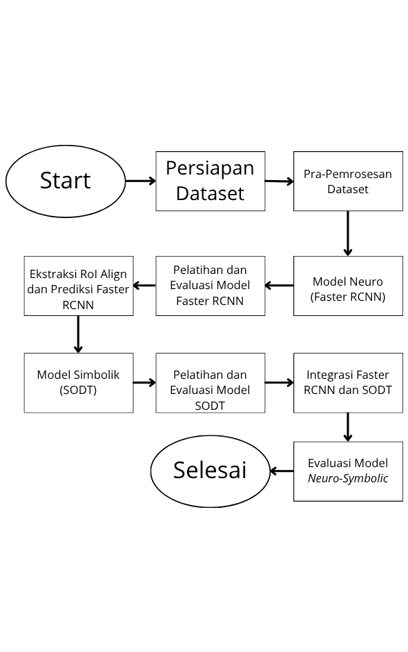

**Gambar 3.1 Diagram Alur Penelitian**

Penelitian dimulai dengan persiapan dan pra-pemrosesan *dataset* DeepPCB, dilanjutkan pelatihan *Faster* R-CNN, ekstraksi *dataset* simbolik, pelatihan SODT, integrasi keduanya, lalu evaluasi akhir. Kontribusi penelitian ini terletak pada tiga hal yang ditambahkan pada penggantian *classification head* oleh SODT, yaitu *class weighting* pada pelatihan SODT (Subbab 3.7), skor deteksi berbasis *routing margin* (Subbab 3.8.1), dan *heatmap* per *node* yang *faithful* (Subbab 3.8.2).

## 3.1 Persiapan Dataset

*Dataset* DeepPCB (Tang et al., 2019) dibagi menjadi data latih dan data uji berdasarkan berkas indeks bawaannya yang ditunjukkan pada Tabel 3.1, sehingga tidak ada kebocoran data antarfase.

**Tabel 3.1 Pembagian *dataset* berdasarkan kategori**

| **Kategori** | **Berkas Indeks** | **Jumlah Citra** | **Persentase (%)** |
|:------------:|-------------------|------------------|--------------------|
| *Train Set*  | *trainval.txt*    | 1.000            | 66,67%             |
|  *Test Set*  | *test.txt*        | 500              | 33,33%             |

Penelitian ini bersifat non-referensial, yaitu model mendeteksi cacat tanpa membandingkan citra uji dengan citra *template*, sesuai kondisi inspeksi nyata ketika citra referensi sering tidak tersedia. Oleh karena itu, dari setiap pasangan citra hanya citra target (*\_test.jpg*) yang dimuat, sedangkan citra *template* (*\_temp.jpg*) diabaikan.

Koordinat cacat pada berkas anotasi diubah menjadi *bounding box*, sedangkan ID kelas 1–6 dipakai langsung sebagai indeks kelas, yaitu *open*, *short*, *mousebite*, *spur*, *spurious copper*, dan *pinhole*. Contoh sampel beserta anotasinya ditunjukkan pada Gambar 3.2.

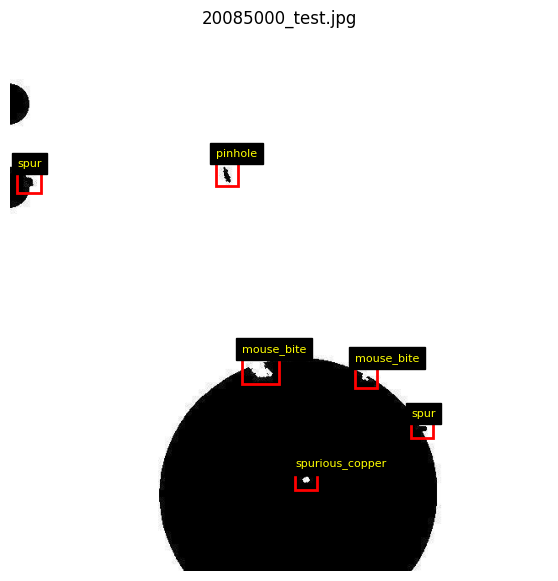

**Gambar 3.2 Contoh sampel dataset PCB beserta anotasinya**

## 3.2 Pra-pemrosesan *Dataset*

Citra diproses melalui dua *pipeline*, yaitu di luar model untuk konversi dan augmentasi, serta di dalam model untuk normalisasi dan pengaturan resolusi. Konfigurasinya dirangkum pada Tabel 3.2 dan Tabel 3.3.

**Tabel 3.2 Parameter Normalisasi dan Standardisasi *Input***

| **Parameter** | **Nilai Konfigurasi** | **Tujuan** |
|:----------------------:|---------------------|---------------------------|
| Rentang Intensitas | \[0,0; 1,0\] | Penyeragaman *dynamic range* piksel |
| Rata-rata (*Mean*) | \[0,485; 0,456; 0,406\] | Penyelarasan distribusi ImageNet |
| Deviasi Standar (*Std*) | \[0,229; 0,224; 0,225\] | Penyelarasan distribusi ImageNet |

**Tabel 3.3 Konfigurasi Augmentasi Data Pelatihan**

| **Jenis Augmentasi** | **Parameter** | **Deskripsi** |
|:----------------------:|------------------------|------------------------|
| *Random Horizontal Flip* | Probabilitas: 0,5 | Variasi Arah |
| *Multi-resolution Scaling* | Sisi terpendek: {480, 560, 640, 720, 800, 880}; sisi terpanjang maks. 880 | Ketahanan terhadap skala |
| *Coordinate Sync* | Enabled | Penyesuaian otomatis lokasi *box* saat gambar berubah |

Pada fase latih, citra diubah menjadi *tensor* berintensitas \[0,0; 1,0\], lalu dibalik secara horizontal secara acak beserta koordinat *bounding box*. Di dalam model, citra dinormalisasi per kanal sesuai Tabel 3.2, diskalakan, dan diseragamkan ukurannya melalui *padding*. Resolusi dipilih acak sesuai Tabel 3.3 saat latih, sedangkan saat inferensi, ekstraksi fitur, dan evaluasi digunakan sisi terpendek 800 piksel, yaitu salah satu skala pelatihan tersebut.

## 3.3 Model Neuro (*Faster* R-CNN)

*Faster* R-CNN berperan sebagai ekstraktor fitur, pengusul area, dan model *teacher*. Penelitian ini menggunakan SF-PSPyramid dari Fung et al. (2024) sesuai Subbab 2.1.5 karena *neck*-nya dirancang untuk cacat berukuran mikro pada PCB. ResNet-50 menghasilkan *feature map* C2–C5 yang dirangkai oleh *neck* menjadi piramida P2′–P6. RPN menghasilkan proposal yang diseragamkan oleh *RoI Align* menjadi *tensor* 64×7×7, kemudian diproses oleh *box head* dan disaring oleh *Soft*-NMS.

Tiga keluaran tersebut digunakan pada tahap berikutnya. Proposal RPN menjadi kandidat RoI bagi sistem *neuro-symbolic*, sedangkan *tensor* *RoI Align* 64×7×7 menjadi masukan SODT karena masih mempertahankan informasi spasial. Prediksi kelas *box head* menjadi label *teacher* pada Subbab 3.5, dan *regression head* menghitung koordinat *bounding box* akhir pada Subbab 3.8. Konfigurasi tiap modul dirangkum pada Tabel 3.4.

**Tabel 3.4 Parameter utama *Faster* R-CNN**

| **Modul** | **Parameter** | **Nilai / Konfigurasi** |
|:----------------|---------------------|---------------------------|
| *Backbone* | Inisialisasi bobot | ResNet-50, *pre-trained* ImageNet |
| *Backbone* | *Batch Normalization* | *Frozen* |
| *Neck* (SF-PSPyramid) | Tingkat piramida | P2′, P3′, P4, P5, P6 |
| *Neck* (SF-PSPyramid) | Jumlah kanal (*C*) | 64 |
| RPN | Ukuran *anchor* | 32, 64, 128, 256, 512 piksel (satu ukuran per tingkat) |
| RPN | Rasio aspek | 0,5; 1,0; 2,0 |
| RPN | Ambang IoU | *Foreground* ≥ 0,7; *background* < 0,3 |
| RPN | Penyelamatan *anchor* terbaik | Hanya jika IoU ≥ 0,3 |
| RPN | Batas proposal setelah NMS | Latih: 2.000 \| Uji: 1.000 |
| *RoI Align* | Dimensi keluaran | 7×7 (rasio *sampling*: 2) |
| *Soft*-NMS | Metode penurunan skor | *Linear*, sigma 0,5, ambang IoU 0,5 |
| *Soft*-NMS | Pemotongan skor | 0,001 |

Konfigurasi ini mengikuti Fung et al. (2024) dengan beberapa perbedaan. Jumlah kanal *neck* adalah 64, bukan 256, agar dimensi masukan SODT hanya $64 \times 7 \times 7 = 3.136$. Ukuran *anchor* 32 hingga 512 piksel dipakai karena Fung et al. tidak menyebutkan ukuran *anchor*, dengan syarat IoU minimum 0,3 untuk penyelamatan *anchor* terbaik sebagaimana dinyatakan pada paper tersebut. Pembesaran resolusi pada *selective feature attention* memakai interpolasi *nearest*, dan bobot awal ResNet-50 adalah bobot ImageNet versi 2. Perbedaan pada pelatihan dan skala pengujian dijelaskan pada Subbab 3.4.

## 3.4 Pelatihan dan Evaluasi Model Neuro

*Faster* R-CNN dilatih selama 15 *epoch*, dibandingkan 12 *epoch* pada Fung et al. (2024), dengan *Automatic Mixed Precision* (AMP) dan *gradient accumulation* untuk mengatasi keterbatasan memori GPU. *Loss* regresi menggunakan L1 pada Persamaan 2.8 mengikuti Fung et al. (2024). *Learning rate* dinaikkan secara linear pada awal pelatihan (*warmup*) lalu diturunkan secara bertahap. *Hyperparameter* dirangkum pada Tabel 3.5.

**Tabel 3.5 *Hyperparameter* pelatihan model *Faster* R-CNN**

| **Kelompok** | **Parameter** | **Nilai / Konfigurasi** |
|:----------------|---------------------|---------------------------|
| Siklus pelatihan | Total *epoch* | 15 |
| Siklus pelatihan | *Gradient accumulation* | 4 langkah |
| Siklus pelatihan | Presisi komputasi | AMP |
| Pengoptimal | *Optimizer* | SGD |
| Pengoptimal | *Learning rate* | 0,02 |
| Pengoptimal | *Momentum* dan *weight decay* | 0,9 dan 0,0001 |
| Penjadwalan | Tipe *scheduler* | *Step decay* pada *epoch* ke-8 dan ke-11 |
| Penjadwalan | Faktor penurunan | 0,1 |
| Pemanasan | Iterasi dan rasio awal | 500 *batch*, 0,001 |

Pada setiap *batch*, *multi-task loss* pada Persamaan 2.7 dihitung dan gradien diakumulasikan selama empat iterasi sebelum bobot diperbarui dengan SGD sesuai Persamaan 2.3.

Evaluasi mengikuti protokol Fung et al. (2024), yaitu AP dihitung dengan cara PASCAL VOC (Persamaan 2.32) dan dilaporkan sebagai AP50, AP75, AP80, AP85, dan AP@50:5:85. Fung et al. tidak menyebutkan skala pengujiannya, sehingga penelitian ini menguji pada sisi terpendek 800 piksel. Selain itu dilaporkan mAP@0,5:0,95 dan *Precision*, *Recall*, serta F1 (Persamaan 2.29 sampai 2.31) pada IoU 0,5 dan ambang skor 0,5, termasuk per kelas dan *confusion matrix*. Dari tiga pelatihan dengan *seed* berbeda, model dengan AP terbaik dipilih lalu dibekukan dan disimpan sebagai *teacher*.

## 3.5 Ekstraksi Fitur RoI dan Hasil Klasifikasi *Faster* R-CNN

Tahap ini membentuk dataset simbolik sesuai skema model mimicking pada Subbab 2.1.7. Fitur diambil tepat setelah RoI Align, sebelum masuk MLP pada box head, sehingga bentuk grid 7×7 tetap terjaga. Yang diekstrak adalah seluruh proposal RPN pada mode inferensi, bukan hanya deteksi akhir, agar SODT dilatih pada populasi proposal yang sama dengan saat inferensi.

Label setiap proposal adalah prediksi *teacher*, termasuk *background*, bukan *ground truth*. *Ground truth* hanya disimpan sebagai data pendamping. Ekstraksi dilakukan terpisah untuk data latih dan data uji. Mekanismenya diilustrasikan pada Gambar 3.3.

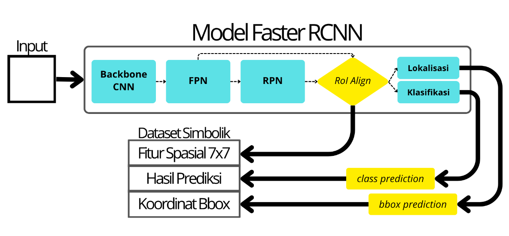

**Gambar 3.3 Pengambilan *RoI Align* dan Hasil dari *Faster* R-CNN**

Berdasarkan mekanisme tersebut, pembentukan *dataset* simbolik dirangkum pada Algoritma 3.1.

**Algoritma 3.1 Pembentukan Dataset Simbolik**

**Input:** Model *teacher* (*frozen*) serta citra latih dan uji beserta anotasinya.

**Output:** *Dataset* simbolik latih dan uji berisi fitur $64 \times 7 \times 7$, koordinat proposal, label *teacher*, dan data pendamping *ground truth*.

**Langkah-langkah:**

1.  Setiap citra diproses dengan resolusi tetap sesuai Subbab 3.2, lalu RPN menghasilkan hingga 1.000 proposal.

2.  *RoI Align* mengubah setiap proposal menjadi *tensor* 64×7×7 sesuai Persamaan 2.10 dan 2.12.

3.  *Tensor* diteruskan ke *box head teacher*, lalu kelas dengan probabilitas *softmax* tertinggi sesuai Persamaan 2.4 diambil sebagai label.

4.  Setiap proposal dicocokkan dengan *ground truth* ber-IoU tertinggi sebagai data pendamping.

5.  Fitur, label, dan data pendamping disimpan sebagai *dataset* simbolik.

## 3.6 Model Simbolik (SODT)

SODT menggantikan *classification head* pada *box head*, sehingga setiap keputusan kelas berasal dari rangkaian keputusan linear yang dapat ditelusuri sesuai Subbab 2.1.8. Masukannya adalah *tensor* $64 \times 7 \times 7$ yang diratakan menjadi vektor berdimensi 3.136, dengan urutan yang dicatat agar setiap bobot dapat dikembalikan ke kanal dan posisi grid asalnya.

SODT dibentuk sebagai pohon biner lengkap dengan fungsi keputusan linear pada setiap *node* internal sesuai Persamaan 2.21 dan satu label kelas pada setiap *leaf*. Bobot dan bias setiap *node* diinisialisasi dari distribusi normal baku (Hada et al., 2024), sedangkan label *leaf* diinisialisasi secara acak, bukan dengan kelas mayoritas, agar TAO tidak terjebak pada kelas *background* yang dominan. Konfigurasinya dirangkum pada Tabel 3.6.

**Tabel 3.6 Konfigurasi struktur dan inisialisasi SODT**

| **Parameter** | **Nilai** | **Keterangan** |
|:----------------:|------------------|-------------------------------------|
| Kedalaman pohon | 6 | Batas maksimum tingkat hierarki *node* |
| Inisialisasi bobot dan bias | Distribusi normal baku N(0, 1) | Menentukan *routing* awal pada iterasi TAO pertama |
| Inisialisasi label *leaf* | Acak | Mencegah TAO terjebak pada kelas *background* yang dominan |

## 3.7 Pelatihan dan Evaluasi Model Simbolik

SODT dilatih dengan TAO pada *dataset* simbolik latih untuk meminimalkan fungsi tujuan yang mencakup *loss* berbobot kelas pada Persamaan 2.26 serta penalti L1 berbobot ukuran *reduced set* pada Persamaan 2.24 dan 2.25. Karena sebagian besar proposal berlabel *background*, distribusi kelas sangat timpang sehingga digunakan *negative sampling* dengan mengambil sebagian proposal *background* secara acak berdasarkan rasio negatif (*negative ratio*) terhadap proposal cacat.

**Class weighting.** Karena label pelatihan SODT adalah prediksi *teacher*, kelas yang sulit ditiru mudah dikalahkan oleh *background* yang dominan. Pembobotan kelas diterapkan di dua tempat agar kesalahan pada kelas cacat dengan *recall* terlemah menjadi lebih mahal. Pada *reduced problem* setiap *node* sesuai Persamaan 2.23, setiap sampel diberi bobot pada Persamaan 3.1. Pada *leaf*, label ditentukan dengan mayoritas berbobot pada Persamaan 3.2.

$$
u_{n} = \left| e_{L}(n) - e_{R}(n) \right| \cdot \omega_{y_{n}}
$$

(3.1)

$$
{\widehat{y}}_{l} = \arg{\max_{c}{\omega_{c} \cdot N_{l,c}}}
$$

(3.2)

dengan $u_{n}$ bobot sampel ke-*n*, $e_{L}(n),e_{R}(n)$ *loss* 0/1 sampel ke-*n* bila diarahkan ke kiri dan ke kanan, $\omega_{c}$ bobot kelas $c$ pada Persamaan 2.26, ${\widehat{y}}_{l}$ label *leaf* ke-$l$, dan $N_{l,c}$ jumlah sampel berlabel $c$ pada *leaf* tersebut. Faktor $\left| e_{L} - e_{R} \right|$ bernilai 1 hanya untuk *care set*, sedangkan $\omega$ membuat kesalahan pengarahan pada kelas berbobot besar lebih mahal. Bobot *background* dibiarkan netral (bernilai 1) agar *false positive* tidak meningkat.

Setelah TAO, pohon dipangkas (*pruning*) dengan menghapus *dead branch* dan *pure subtree* (Carreira-Perpiñán & Tavallali, 2018; Hada et al., 2024), sehingga *explanation* menjadi lebih ringkas. Nilai $\lambda$ dan $\alpha$ ditentukan secara empiris dengan memilih nilai yang menghasilkan pohon *sparse* tanpa menurunkan fidelitas secara berarti. Pengaruh kedua parameter terhadap sparsitas dan akurasi telah dikaji oleh Hada et al. (2024) serta Kairgeldin dan Carreira-Perpiñán (2025). Pada setiap *node*, regresi logistik L1 diselesaikan dengan *solver* L-BFGS-B yang bekerja per potongan data (*chunk*) berpresisi *float32*. *Solver* ini menggantikan LIBLINEAR yang kehabisan memori pada 16 GB RAM karena menyimpan matriks data dua kali dengan 27 hingga 32 *byte* per elemen, dan menyelesaikan masalah L1 yang sama dengan toleransi 10⁻⁶ dan maksimum 2.000 iterasi per *node*. *Hyperparameter* pelatihan dirangkum pada Tabel 3.7.

**Tabel 3.7 *Hyperparameter* pelatihan SODT**

| **Tahapan/Komponen** | **Nilai** | **Deskripsi** |
|:----------------|----------------|---------------------------|
| Iterasi maksimum TAO | 15 | Jumlah siklus pembaruan seluruh *node* |
| Lambda (*λ*) | 0,01 | Kekuatan penalti L1 pada Persamaan 2.24 |
| Alpha (*α*) | 0,85 | Eksponen pembobot penalti pada Persamaan 2.25 |
| Rasio negatif | 2 | Sampel *background* terhadap sampel cacat |
| Bobot kelas (*ω*) | *Short*: 2; *Spur*: 1,5; *Open*: 1,5; *Pinhole*: 1,25; *Spurious copper*: 1,25; lainnya: 1 | Biaya lebih besar untuk kelas dengan *recall* terlemah |
| Toleransi konvergensi | 10⁻⁶ | Pelatihan berhenti jika penurunan relatif fungsi tujuan di bawah nilai ini |
| Ambang nol bobot | 10⁻⁵ | Bobot dengan nilai mutlak di bawah nilai ini dinolkan |

Fidelitas SODT pada *dataset* simbolik uji dievaluasi menggunakan *mimic accuracy*, *macro*-F1, dan *agreement* per kelas, disertai jumlah *node* aktif dan *nonzero weight*. Seluruh tahapan pelatihan, mulai dari *negative sampling* hingga *pruning*, dirangkum pada Algoritma 3.2.

**Algoritma 3.2 Pelatihan SODT dengan TAO**

**Input:** *Dataset* simbolik latih dan uji, serta SODT terinisialisasi.

**Output:** SODT terlatih dan hasil evaluasi fidelitasnya.

**Langkah-langkah:**

1.  Sistem mempertahankan seluruh proposal berlabel cacat dan mengambil acak proposal *background* sesuai *negative ratio* pada Tabel 3.7.

2.  Pada setiap iterasi TAO, *node* diperbarui dari yang terdalam menuju *root* menggunakan bobot sampel Persamaan 3.1, lalu label *leaf* diperbarui dengan Persamaan 3.2.

3.  Iterasi berhenti setelah mencapai batas iterasi TAO atau ketika penurunan relatif fungsi tujuan di bawah toleransi sesuai Tabel 3.7.

4.  *Node* yang tidak dilalui sampel (*dead branch*) dan *node* yang seluruh *leaf* di bawahnya berlabel sama (*pure subtree*) dinolkan bersama sub-pohonnya, sedangkan *leaf* yang tidak dicapai sampel diberi label *background*.

5.  Fidelitas diukur pada *dataset* simbolik uji.

## 3.8 Integrasi *Faster* R-CNN dan SODT

Tahap ini menyatukan *Faster* R-CNN dan SODT menjadi satu alur inferensi, ditambah dua komponen, yaitu skor deteksi berbasis *routing margin* dan *heatmap* per *node*.

### 3.8.1 Hybrid Inference

SODT hanya menggantikan *classification head*. Koordinat *bounding box* akhir tetap dihitung oleh *regression head* *Faster* R-CNN, sehingga sifat *faithful* berlaku pada keputusan kelas, bukan pada penyesuaian lokasi kotak. Alurnya ditunjukkan pada Gambar 3.4.

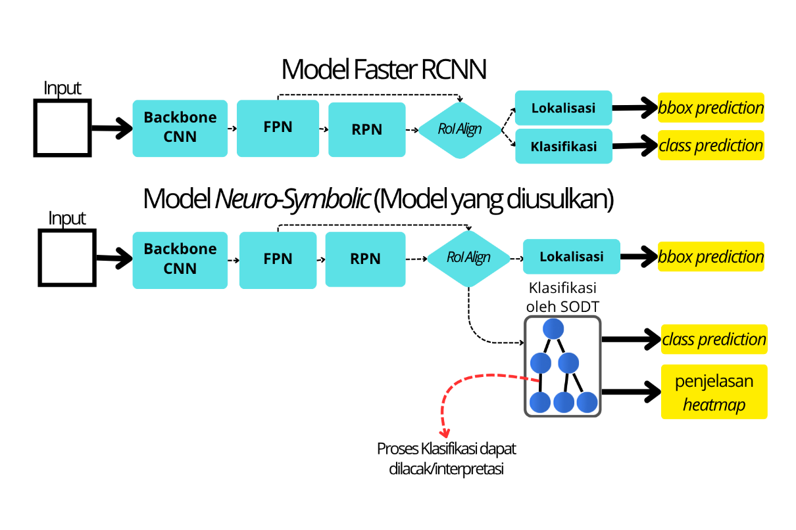

**Gambar 3.4 Diagram integrasi Neuro-Symbolic**

Penggantian *classification head* tersebut menimbulkan satu persoalan pada skor deteksi. Karena setiap *leaf* hanya menyimpan satu label, semua deteksi yang mencapai *leaf* berkelas sama akan memiliki skor identik, sebagaimana sifat keluaran simbolik yang dijelaskan pada Subbab 2.1.7. Akibatnya, AP dan *Soft*-NMS kehilangan urutan skor. Oleh karena itu, skor dibentuk dari *margin* pada Persamaan 2.19 dan *sigmoid* pada Persamaan 2.20 setiap *node* pada *decision path*, yang selanjutnya disebut skor deteksi berbasis *routing margin*, sebagaimana dinyatakan pada Persamaan 3.3.

$$
s(x) = \prod_{i \in P(x),\, w_{i} \neq 0}^{}{\sigma\left( \left| f_{i}(x) \right| \right)}
$$

(3.3)

dengan $s(x)$ skor untuk RoI $x$ pada kelas *leaf* yang dicapai (kelas lain bernilai 0), $P(x)$ *node* pada *decision path*, dan $f_{i}$ fungsi keputusan *node* ke-*i* pada Persamaan 2.21. *Node* yang telah dinolkan dilewati. Bentuk perkalian ini setara dengan probabilitas *routing* pada *soft decision tree* (Kontschieder et al., 2015), namun pada penelitian ini pohon tetap dieksekusi secara *hard* sehingga *decision path* dan label tidak berubah. Skor ini hanya berasal dari parameter pohon tanpa keluaran *classifier* neural. Ilustrasinya ditunjukkan pada Gambar 3.5.

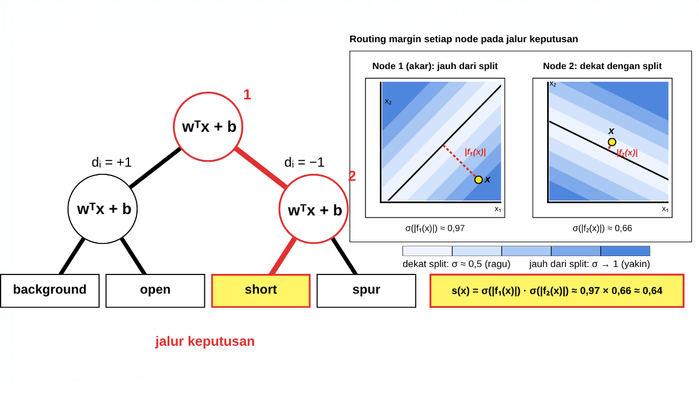

**Gambar 3.5 Ilustrasi Routing Margin pada SODT**

Berbeda dengan Platt (1999), parameter *sigmoid* bernilai tetap sehingga hasilnya merupakan skor *confidence*, bukan probabilitas kelas. Setiap faktor *sigmoid* berada pada rentang \[0,5; 1), sehingga $s(x)$ berada pada rentang \[$0{,}5^{k}$; 1) dengan $k \leq 6$ jumlah *node* aktif pada *decision path*. Karena fungsi keputusan *node* pada Persamaan 2.21 merupakan *logit* regresi logistik, setiap faktor *sigmoid* pada Persamaan 3.3 merepresentasikan *confidence* lokal terhadap arah yang diambil (Carreira-Perpiñán & Tavallali, 2018; Kairgeldin & Carreira-Perpiñán, 2025). Namun, karena setiap faktor bernilai kurang dari 1, *decision path* yang lebih panjang cenderung menghasilkan skor lebih rendah sehingga skor memiliki bias terhadap panjang *decision path*.

**Ambang skor.** Deteksi hanya ditampilkan, dan dihitung pada *Precision*, *Recall*, dan F1, apabila skornya mencapai ambang skor. *Faster* R-CNN memakai ambang 0,5. Skor NeSy berupa hasil kali beberapa *sigmoid* sehingga berada pada skala yang berbeda dari probabilitas *softmax*, dan ambang yang sama tidak sebanding. Ambang NeSy ditetapkan sebagai ambang terendah yang membuat *precision* pada 200 citra acak data latih setidaknya sama dengan *precision* *Faster* R-CNN pada ambang 0,5. Pada 200 citra tersebut *precision* *Faster* R-CNN adalah 0,952, sedangkan NeSy mencapai 0,941 pada ambang 0,30 dan 0,960 pada ambang 0,35, sehingga ambang NeSy adalah 0,35 (kelipatan 0,05). Ambang tidak dipakai saat pelatihan dan tidak ikut menentukan *decision path*, sedangkan mAP tidak bergantung pada ambang sehingga menjadi perbandingan yang adil antarmodel.

Dengan skor dan ambang tersebut, alur inferensi model hibrida dari citra uji hingga deteksi akhir dirangkum pada Algoritma 3.3.

**Algoritma 3.3 *Hybrid Inference* dengan *Routing Margin***

**Input:** Citra uji, *Faster* R-CNN (*frozen*), dan SODT terlatih.

**Output:** *Bounding box*, label kelas, skor deteksi, dan jalur keputusan setiap deteksi.

**Langkah-langkah:**

1.  *Faster* R-CNN menghasilkan proposal dan *tensor* 64×7×7 untuk setiap proposal.

2.  SODT menentukan label dari *leaf* yang dicapai, dan skor deteksi berbasis *routing* *margin* dihitung dengan Persamaan 3.3.

3.  *Regression* *head* *Faster* R-CNN menghitung koordinat *bounding* *box* akhir.

4.  Deteksi berlabel *background* dibuang, lalu *Soft*-NMS diterapkan sesuai Persamaan 2.13 dan deteksi berskor di bawah ambang skor dibuang.

5.  *Decision* *path*, *pyramid* *level* sumber, dan *feature* *map* *neck* setiap deteksi disimpan untuk pembentukan *heatmap*.

### 3.8.2 Heatmap per Node

Setiap *node* pada *decision path* memperoleh satu *heatmap* yang menunjukkan *region* yang dipertimbangkan oleh *node* tersebut untuk RoI yang dijelaskan. Pendekatan ini serupa dengan *Class Activation Mapping* (CAM) yang mengalikan bobot *classifier* linear dengan *feature map* (Zhou et al., 2016), tetapi diterapkan pada setiap *node* SODT dan melalui *RoI Align*. Berbeda dengan peta Kairgeldin dan Carreira-Perpiñán (2025) pada Persamaan 2.27 yang statis, *heatmap* ini dinamis karena memakai nilai fitur RoI, dan dihitung pada *feature map neck*, bukan grid $7 \times 7$.

Fungsi keputusan *node* bersifat linear terhadap fitur RoI sesuai Persamaan 2.21, dan *RoI Align* juga bersifat linear terhadap *feature map neck* sesuai Persamaan 2.11. Dengan bobot *node* per kanal $w_{i,c}$ dan *feature map* kanal ke-*c* pada *pyramid level* terpilih $F_{c}$, bagian linear fungsi keputusan dapat ditulis sebagai Persamaan 3.4.

$$
f_{i}(x) - b_{i} = \sum_{c = 1}^{C}{w_{i,c}^{T}\, A\, F_{c}}
$$

(3.4)

dengan $A$ matriks koefisien *RoI Align* dan $C = 64$. Gradien Persamaan 3.4 terhadap $F_{c}$ adalah $A^{T}w_{i,c}$, yaitu bobot *node* yang disebar kembali ke posisi asalnya pada *feature map*. Gradien ini dikalikan dengan nilai *feature map* sesuai *Gradient × Input* pada Persamaan 2.16, sebagaimana dinyatakan pada Persamaan 3.5.

$$
r_{i}\lbrack c,p\rbrack = d_{i} \cdot \left( A^{T}w_{i,c} \right)_{p} \cdot F_{c}(p)
$$

(3.5)

dengan $r_{i}\left\lbrack c,p \right\rbrack$ kontribusi kanal ke-*c* posisi $p$ terhadap *node* ke-*i*, dan $d_{i}$ arah keputusan *node*, sehingga kontribusi positif berarti mendukung arah yang diambil. Karena seluruh operasinya linear, *completeness* yang disebutkan pada Persamaan 2.17 dan 2.18 berlaku secara eksak sebagaimana Persamaan 3.6. Bias *node* tidak diatribusikan ke posisi mana pun, sehingga jumlah seluruh kontribusi sama dengan bagian linear fungsi keputusan pada Persamaan 3.4, bukan *margin* pada Persamaan 2.19.

$$
\sum_{c = 1}^{C}{\sum_{p}^{}{r_{i}\lbrack c,p\rbrack}} = d_{i} \cdot \left( f_{i}(x) - b_{i} \right)
$$

(3.6)

Untuk ditampilkan, kontribusi seluruh kanal diringkas menjadi satu peta dengan Persamaan 3.7.

$$
H_{i}(p) = \sum_{c = 1}^{C}\left| r_{i}\lbrack c,p\rbrack \right|
$$

(3.7)

Nilai mutlak membuat $H_{i}$ menunjukkan besar pengaruh, baik yang mendukung maupun yang menentang, sehingga $d_{i}$ tidak memengaruhi $H_{i}$, sedangkan arah keputusan ditampilkan pada *decision path*.

Perhitungan $H_{i}$ eksak per sel *feature map neck* pada satu *pyramid level*, yaitu level yang dibaca *RoI Align* untuk proposal tersebut. Satu sel *feature map* melihat *region* citra yang jauh lebih luas melalui *backbone*, sehingga peta yang diletakkan pada citra merupakan label lokasi (*region* yang ditimbang), bukan penyebab per piksel. Peta juga hanya dapat menyala di dalam proposal dan sel tetangga yang dibaca interpolasi *RoI Align*, sehingga konteks di luar area tersebut tidak terlihat. Alurnya ditunjukkan pada Gambar 3.6.

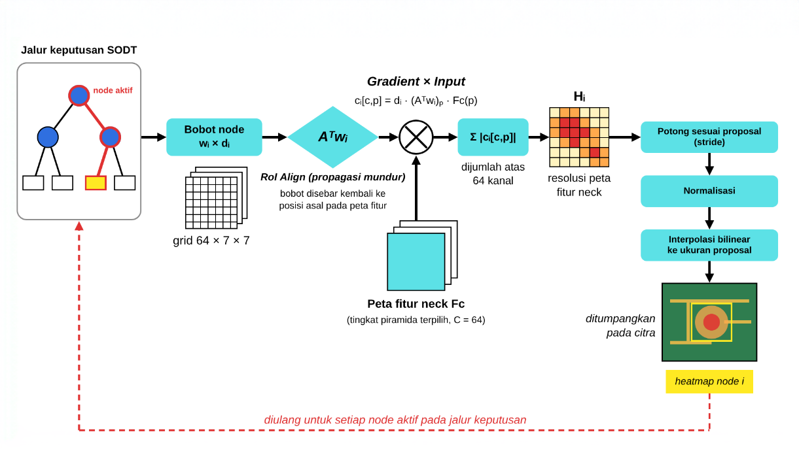

**Gambar 3.6 Alur Pembentukan Heatmap per Node**

Berdasarkan Persamaan 3.4 hingga 3.7, pembentukan *heatmap* untuk satu deteksi dirangkum pada Algoritma 3.4.

**Algoritma 3.4 Pembentukan Heatmap per Node**

**Input:** Satu deteksi beserta *tensor* RoI, jalur keputusan, tingkat piramida, dan *feature map neck* yang disimpan saat deteksi.

**Output:** Satu *heatmap* untuk setiap *node* aktif pada jalur keputusan.

**Langkah-langkah:**

1.  Bobot $w_{i}$ dikembalikan ke grid 64×7×7.

2.  Pada *pyramid level* proposal, *RoI Align* dijalankan ulang pada potongan *feature map neck* di sekitar proposal, lalu gradien Persamaan 3.4 dihitung dengan propagasi mundur satu kali untuk seluruh *node*.

3.  Gradien dikalikan dengan *feature map* pada Persamaan 3.5 dan diringkas menjadi $H_{i}$ pada Persamaan 3.7.

4.  Nilai setiap sel disebarkan merata ke piksel citra yang ditutupinya sesuai *stride* pada Persamaan 2.5 dan 2.6 dengan membatalkan penskalaan dan *padding*, lalu dipotong pada proposal dan dinormalisasi terhadap nilai puncaknya.

5.  *Heatmap* ditumpangkan pada citra.

## 3.9 Evaluasi Model *Neuro-Symbolic*

Evaluasi mencakup dua aspek, yaitu kinerja deteksi model hibrida dan kualitas penjelasan yang dihasilkannya. Seluruh pengujian dilakukan pada data uji.

### 3.9.1 Evaluasi Deteksi

Model hibrida dibandingkan dengan *Faster* R-CNN menggunakan metrik pada Subbab 3.4, dengan ambang skor 0,5 untuk *Faster* R-CNN dan 0,35 untuk NeSy sesuai Subbab 3.8.1. Setiap hasil menyebut ambang yang dipakainya karena *Precision*, *Recall*, dan F1 bergantung padanya, sedangkan mAP tidak.

Kontribusi diuji melalui ablasi. Peran *routing margin* diuji dengan menyamakan skor seluruh deteksi menjadi 1 tanpa mengubah *decision path* maupun label. Peran *class weighting* diuji dengan membandingkan SODT berbobot kelas dan tanpa bobot kelas pada rasio negatif, hiperparameter, dan *seed* yang sama. Ambang skor pohon tanpa bobot kelas diturunkan dengan aturan yang sama pada data *trainval*.

Waktu per citra uji diukur sebagai rata-rata dari tiga kali pengukuran untuk tiga *pipeline*, yaitu *Faster* R-CNN yang hanya melakukan deteksi, NeSy yang melakukan deteksi beserta pembentukan *heatmap* per *node*, serta *Faster* R-CNN dengan Grad-CAM yang melakukan deteksi beserta pembentukan peta Grad-CAM.

### 3.9.2 Evaluasi Penjelasan

Grad-CAM menghasilkan satu peta per deteksi, sedangkan SODT satu peta per *node*. Untuk perbandingan, *heatmap* per *node* dijumlahkan menjadi satu peta dengan Persamaan 3.8.

$$
M(p) = \sum_{i \in P(x)}^{}{H_{i}(p)}
$$

(3.8)

dengan $M(p)$ peta gabungan pada posisi $p$, $P(x)$ *node* pada *decision path* RoI $x$ pada Persamaan 3.3, dan $H_{i}$ *heatmap* *node* ke-*i* pada Persamaan 3.7. Peta $M$ hanya dipakai untuk perbandingan dengan Grad-CAM dan untuk studi kasus, yang juga menguraikan $M$ menjadi peta per *node*.

*Explanation* diuji dengan *faithfulness*, yaitu apakah *region* yang disorot menentukan keputusan model, dan melalui studi kasus pada satu PCB. Kedua metode diuji dengan protokol yang sama. Citra dibagi menjadi petak 16×16 piksel yang diurutkan menurut peta, petak teratas diganti warna rata-rata citra, dan model asli dijalankan ulang. Anggaran petak adalah setengah dari jumlah petak yang disentuh proposal. Sebagai pembanding (*random control*), urutan petak diacak dengan petak di dalam proposal didahulukan. Karena SODT dan Grad-CAM menjelaskan model dengan kepala klasifikasi yang berbeda, dengan label dan skor yang berbeda, hanya perbandingan tiap metode terhadap *random control*-nya sendiri yang sebanding. Grad-CAM dihitung pada *feature map neck* sesuai Selvaraju et al. (2017) dan dilaporkan dalam dua bentuk, yaitu pada seluruh citra dan dengan petak dibatasi pada proposal. Skor *Deletion* dan *Insertion* AUC pada SODT adalah skor *routing margin* pada Persamaan 3.3, sedangkan pada Grad-CAM adalah probabilitas kelas. Prosedur pengujian dirangkum pada Algoritma 3.5.

**Algoritma 3.5 Evaluasi Penjelasan**

**Input:** Model hibrida, Grad-CAM, dan data uji.

**Output:** Metrik *faithfulness* dan perbandingan visual pada satu PCB.

**Langkah-langkah:**

1.  Deteksi berskor di atas ambang skor masing-masing model dipilih dari 50 citra uji pertama, masing-masing dari NeSy dan dari *Faster* R-CNN.

2.  Peta M pada Persamaan 3.8 dihitung untuk deteksi NeSy, dan peta Grad-CAM pada Persamaan 2.14 dan 2.15 untuk deteksi *Faster* R-CNN.

3.  Petak citra diurutkan menurut peta, lalu setengah dari jumlah petak yang disentuh proposal dipilih dari urutan teratas.

4.  Petak tersebut diganti warna rata-rata untuk *Necessity* sesuai Persamaan 2.34 dan dipertahankan sementara sisanya diganti untuk *Sufficiency* sesuai Persamaan 2.35, lalu model dijalankan ulang dan label diperiksa. *Deletion* dan *Insertion* AUC pada Persamaan 2.36 dihitung dengan menghapus atau menambahkan petak secara bertahap dalam lima tahap.

5.  Langkah 3 dan 4 diulang dengan urutan petak acak sebagai *random control*.

6.  Satu PCB dipilih, lalu deteksi NeSy, peta M, dan peta Grad-CAM ditampilkan pada citra utuh, dan *decision path* beserta *heatmap* setiap *node* ditampilkan untuk dua deteksi dari kelas berbeda.

# BAB IV HASIL DAN PEMBAHASAN

## 4.1 Hasil Persiapan Dataset

*Dataset* DeepPCB dipartisi menjadi 1.000 citra latih dan 500 citra uji sesuai Subbab 3.1 tanpa ada citra yang muncul di kedua himpunan. Statistik anotasinya dirangkum pada Tabel 4.1.

**Tabel 4.1 Statistik Partisi *Dataset* DeepPCB**

|       **Metrik**        | ***Train Set*** | ***Test Set*** |
|:-----------------------:|-----------------|----------------|
|      Jumlah Citra       | 1.000           | 500            |
|      Total Anotasi      | 6.873           | 3.140          |
| Rata-rata Anotasi/Citra | 6,87            | 6,28           |
|  Minimum Anotasi Citra  | 1               | 2              |
|  Maximum Anotasi Citra  | 15              | 13             |
|      Citra Kosong       | 0               | 0              |

Berdasarkan Tabel 4.1, tidak ada citra kosong dan setiap citra rata-rata memuat 6 hingga 7 cacat, sehingga seluruh data merupakan kasus deteksi multi-objek. Distribusi anotasi per kelas ditunjukkan pada Gambar 4.1 dan Gambar 4.2.

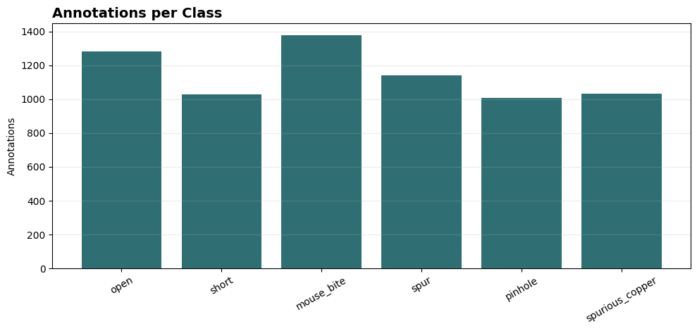

**Gambar 4.1 Distribusi anotasi per kelas pada *training set***

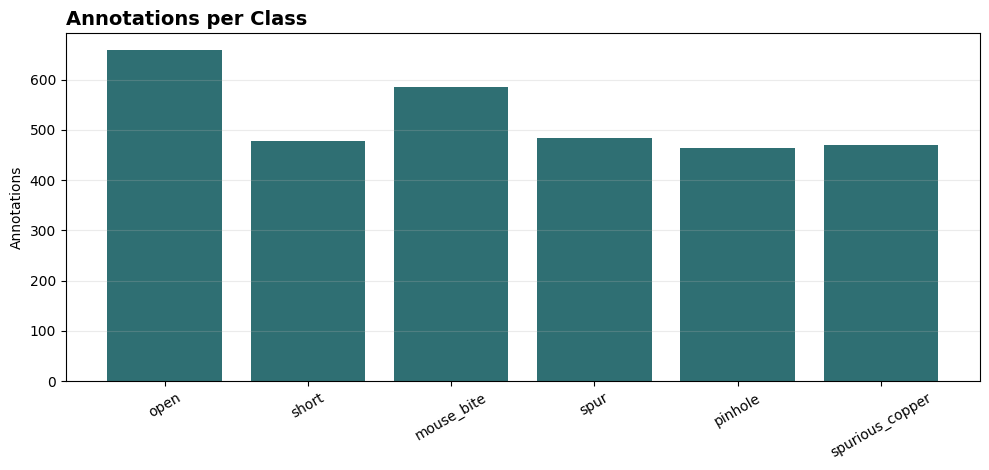

**Gambar 4.2 Distribusi anotasi per kelas pada *test set***

Berdasarkan Gambar 4.1 dan Gambar 4.2, kelas terbanyak hanya sekitar 1,4 kali kelas tersedikit pada kedua himpunan, sehingga distribusi kelas relatif seimbang.

Seluruh *bounding box* berada di dalam batas citra 640×640 piksel tanpa dimensi nol, dan kesesuaiannya dengan citra diperiksa melalui enam sampel acak pada Gambar 4.3.

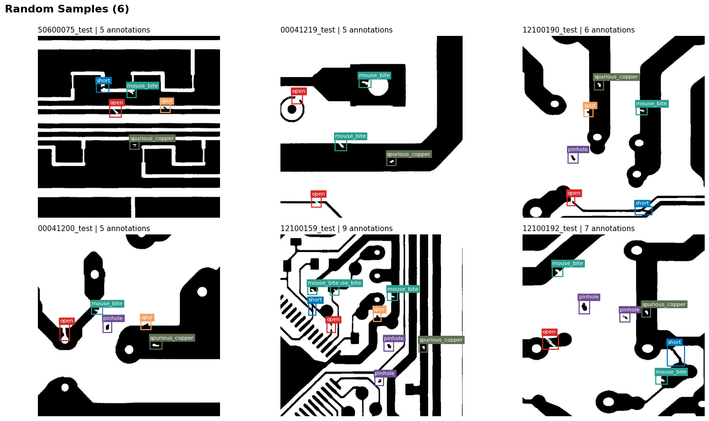

**Gambar 4.3 Sampel acak citra PCB dengan anotasi *bounding box ground truth***

Berdasarkan Gambar 4.3, setiap *bounding box* pada keenam sampel menutupi area cacat dengan label yang sesuai, sehingga anotasi dapat langsung digunakan sebagai *ground truth*.

## 4.2 Hasil Pra-Pemrosesan Dataset

Kedua transformasi pada Tabel 3.3 diterapkan dua kali pada citra contoh untuk memperlihatkan keacakannya sekaligus memastikan *bounding box* tetap sesuai. Hasil *horizontal flip* ditunjukkan pada Gambar 4.4.

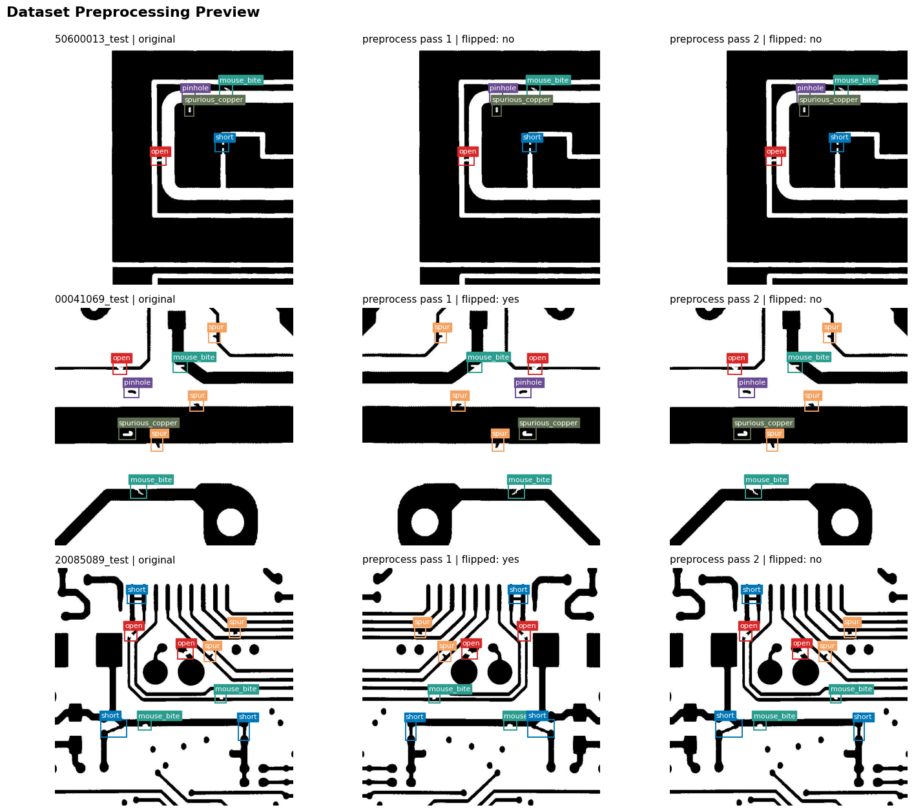

**Gambar 4.4 Hasil visualisasi augmentasi pembalikan horizontal pada citra PCB**

Berdasarkan Gambar 4.4, *flip* terjadi secara acak sehingga model menerima orientasi yang beragam, dan saat citra terbalik *bounding box* selalu ikut berpindah ke posisi cerminnya. Hasil *multi-resolution scaling* ditunjukkan pada Gambar 4.5.

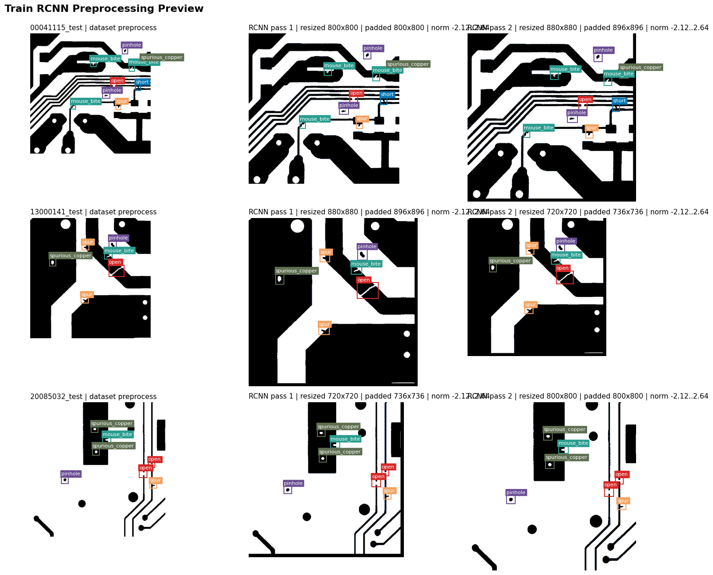

**Gambar 4.5 Hasil visualisasi penskalaan multi-resolusi dalam arsitektur model**

Berdasarkan Gambar 4.5, resolusi dipilih secara acak lalu diberi *padding* hingga kelipatan 32, tetapi penskalaan yang proporsional membuat bentuk cacat tidak terdistorsi dan *bounding box* tetap pada area cacat. Kedua transformasi menghasilkan variasi orientasi dan skala tanpa merusak kesesuaian anotasi.

## 4.3 Hasil dan Evaluasi *Faster* R-CNN sebagai *Teacher*

*Faster* R-CNN dilatih selama 15 *epoch* dengan *hyperparameter* pada Tabel 3.5. Perkembangan *loss* total dan setiap komponennya ditunjukkan pada Gambar 4.6.

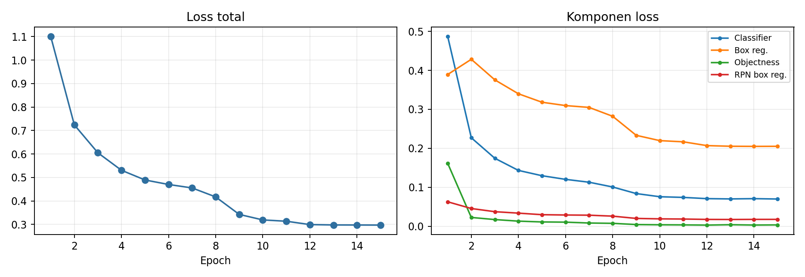

**Gambar 4.6 *Training Loss Faster* R-CNN selama 15 *Epoch***

Berdasarkan Gambar 4.6, *loss* total turun tajam setiap kali *learning rate* diturunkan sesuai Tabel 3.5 dan mendatar pada *epoch* akhir, menandakan model telah konvergen. *Loss* regresi *bounding box* tetap terbesar hingga akhir pelatihan, sehingga kesulitan utama model terletak pada presisi batas *bounding box*, bukan pada menemukan cacat.

Kinerja model terpilih pada data uji dirangkum pada Tabel 4.2 bersama hasil Fung et al. (2024) pada *dataset* DeepPCB non-referensial. Model terpilih adalah yang terbaik dari tiga pelatihan dengan *seed* berbeda.

**Tabel 4.2 Kinerja Deteksi *Faster* R-CNN pada Data Uji**

| **Model** | **AP50** | **AP75** | **AP80** | **AP85** | **AP@50:5:85** |
|:------------|--------|--------|--------|--------|---------|
| *Faster* R-CNN + SF-PSPyramid (Fung et al., 2024) | 98,6 | **94,6** | **88,1** | **72,7** | **93,2** |
| *Faster* R-CNN + SF-PSPyramid (penelitian ini) | **98,73** | 94,30 | 87,50 | 71,63 | 93,03 |

*Catatan:* AP dihitung dengan protokol PASCAL VOC seperti Fung et al. (2024) dan dalam persen. Fung et al. tidak menyebutkan skala pengujiannya, sedangkan penelitian ini menguji pada sisi terpendek 800 piksel.

Berdasarkan Tabel 4.2, model ini setara dengan Fung et al. (2024). AP50 sedikit lebih tinggi, sedangkan AP pada IoU yang lebih ketat lebih rendah 0,3 hingga 1,1 poin, sehingga AP@50:5:85 hanya selisih 0,17 poin. Hal ini diperoleh walaupun kanal *neck* dikurangi menjadi 64 untuk membatasi dimensi masukan SODT. Pada IoU 0,5 dan ambang skor 0,5, model mencapai *Precision* 0,903, *Recall* 0,983, F1 0,941, dan mAP@0,5:0,95 sebesar 0,797. Kinerja per kelas cacat dirangkum pada Tabel 4.3.

**Tabel 4.3 Kinerja *Faster* R-CNN per Kelas Cacat**

|     **Kelas**     | ***Precision*** | ***Recall*** | **AP@0,5:0,95** |
|:-----------------:|-----------------|--------------|-----------------|
|     *Pinhole*     | 0,834           | 0,996        | 0,901           |
| *Spurious copper* | 0,874           | 0,989        | 0,916           |
|    *Mousebite*    | 0,952           | 0,983        | 0,783           |
|      *Open*       | 0,956           | 0,980        | 0,725           |
|      *Spur*       | 0,967           | 0,981        | 0,772           |
|      *Short*      | 0,827           | 0,969        | 0,681           |

Berdasarkan Tabel 4.3, *recall* seluruh kelas di atas 0,96, sedangkan *precision* terendah terdapat pada *short*, *pinhole*, dan *spurious copper*. Penyebabnya ditelusuri melalui *confusion matrix* pada Gambar 4.7.

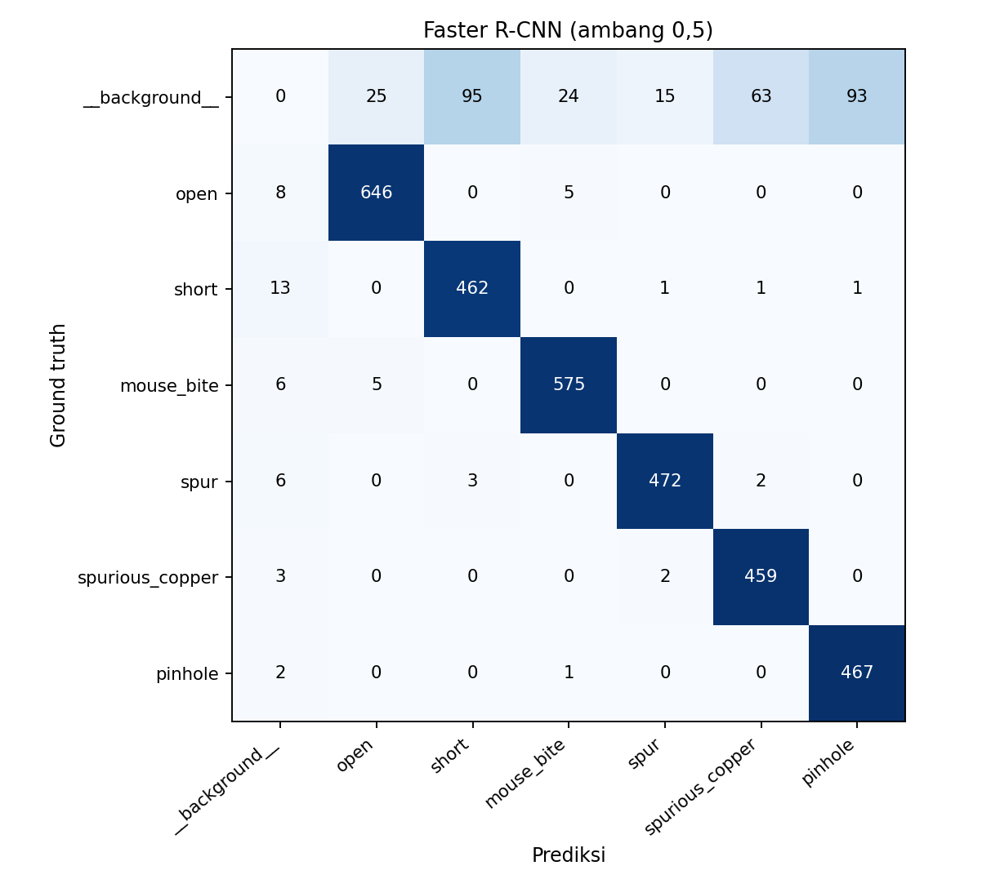

**Gambar 4.7 *Confusion Matrix Faster* R-CNN pada Data Uji**

Hampir seluruh cacat terklasifikasi benar dengan sangat sedikit yang tertukar antarkelas, sedangkan kesalahan utama berasal dari *background* yang terdeteksi sebagai cacat (kolom pertama), terutama pada *pinhole* dan *short*. Jumlahnya jauh lebih banyak daripada cacat yang terlewat, sehingga model cenderung mendeteksi berlebih. Karena SODT meniru label *teacher* sesuai Subbab 3.5, kecenderungan ini ikut terbawa dan menjadi pembanding pada Subbab 4.6.

## 4.4 Hasil Ekstraksi Fitur *Teacher* (*Faster* R-CNN)

Model *teacher* digunakan untuk mengekstrak fitur dan label 1.000 proposal RPN per citra sesuai Subbab 3.5. Distribusi label hasil ekstraksi ditunjukkan pada Tabel 4.4.

**Tabel 4.4 Distribusi Label *Teacher* pada RoI Hasil Ekstraksi**

| **Label *Teacher*** | **Data Latih** | **Data Uji** |
|:-------------------:|----------------|--------------|
|    *Background*     | 822.258        | 414.076      |
|       *Open*        | 32.283         | 17.224       |
|       *Short*       | 25.457         | 12.995       |
|     *Mousebite*     | 34.660         | 15.233       |
|       *Spur*        | 32.212         | 14.108       |
|  *Spurious copper*  | 26.581         | 13.170       |
|      *Pinhole*      | 26.549         | 13.194       |
|        Total        | 1.000.000      | 500.000      |

Sekitar 82% RoI dilabeli *background* karena setiap citra hanya memuat 6 hingga 7 cacat dari 1.000 proposal. Setiap cacat juga diwakili puluhan proposal yang saling tumpang-tindih. Akibatnya, data SODT didominasi *background*, sedangkan setiap cacat terwakili dari berbagai posisi proposal.

## 4.5 Evaluasi Model Simbolik (*Sparse Oblique Decision Tree*)

Subbab ini mengevaluasi fidelitas SODT hasil Subbab 3.7, yaitu kemampuannya meniru label *teacher* pada 500.000 RoI data uji, bukan kinerjanya terhadap *ground truth* yang dibahas pada Subbab 4.6.

### 4.5.1 Pelatihan, Fidelitas, dan Struktur Pohon

SODT dilatih dengan konfigurasi pada Tabel 3.7. Dengan rasio negatif 2, *background* mencakup dua pertiga dari 533.226 RoI data latih (177.742 RoI cacat dan 355.484 RoI *background*). Perkembangan *mimic accuracy* dan jumlah *nonzero weight* selama pelatihan TAO ditunjukkan pada Gambar 4.8.

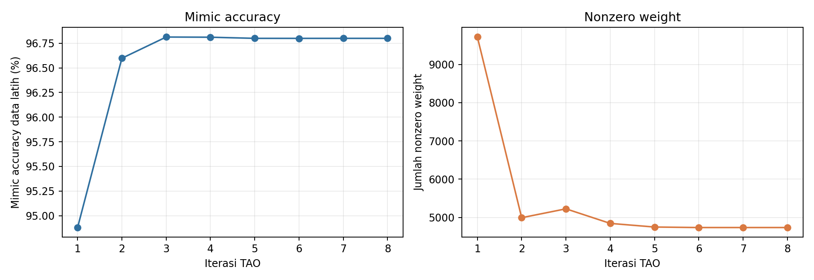

**Gambar 4.8 Grafik *Mimic Accuracy* dan *Nonzero Weight***

*Mimic accuracy* sudah mencapai 94,9% pada iterasi pertama dan naik menjadi 96,8% pada iterasi ke-3, sedangkan *nonzero weight* turun dari 9.715 menjadi sekitar 4.700 dan *node* aktif dari 58 menjadi 47. TAO lebih banyak menyederhanakan pohon daripada menaikkan fidelitas. Pelatihan berhenti pada iterasi ke-8 setelah penurunan fungsi tujuan di bawah toleransi 10⁻⁶, dan *pruning* pada iterasi berikutnya menghapus enam *node* tanpa mengubah keputusan pohon pada data latih. Ringkasan hasil akhirnya ditunjukkan pada Tabel 4.5.

**Tabel 4.5 Ringkasan Struktur dan Fidelitas SODT Terpilih**

|                 **Metrik**                  | **Nilai**                      |
|:--------------------------------------:|---------------------------------|
|               Kedalaman pohon               | 6                              |
|            *Node* internal aktif            | 44 dari 63                     |
|              *Nonzero weight*               | 4.642 dari 197.568             |
|                  Sparsitas                  | 97,65%                         |
| Rata-rata *nonzero weight* per *node* aktif | 105,5 (3,36% dari 3.136 fitur) |
|         *Mimic accuracy* data latih         | 96,80%                         |
|          *Mimic accuracy* data uji          | 96,33%                         |
|            *Macro*-F1 data uji              | 0,909                          |

SODT meniru *teacher* dengan fidelitas di atas 96% meskipun setiap *node* hanya memakai sekitar 3% fitur, sejalan dengan Hada et al. (2024). *Agreement* per kelas berada pada rentang sempit, yaitu 0,951 (*spurious copper*) hingga 0,972 (*spur*), dengan *background* 0,964, *mousebite* 0,957, *open* 0,967, *pinhole* 0,963, dan *short* 0,964, sehingga tidak ada kelas yang ditinggalkan. *Macro*-F1 lebih rendah daripada *mimic accuracy* karena F1 juga memperhitungkan *precision*, yaitu RoI *background* yang ikut dilabeli cacat.

Perbandingan struktur pohon penuh dan SODT terpilih setelah *pruning* ditunjukkan pada Gambar 4.9. Panel (a) menampilkan struktur biner lengkap berkedalaman 6 dengan 63 *node* internal dan 64 *leaf*; setelah TAO, 47 *node* aktif dan 4.735 bobot bernilai bukan nol, sedangkan *node* abu-abu memiliki seluruh bobot nol. Panel (b) menampilkan pohon setelah pemangkasan dengan 44 *node* aktif, 45 *leaf* terjangkau, dan 4.642 bobot bukan nol (sparsitas 97,65%), sedangkan cabang yang tidak terjangkau dilipat. Angka pada *node* menyatakan jumlah *nonzero weight*, label pada *leaf* menyatakan kelas keputusan, dan *node* dinomori per tingkat dari kiri ke kanan mulai dari N0 sebagai *root*, sehingga anak kiri dan kanan N*i* adalah N(2*i*+1) dan N(2*i*+2).

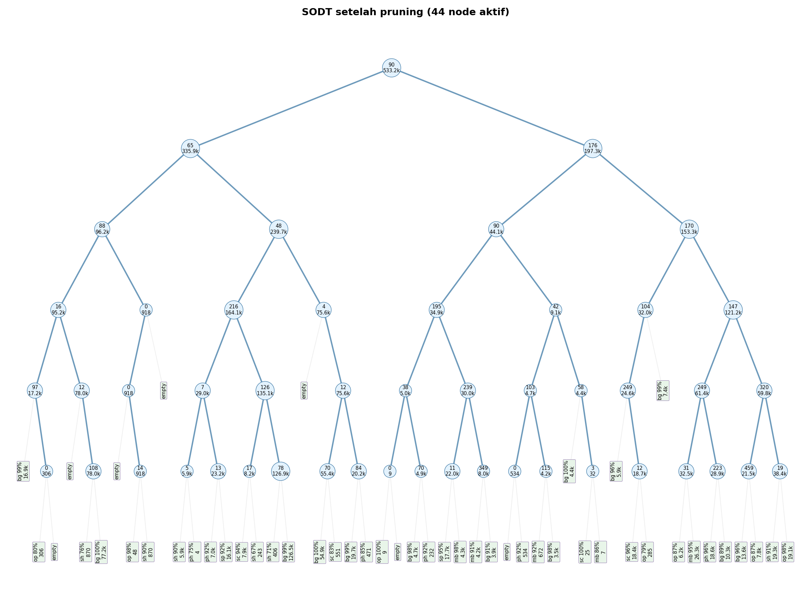

**Gambar 4.9 Perbandingan struktur SODT: (a) pohon penuh dengan 63 *node* internal dan 64 *leaf* serta (b) SODT terpilih dengan 44 *node* aktif setelah pemangkasan. Angka pada *node* menyatakan jumlah bobot bukan nol, *node* abu-abu memiliki seluruh bobot nol, dan kotak merah menandai subtree yang dipangkas.**

Dari 64 *leaf* pada panel (a), 34 berlabel *background* dan 30 berlabel cacat (*open* 7, *short* 6, *pinhole* 6, *mousebite* 5, *spurious copper* 4, *spur* 2). Pada 9 dari 32 pasangan *leaf* bersaudara, kedua *leaf* berlabel cacat yang berbeda, sehingga *node* tingkat atas terutama menyaring *background*, sedangkan *node* di dekat *leaf* menentukan kelas cacat. Jumlah *nonzero weight* tersebar tidak merata, dengan *node* terpadat N61 (459), N50 (349), dan N30 (320), sedangkan rata-rata per *node* aktif hanya sekitar 90 hingga 126 pada setiap kedalaman. Sparsitas inilah yang membuat setiap *node* cukup ringkas untuk diubah menjadi *heatmap* pada Subbab 4.7.

### 4.5.2 Pengaruh *Class Weighting* (Kontribusi 1)

Karena label pelatihan adalah prediksi *teacher*, kelas cacat yang sulit ditiru mudah dikalahkan oleh *background* yang dominan. *Class weighting* (CW) pada Persamaan 3.1 dan 3.2 menaikkan biaya kesalahan pada kelas cacat dengan *recall* terlemah. Pengaruhnya diuji dengan melatih ulang pohon yang sama (λ = 0,01, α = 0,85, NR 2, *seed* 112) tanpa CW, sehingga satu-satunya perbedaan adalah bobot kelas. Hasilnya ditunjukkan pada Tabel 4.6, dan dampaknya pada deteksi pada Tabel 4.8. Jumlah RoI uji per kelas adalah 414.076 (*background*), 17.224 (*open*), 12.995 (*short*), 15.233 (*mousebite*), 14.108 (*spur*), 13.170 (*spurious copper*), dan 13.194 (*pinhole*) dari total 500.000 RoI.

**Tabel 4.6 Agreement per Kelas Pohon SODT dengan dan tanpa *Class Weighting* pada Data Uji**

| **Model** | ***Agreement background*** | ***Agreement open*** | ***Agreement short*** | ***Agreement mousebite*** | ***Agreement spur*** | ***Agreement spurious copper*** | ***Agreement pinhole*** | ***Mimic accuracy*** | ***Macro*-F1** |
|:------------|:------:|:------:|:------:|:------:|:------:|:------:|:------:|:------:|:------:|
| SODT tanpa CW | **0,9699** | 0,9515 | 0,9331 | **0,9579** | 0,9590 | 0,9456 | 0,9568 | **0,9667** | **0,9155** |
| SODT dengan CW (terpilih) | 0,9635 | **0,9666** | **0,9639** | 0,9565 | **0,9719** | **0,9506** | **0,9628** | 0,9633 | 0,9092 |
| Selisih (poin) | −0,6 | +1,5 | +3,1 | −0,1 | +1,3 | +0,5 | +0,6 | −0,3 | −0,6 |

Jumlah RoI uji di atas menunjukkan ketimpangan kelas yang ditangani CW. Pada 500.000 RoI uji, *background* menyumbang 82,8% sampel, sedangkan setiap kelas cacat hanya 2,6% hingga 3,4%, atau sekitar 24 hingga 32 kali lebih sedikit. Tanpa CW, pohon meminimalkan kesalahan total sehingga *agreement background* tertinggi (0,9699) dan kelas cacat yang paling sulit ditiru dikorbankan, yaitu *short* (0,9331) dan *spurious copper* (0,9456). Dengan CW, *agreement short* naik 3,1 poin (0,9331 menjadi 0,9639), *open* 1,5 poin, *spur* 1,3 poin, *pinhole* 0,6 poin, dan *spurious copper* 0,5 poin, sedangkan *mousebite* praktis tetap (turun 0,1 poin). Sebagai *trade-off* *cost-sensitive learning* (Elkan, 2001), *agreement background* turun 0,6 poin. Karena *background* mendominasi sampel, penurunan kecil itu membuat *mimic accuracy* turun 0,3 poin dan *macro*-F1 turun dari 0,9155 menjadi 0,9092, sementara kenaikan pada kelas cacat yang jauh lebih sedikit nyaris tidak terlihat pada metrik ringkasan tersebut. Karena itu CW dinilai dari *agreement* per kelas, bukan dari *mimic accuracy*. Rentang *agreement* antarkelas menyempit dari 3,7 menjadi 2,1 poin. Bobot *background* sengaja dibiarkan 1 agar *false positive* tidak bertambah.

### 4.5.3 Pengaruh *Negative Ratio*

*Negative ratio* (NR) menentukan jumlah proposal *background* yang dipertahankan terhadap proposal cacat. Pada NR 1 data latih memuat 355.484 RoI, NR 2 memuat 533.226 RoI, dan NR *full* memakai seluruh 1.000.000 RoI. Ketiga pohon dilatih dengan CW aktif, λ = 0,01, α = 0,85, *seed* 112, dan *dataset* simbolik yang sama, sehingga hanya komposisi data latih yang berubah. *Agreement* cacat adalah rata-rata *agreement* enam kelas cacat, sedangkan selisih adalah *agreement* cacat dikurangi *agreement background*. Fidelitas ketiga pohon pada 500.000 RoI uji ditunjukkan pada Tabel 4.7.

**Tabel 4.7 Pengaruh *Negative Ratio* terhadap Fidelitas SODT**

| ***Negative Ratio*** | ***Mimic accuracy*** | ***Macro*-F1** | ***Agreement* cacat** | ***Agreement background*** | **Selisih** |
|:---:|:---:|:---:|:---:|:---:|:---:|
| NR 1 | 0,9530 | 0,8887 | **0,976** | 0,948 | +0,028 |
| NR 2 (terpilih) | 0,9633 | 0,9092 | 0,962 | 0,964 | **−0,002** |
| NR *full* | **0,9714** | **0,9245** | 0,927 | **0,981** | −0,054 |

Berdasarkan Tabel 4.7, *mimic accuracy* dan *macro*-F1 naik seiring bertambahnya *background*, dari 0,9530 menjadi 0,9714 dan dari 0,8887 menjadi 0,9245. Kenaikan itu tidak mencerminkan kelas cacat karena *agreement background* naik dari 0,948 menjadi 0,981, sedangkan *agreement* rata-rata kelas cacat justru turun dari 0,976 menjadi 0,927. Pada NR 1 pohon berpihak ke kelas cacat dan mengorbankan *background* dengan selisih +0,028, sedangkan pada NR *full* pohon berpihak ke *background* dan mengorbankan kelas cacat dengan selisih −0,054. *Agreement spurious copper* turun dari 0,970 menjadi 0,900 dan *short* dari 0,978 menjadi 0,928. NR 2 adalah satu-satunya titik yang hampir seimbang dengan selisih −0,002, *agreement* kelas cacat 0,962, dan *background* 0,964, sehingga NR 2 dipilih. Dari sisi struktur, NR 1 menghasilkan pohon paling padat dengan 7.463 *nonzero weight* dan sparsitas 96,2%, sedangkan NR 2 dan NR *full* serupa dengan 4.642 dan 4.820 *nonzero weight* serta sparsitas 97,65% dan 97,56%.

## 4.6 Hasil dan Evaluasi Deteksi *Neuro-Symbolic*

Subbab ini membandingkan model hibrida dengan *Faster* R-CNN terhadap *ground truth*, memakai *Faster* R-CNN pada Tabel 4.2 sebagai *teacher* dan SODT pada Tabel 4.5. Ambang skor adalah 0,5 untuk *Faster* R-CNN dan 0,35 untuk NeSy sesuai Subbab 3.8.1, dan setiap hasil menyebut ambang yang dipakainya.

### 4.6.1 Kinerja Deteksi *Neuro-Symbolic*

Kinerja kedua model dirangkum pada Tabel 4.8, sedangkan kinerja per kelas (*precision*, *recall*, dan AP) pada Tabel 4.9.

**Tabel 4.8 Kinerja Deteksi pada Data Uji**

| **Model** | **Ambang** | **mAP@0,5:0,95** | **mAP@0,5** | ***Precision*** | ***Recall*** | **F1** |
|:------------|-------|--------|--------|--------|---------|--------|
| *Faster* R-CNN (*teacher*) | 0,5 | **0,797** | **0,987** | 0,903 | **0,983** | 0,941 |
| *Neuro-Symbolic* (SODT) | 0,35 | 0,787 | 0,982 | 0,912 | 0,978 | 0,944 |
| *Neuro-Symbolic* tanpa CW | 0,30 | 0,787 | 0,983 | 0,912 | 0,978 | 0,944 |

Ambang NeSy tanpa CW diturunkan dengan aturan yang sama pada Subbab 3.8.1, yaitu ambang terendah yang *precision*-nya pada 200 citra *trainval* mencapai 0,952, dan hasilnya 0,30 (*precision* 0,955). Pohon tanpa CW tidak diberi ambang 0,35 karena skor pohon tersebut berskala berbeda.

**Tabel 4.9 *Precision*, *Recall*, dan AP@0,5:0,95 per Kelas Cacat pada Data Uji**

| **Metrik** | **Model** | ***Open*** | ***Short*** | ***Mousebite*** | ***Spur*** | ***Spurious copper*** | ***Pinhole*** |
|:------------|:------------|--------|--------|--------|--------|--------|--------|
| ***Precision*** | *Faster* R-CNN | 0,956 | 0,827 | 0,952 | **0,967** | 0,874 | 0,834 |
| | *Neuro-Symbolic* | **0,958** | **0,862** | **0,955** | 0,950 | **0,891** | **0,841** |
| ***Recall*** | *Faster* R-CNN | **0,980** | **0,969** | **0,983** | **0,981** | **0,989** | **0,996** |
| | *Neuro-Symbolic* | 0,974 | 0,964 | 0,976 | 0,979 | 0,987 | 0,991 |
| **AP@0,5:0,95** | *Faster* R-CNN | **0,725** | **0,681** | **0,783** | **0,772** | **0,916** | **0,901** |
| | *Neuro-Symbolic* | 0,707 | 0,669 | 0,782 | 0,762 | 0,905 | 0,894 |

Berdasarkan Tabel 4.8, SODT menggantikan *classification head* dengan selisih mAP@0,5:0,95 hanya 0,010 dan mAP@0,5 hanya 0,005, tetapi *precision* naik 0,9 poin dan F1 naik 0,3 poin, dengan *recall* turun 0,5 poin. Selisih ini kecil, sehingga NeSy dibaca setara dengan *Faster* R-CNN pada ambang masing-masing, bukan lebih baik. Baris *precision* pada Tabel 4.9 menunjukkan *precision* naik pada lima dari enam kelas, terbesar pada *short* (+0,035) dan *spurious copper* (+0,017) yang termasuk kelas paling lemah di *Faster* R-CNN, sedangkan *spur* turun 0,017. Hanya pada *short* selisihnya cukup besar. Pohon tanpa CW (baris terakhir Tabel 4.8) memberi mAP, *precision*, *recall*, dan F1 yang sama sampai tiga desimal, dengan *precision short* 0,890 yang bahkan lebih tinggi daripada 0,862. Jadi CW memperbaiki *agreement* pohon pada kelas lemah (Tabel 4.6), tetapi pengaruh tersebut tidak terlihat pada kinerja deteksi, dan kenaikan *precision* di atas tidak dapat dikaitkan dengan CW. AP pada Tabel 4.9 sedikit lebih rendah pada semua kelas karena SODT menurunkan kualitas urutan skor, sebagaimana dibahas pada Subbab 4.6.3.

Hasil deteksi ditunjukkan pada empat PCB uji pada Gambar 4.10, dengan *ground truth* pada kolom pertama, *Faster* R-CNN pada kolom kedua, dan NeSy pada kolom ketiga. PCB 1 sampai PCB 3 dipilih acak dari citra yang dideteksi benar oleh kedua model, sedangkan PCB 4 dipilih karena kedua model berbeda hasilnya. Ambang skor masing-masing model tertera pada judul kolom. Kotak hijau adalah deteksi benar (TP) dan diberi nomor urutan skor serta skornya, tanpa kelas karena kelasnya sama dengan *ground truth* pada kolom pertama. Kotak merah adalah *false positive* (FP) dengan nomor, kelas, dan skor, sedangkan kotak kuning putus-putus menandai cacat yang terlewat (FN) dengan kelas dan skor kandidat terbaik model pada cacat tersebut, atau tanda – bila model tidak memiliki kandidat. PCB 1 digunakan kembali pada Subbab 4.7.2.

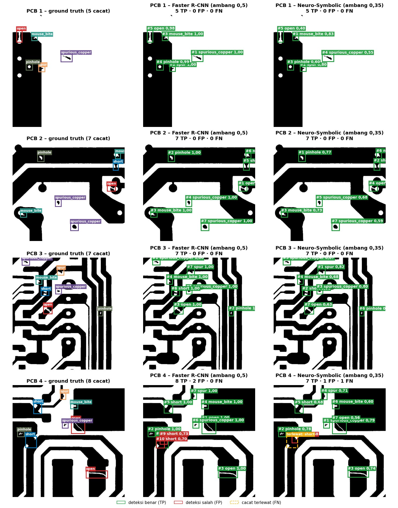

**Gambar 4.10 Hasil deteksi *ground truth*, *Faster* R-CNN, dan *Neuro-Symbolic* pada empat PCB uji**

Pada PCB 1 sampai PCB 3, kedua model menemukan seluruh cacat dengan kelas yang benar dan tanpa *false positive*. Perbedaannya terletak pada skor yang tertera pada setiap kotak. Pada ke-19 deteksi di PCB 1 sampai PCB 3, *Faster* R-CNN memberi skor 0,98 hingga 1,00, sedangkan NeSy memberi skor 0,40 hingga 0,83 yang bervariasi menurut keyakinan *decision path*. Pada PCB 4 yang memuat 8 cacat, kedua model kesulitan pada kelompok *short* di kiri bawah. *Faster* R-CNN menghasilkan dua *false positive* (#9 dan #10, *short* berskor 0,73 dan 0,70) dengan seluruh cacat terdeteksi, sedangkan NeSy menghasilkan satu *false positive* (#8, *spur* berskor 0,48) dan melewatkan satu *short*. Kesalahan tersebut berbeda jenis tetapi sama-sama terjadi pada area yang ambigu, dan pola serupa dibahas pada Subbab 4.6.2.

### 4.6.2 Mengapa *Precision* Naik dan *Recall* Turun

Perubahan *precision* dan *recall* pada Tabel 4.8 terutama berasal dari satu perilaku NeSy, yaitu skor yang rendah pada RoI yang berada dekat batas keputusan pohon. Pada ambang 0,35, perilaku ini menolak *background* yang ambigu sehingga *false positive* berkurang (*precision* naik), dan menolak pula cacat yang ambigu sehingga cacat terlewat bertambah (*recall* turun). Kedua sisi tersebut diperiksa mulai dari jenis kesalahan yang berubah. Kesalahan *false positive* diklasifikasikan sebagai duplikat, salah kelas, salah lokalisasi, atau *background* (tidak menutupi cacat mana pun), dan hasilnya ditunjukkan pada Tabel 4.10.

**Tabel 4.10 Jenis *False Positive* pada Data Uji**

| **Model** | **Background** | **Salah kelas** | **Salah lokalisasi** | **Duplikat** | **Total** |
|:------------|--------|--------|--------|--------|--------|
| *Faster* R-CNN (ambang 0,5) | 260 | 33 | 35 | 3 | 331 |
| *Neuro-Symbolic* (ambang 0,35) | **215** | 49 | **27** | 7 | **298** |

Dari 260 *false positive* *background* *Faster* R-CNN, 74 tidak lagi terdeteksi oleh NeSy pada ambang 0,35 (tidak ada deteksi NeSy sekelas yang menutupinya), sehingga *background* turun dari 260 menjadi 215 dan total *false positive* dari 331 menjadi 298. Sebaliknya, salah kelas naik dari 33 menjadi 49 karena SODT lebih sering memilih kelas yang keliru pada RoI yang ambigu, dan duplikat naik dari 3 menjadi 7. Penurunan *false positive* memperkecil penyebut *precision*. Di sisi lain, cacat yang terlewat bertambah dari 38 menjadi 47 seperti ditunjukkan pada Tabel 4.11.

**Tabel 4.11 Cacat Terlewat (*False Negative*) per Kelas**

| **Model** | ***Open*** | ***Short*** | ***Mousebite*** | ***Spur*** | ***Spurious copper*** | ***Pinhole*** | **Total** |
|:------------|-----|-----|-----|-----|-----|-----|-----|
| *Faster* R-CNN (ambang 0,5) | **8** | **13** | **6** | **6** | **3** | **2** | **38** |
| *Neuro-Symbolic* (ambang 0,35) | 8 | 16 | 8 | 8 | 4 | 3 | 47 |

Dari cacat yang berhasil dideteksi *Faster* R-CNN, 15 hilang pada NeSy. Sebanyak 14 di antaranya terjadi karena skor NeSy berada di bawah ambang 0,35 dan hanya satu karena kelas yang salah. Penyebab skor rendah adalah *node* terlemah pada *decision path*, yaitu *node* dengan faktor σ terkecil pada Persamaan 3.3, yang berupa *root* (N0) pada 9 dari 14 kasus. Kehilangan terbanyak terjadi pada *open* dan *mousebite* (masing-masing 4), diikuti *short* (3), *pinhole* (2), serta *spur* dan *spurious copper* (masing-masing 1).

Kedua sisi perilaku tersebut ditunjukkan pada Gambar 4.11 dan Gambar 4.12. Setiap baris memuat satu contoh dengan tiga kolom, yaitu citra PCB utuh dengan satu kotak penanda lokasi, potongan yang diperbesar berisi hasil *Faster* R-CNN, dan potongan yang sama berisi hasil NeSy. Gambar 4.11 memperlihatkan *false positive* *Faster* R-CNN pada area tanpa cacat yang ditolak NeSy. Kotak merah pada citra PCB menandai lokasinya, kotak merah pada potongan adalah deteksi *Faster* R-CNN, dan kotak biru putus-putus adalah kandidat NeSy yang skornya berada di bawah ambang.

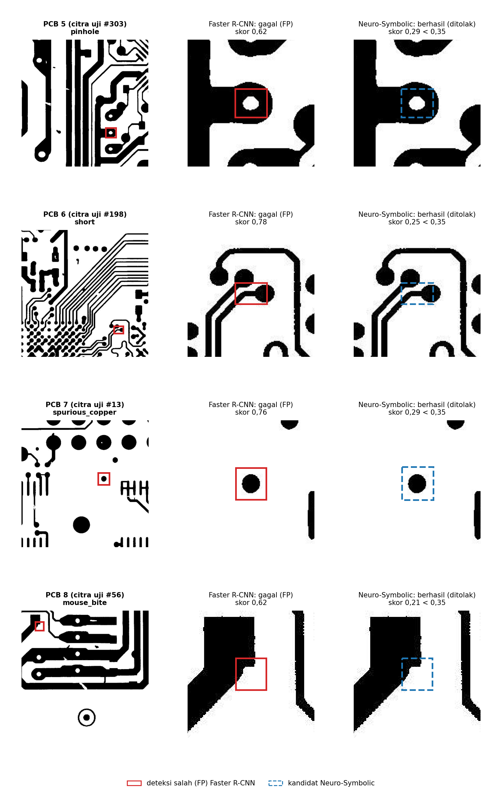

**Gambar 4.11 *False positive Faster* R-CNN yang ditolak NeSy**

Pada Gambar 4.11, keempat kotak merah *Faster* R-CNN (skor 0,62 hingga 0,78) menutupi struktur yang tampak seperti cacat, misalnya lubang bundar pada tembaga atau jalur yang berdekatan, dengan kelas prediksi *pinhole*, *short*, *spurious copper*, dan *mousebite*, tetapi tidak ada anotasi di sana. NeSy memberi kandidat yang hampir sama kotaknya, namun berskor 0,21 hingga 0,29 sehingga berada di bawah ambang 0,35.

Gambar 4.12 memperlihatkan arah sebaliknya, yaitu cacat yang terdeteksi *Faster* R-CNN tetapi terlewat NeSy. Kotak kuning pada citra PCB adalah *ground truth*, kotak hijau pada potongan adalah deteksi benar *Faster* R-CNN, dan kotak biru putus-putus adalah kandidat NeSy. *Node* terlemah pada *decision path* tertulis pada judul potongan NeSy. Contoh pertama berasal dari PCB 4 pada Gambar 4.10.

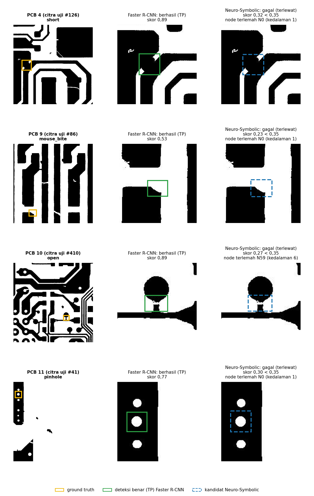

**Gambar 4.12 Cacat yang terdeteksi *Faster* R-CNN tetapi terlewat NeSy**

Pada Gambar 4.12, keempat cacat nyata (*short*, *mousebite*, *open*, dan *pinhole*) memiliki skor NeSy 0,23 hingga 0,32, dengan tiga di antaranya ditolak pada *root* dan satu pada N59. Kotak NeSy hampir sama dengan kotak *Faster* R-CNN dan *ground truth*. Dengan demikian NeSy tidak salah menemukan lokasi, melainkan kurang yakin terhadap kelasnya. Cacat pada PCB 4 adalah *short* yang terlewat pada Gambar 4.10.

Penyebab skor rendah tersebut diuji pada Gambar 4.13. Keyakinan *root* adalah faktor σ milik *root* pada Persamaan 3.3, bernilai 0,5 bila *root* sama sekali tidak yakin dan mendekati 1 bila sangat yakin. Panel (a) membandingkan keyakinan *root* pada 3.072 deteksi benar NeSy, pada 69 *false positive* *background* *Faster* R-CNN yang ditolak NeSy dengan kandidat berskor di bawah ambang (5 lainnya tidak memiliki kandidat NeSy sama sekali), dan pada 14 cacat yang ditolak karena skornya di bawah ambang 0,35. Panel (b) menunjukkan ke arah mana *root* mengirim RoI dari setiap kelas menurut label *teacher*.

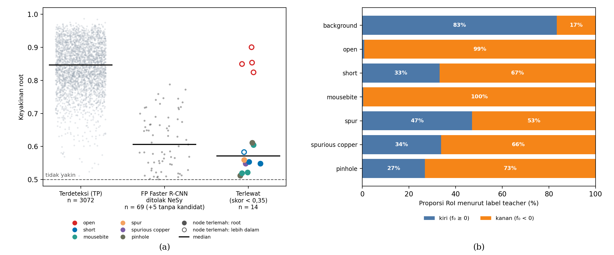

**Gambar 4.13 Keyakinan *root* pada deteksi benar, *false positive* yang ditolak, dan cacat terlewat NeSy: (a) keyakinan *root* dan (b) arah *root* per kelas**

Pada Gambar 4.13 (a), deteksi benar memiliki median keyakinan *root* 0,85 dan hanya 45 dari 3.072 (1,5%) yang berada di bawah 0,65. *False positive* *background* yang ditolak bermedian 0,61 dengan 44 dari 69 di bawah 0,65, sedangkan 9 cacat yang ditolak di *root* bermedian 0,55 dan tidak ada yang melebihi 0,61. Dengan demikian RoI yang ditolak, baik *background* maupun cacat, sama-sama memiliki keyakinan *root* yang rendah, yang jarang dimiliki deteksi benar. Pada panel (b), *root* mengirim sebagian besar *background* (83%) ke kiri dan sebagian besar cacat ke kanan, dari 53% pada *spur* hingga 100% pada *mousebite*. Keyakinan *root* yang mendekati 0,5 berarti RoI berada dekat batas antara kedua sisi tersebut, sehingga keputusan pertama NeSy goyah dan skor akhirnya turun di bawah ambang. *Root* menjadi *node* terlemah pada 39 dari 69 *false positive* yang ditolak dan pada 9 dari 14 cacat yang terlewat. Sisanya (30 *false positive* dan 5 cacat, yang terakhir ditandai titik berongga pada panel (a)) tidak paling lemah di *root*, tetapi ditolak pada *node* yang lebih dalam dengan mekanisme yang sama, yaitu RoI berada dekat batas keputusan *node* yang mereka pisahkan. Mekanisme ini tidak berlaku untuk salah kelas yang bertambah pada Tabel 4.10. Pada 22 *false positive* salah kelas yang tidak dibuat *Faster* R-CNN, keyakinan *root* bermedian 0,87 dan *root* hanya menjadi *node* terlemah pada 6 kasus, sehingga kesalahan kelas tersebut berasal dari *node* yang lebih dalam, bukan dari *root* yang ragu. Dengan demikian, *background* yang ditolak dan cacat yang terlewat dijelaskan oleh sebab yang sama: RoI yang dekat batas keputusan pohon mendapat skor rendah, sehingga *background* yang ambigu ditolak (*precision* naik) dan cacat yang ambigu ikut ditolak (*recall* turun), bukan karena NeSy salah menemukan lokasi.

### 4.6.3 *Routing Margin* (Kontribusi 2)

Tanpa *routing margin*, setiap deteksi berskor 1,0 sehingga urutan skor yang dibutuhkan *Soft*-NMS dan AP hilang. Pengaruhnya diuji dengan menyamakan seluruh skor menjadi 1 tanpa mengubah *decision path* maupun label, sehingga selisihnya murni berasal dari skor. Hasilnya ditunjukkan pada Tabel 4.12.

**Tabel 4.12 Pengaruh *Routing Margin* pada Deteksi *Neuro-Symbolic***

| **Model** | **Ambang** | **mAP@0,5:0,95** | **mAP@0,5** | ***Precision*** | ***Recall*** | **F1** |
|:------------|-------|--------|--------|--------|---------|--------|
| NeSy tanpa *routing margin* | 0,35 | 0,644 | 0,810 | 0,750 | **0,988** | 0,852 |
| NeSy dengan *routing margin* | 0,35 | **0,787** | **0,982** | **0,912** | 0,978 | **0,944** |

Berdasarkan Tabel 4.12, *routing margin* menaikkan mAP@0,5:0,95 sebesar 0,142 dan mAP@0,5 sebesar 0,172, serta *precision* sebesar 16,2 poin, dengan *recall* hanya turun 1,0 poin. Tanpa skor, *false positive* meningkat dari 298 menjadi 1.036 (Tabel 4.13), sebagian besar karena duplikat tidak dapat dibedakan oleh *Soft*-NMS (7 menjadi 140) dan *background* tidak dapat disaring (215 menjadi 517).

**Tabel 4.13 Jenis *False Positive* tanpa dan dengan *Routing Margin***

| **Model** | **Background** | **Salah kelas** | **Salah lokalisasi** | **Duplikat** | **Total** |
|:------------|--------|--------|--------|--------|--------|
| NeSy tanpa *routing margin* | 517 | 248 | 131 | 140 | 1.036 |
| NeSy dengan *routing margin* | **215** | **49** | **27** | **7** | **298** |

Pola yang sama terlihat pada *confusion matrix* pada Gambar 4.14, dengan panel (a) tanpa *routing margin* dan panel (b) dengan *routing margin*. Tanpa *routing margin*, baris *background* membengkak, yaitu *background* yang dideteksi sebagai *short* (264), *pinhole* (218), *open* (152), dan *spurious copper* (143), dibandingkan 71, 89, 24, dan 51 dengan *routing margin*. Selain itu muncul pertukaran antarkelas seperti *mousebite* menjadi *pinhole* (25) dan *spurious copper* menjadi *pinhole* (16).

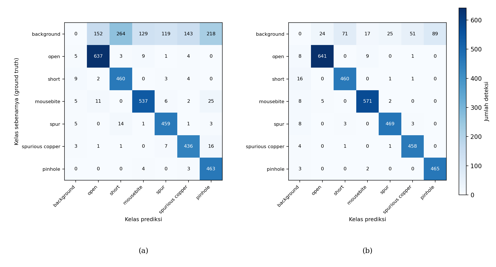

**Gambar 4.14 *Confusion Matrix Neuro-Symbolic* (ambang 0,35): (a) tanpa *Routing Margin* dan (b) dengan *Routing Margin***

Dengan demikian skor *routing margin* membuat SODT dapat menggantikan *classification head* tanpa kehilangan kemampuan deteksi, karena keyakinan *decision path* dapat dipakai sebagai skor. Bias terhadap panjang *decision path* pada Subbab 3.8.1 tetap ada, dan ditunjukkan oleh AP yang sedikit di bawah *Faster* R-CNN pada Tabel 4.9.

## 4.7 Hasil dan Evaluasi *Explanation* pada *Neuro-Symbolic* (Kontribusi 3)

*Explanation* dievaluasi dengan dua cara, yaitu uji *faithfulness* pada 50 citra uji pertama (Subbab 4.7.1) dan studi kasus pada satu PCB (Subbab 4.7.2). Kedua uji memakai metode pada Subbab 3.9.2, dengan Grad-CAM sebagai pembanding.

### 4.7.1 *Faithfulness*

Tabel 4.14 membandingkan metode yang menjelaskan SODT dengan Grad-CAM pada *Faster* R-CNN, masing-masing terhadap *random control*-nya sendiri. *Necessity* dan *Sufficiency* dalam persentase deteksi yang labelnya berubah atau bertahan, sedangkan *Deletion* dan *Insertion* AUC dihitung dari skor deteksi.

**Tabel 4.14 *Faithfulness* Metode *Explanation* terhadap *Random Control***

| **Metode** | ***Necessity*** | ***Sufficiency*** | ***Deletion* AUC** | ***Insertion* AUC** | **Jumlah deteksi** |
|:------------|-------|--------|--------|--------|--------|
| SODT: peta M | **0,961** | **0,774** | **0,439** | **0,758** | 337 |
| SODT: *random control* | 0,591 | 0,285 | 0,590 | 0,585 | 337 |
| Grad-CAM, seluruh citra | 0,322 | 0,183 | 0,711 | 0,186 | 345 |
| Grad-CAM, petak dibatasi pada proposal | 0,687 | 0,470 | 0,375 | 0,492 | 345 |
| Grad-CAM: *random control* | 0,603 | 0,301 | 0,432 | 0,402 | 345 |

*Catatan:* *Necessity* dan *Sufficiency* makin tinggi makin baik, *Deletion* AUC makin rendah makin baik, dan *Insertion* AUC makin tinggi makin baik.

Berdasarkan Tabel 4.14, petak yang diurutkan menurut peta M mengubah label pada 96,1% deteksi bila diganti, dibandingkan 59,1% untuk petak acak, dan mempertahankan label pada 77,4% deteksi bila hanya petak tersebut yang dipertahankan, dibandingkan 28,5% untuk petak acak. Selisih terhadap *random control* sebesar +0,371 (*necessity*) dan +0,490 (*sufficiency*), sedangkan pada Grad-CAM yang dibatasi pada proposal hanya +0,084 dan +0,168. Pada seluruh citra, Grad-CAM bahkan di bawah *random control* karena sebagian besar petak teratasnya berada di luar proposal, sedangkan peta M hanya menyala di dalam proposal. Perbandingan hanya dilakukan antara tiap metode dan *random control*-nya karena kedua metode menjelaskan kepala klasifikasi yang berbeda, sehingga angka mutlak antarmetode tidak sebanding. Jadi, *region* yang disorot SODT benar-benar menentukan keputusan *tree*, sesuai sifat *faithful* dari Subbab 3.8.2.

Dari sisi waktu, *Faster* R-CNN hanya mendeteksi membutuhkan 54,6 ms per citra, NeSy dengan pembentukan *heatmap* per *node* 67,5 ms, dan *Faster* R-CNN dengan Grad-CAM 94,7 ms. Penjelasan SODT lebih murah karena dihitung dengan satu propagasi mundur per deteksi untuk seluruh *node*, sedangkan Grad-CAM memerlukan propagasi mundur tersendiri.

### 4.7.2 Studi Kasus pada Satu PCB

Penjelasan dibaca pada PCB 1 dari Gambar 4.10, yang memuat lima cacat dari lima kelas berbeda (*open*, *mouse_bite*, *pinhole*, *spur*, dan *spurious copper*). Gambar 4.15 menampilkan citra utuh dengan dua panel, yaitu (a) peta gabungan M pada Persamaan 3.8 untuk deteksi NeSy dan (b) peta Grad-CAM pada proposal yang sama. Kotak putih bernomor adalah deteksi NeSy. Kedua peta digambar hanya di dalam proposal masing-masing deteksi karena kelas sebuah deteksi dihitung dari fitur *RoI Align* di dalam proposalnya, sehingga aktivasi di luar proposal tidak memengaruhi keputusan deteksi tersebut. Setiap peta dinormalisasi sendiri per deteksi.

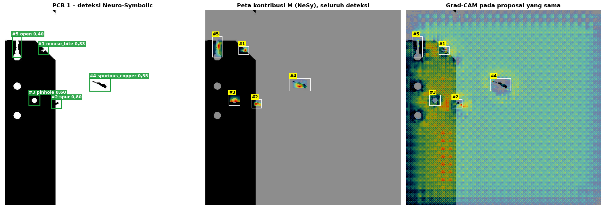

**Gambar 4.15 Penjelasan pada PCB 1: (a) peta M (NeSy) dan (b) peta Grad-CAM pada proposal yang sama**

Pada panel (a), peta M menyala di dalam setiap kotak dan memusat pada struktur cacatnya sendiri, yaitu celah pada konduktor untuk #5, takik pada tepi konduktor untuk #1, tonjolan kecil untuk #2, lubang untuk #3, dan gumpalan tembaga untuk #4. Pada panel (b), Grad-CAM juga terbatas di dalam proposal, tetapi sorotannya lebih lemah dan lebih tersebar, terutama pada #4 dan #5 yang hampir tidak menyala. Peta M berasal dari keputusan *tree* itu sendiri, sedangkan Grad-CAM adalah perkiraan atas keputusan *Faster* R-CNN. Peta M merupakan label lokasi *region* yang ditimbang dan bukan penyebab per piksel, sehingga kedua peta dibaca sebagai petunjuk letak.

Lebih lanjut, Gambar 4.16 dan Gambar 4.17 membandingkan tiga peta untuk satu deteksi yang sama, yaitu (a) peta M, (b) peta Grad-CAM pada proposal yang sama, dan (c) peta per *node* sepanjang *decision path*. Peta M pada panel (a) adalah jumlah seluruh peta *node* pada panel (c) menurut Persamaan 3.8, sehingga panel (c) menguraikan M menjadi langkah-langkah keputusannya. Grad-CAM pada panel (b) tidak dapat diuraikan seperti itu karena hanya menghasilkan satu peta per deteksi. Gambar 4.16 menunjukkan deteksi #1 (*mouse_bite*, skor 0,833) dengan *decision path* N0 → N2 → N6 → N14 → N29 → N59, dan Gambar 4.17 menunjukkan deteksi #2 (*spur*, skor 0,801) dengan *decision path* N0 → N2 → N5 → N11 → N24 → N49. Kotak cyan pada setiap peta adalah proposal dan kotak hijau putus-putus adalah kotak deteksi. Pada panel (c), panah menunjukkan urutan *node* dari *root*, dan di atas setiap peta tertulis nomor *node*, arah keputusan, dan faktor σ pada Persamaan 3.3. Perkalian seluruh faktor σ pada jalur sama dengan skor deteksi (0,95 × 0,93 × 0,99 × 0,97 × 1,00 × 0,99 ≈ 0,84 pada Gambar 4.16, selisih terhadap 0,833 berasal dari pembulatan faktor).

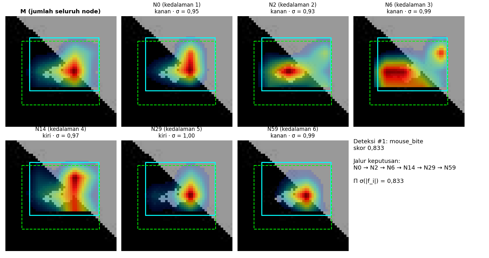

**Gambar 4.16 Perbandingan (a) peta M, (b) peta Grad-CAM pada proposal yang sama, dan (c) peta per *node* sepanjang *decision path* untuk deteksi #1 (*mouse_bite*, skor 0,833) pada PCB 1**

Pada Gambar 4.16, peta M pada panel (a) memusat di sisi kanan takik. Puncak yang sama muncul pada Grad-CAM di panel (b) sebagai garis vertikal di tengah-kanan proposal, tetapi Grad-CAM juga menyala kuat di sepanjang tepi bawah proposal, yang bukan puncak pada M. Pada panel (c), *node* berbeda menyorot bagian berbeda dari cacat yang sama. N0, N14, N29, dan N59 memusat di sisi kanan takik, sedangkan N2 dan N6 memusat di sisi kiri dan kiri bawah proposal. Pembagian ini wajar untuk *tree* yang menyaring secara bertahap. Faktor σ terkecil ada pada N0 (0,95) dan N2 (0,93), sedangkan *node* di bawahnya mendekati 1, sehingga keyakinan keputusan terutama ditentukan pada tingkat atas.

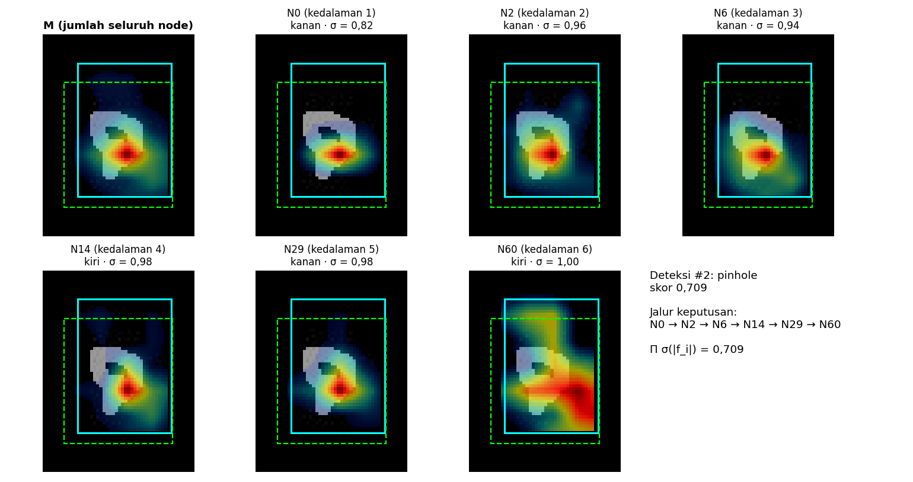

**Gambar 4.17 Perbandingan (a) peta M, (b) peta Grad-CAM pada proposal yang sama, dan (c) peta per *node* sepanjang *decision path* untuk deteksi #2 (*spur*, skor 0,801) pada PCB 1**

Pada Gambar 4.17, peta M pada panel (a) memusat di sisi kiri tengah proposal dan menyebar ke kanan, sedangkan Grad-CAM pada panel (b) menyala paling kuat di tepi kanan bawah proposal dan lebih lemah di sisi kiri. Untuk deteksi ini kedua peta menunjuk bagian yang berbeda, dan hanya peta M yang dapat ditelusuri ke *node* penyusunnya pada panel (c). Pada panel (c), jalur *spur* sama dengan *mouse_bite* pada N0 dan N2, tetapi N2 mengarah ke kiri untuk *spur* dan ke kanan untuk *mouse_bite*, sehingga kedua deteksi berpisah sejak kedalaman 3 (N5 dan bukan N6). Peta *node* berpindah antara bagian tengah proposal (N0, N5), sisi kiri (N11, N24), dan sisi kanan bawah (N2, N49), yaitu bagian-bagian yang berbeda dari tonjolan yang sama. N0 memberi faktor σ terkecil (0,85), sehingga skor 0,801 sebagian besar ditentukan oleh keyakinan pada *root*, sejalan dengan Subbab 4.6.2 yang menyebut *root* sebagai *node* terlemah pada sebagian besar deteksi yang hilang.

Dengan demikian, penjelasan SODT memungkinkan pembaca mengikuti keputusan satu deteksi dari *root* hingga *leaf* beserta *region* yang ditimbang pada setiap langkah, sedangkan Grad-CAM hanya memberi satu peta tanpa urutan keputusan.

# BAB V PENUTUP

## 5.1 Kesimpulan

Penelitian ini mengintegrasikan *Faster* R-CNN dengan SODT sebagai arsitektur *neuro-symbolic* untuk deteksi cacat PCB pada *dataset* DeepPCB. *Faster* R-CNN yang menjadi *teacher* setara dengan Fung et al. (2024), dengan AP@50:5:85 sebesar 93,03 terhadap 93,2. SODT yang menggantikan *classification head* mempertahankan akurasi tersebut, dengan mAP@0,5 sebesar 0,982 terhadap 0,987 dan mAP@0,5:0,95 sebesar 0,787 terhadap 0,797. Pada ambang skor masing-masing, *precision* naik dari 0,903 menjadi 0,912 dan F1 dari 0,941 menjadi 0,944, sedangkan *recall* turun dari 0,983 menjadi 0,978. Selisih ini kecil sehingga NeSy dibaca setara dengan *Faster* R-CNN, bukan lebih baik. Perubahan ini terjadi karena NeSy memberi skor rendah pada RoI yang dekat batas keputusan pohon, sehingga 74 *false positive* *background* milik *Faster* R-CNN ditolak, tetapi 15 cacat yang dideteksi *Faster* R-CNN ikut hilang, hampir seluruhnya karena skor di bawah ambang.

Tiga kontribusi mendukung hasil tersebut. Pertama, *class weighting* menyempitkan rentang *agreement* antarkelas dari 3,7 menjadi 2,1 poin dan menaikkan *agreement* kelas *short* sebesar 3,1 poin, dengan biaya 0,3 poin *mimic accuracy*. Pengaruh ini belum terlihat pada kinerja deteksi, yang tidak berubah tanpa *class weighting*. Kedua, skor deteksi berbasis *routing margin* memberi urutan skor yang dibutuhkan *Soft*-NMS dan AP, sehingga mAP@0,5:0,95 naik dari 0,644 menjadi 0,787 dan *false positive* turun dari 1.036 menjadi 298. Ketiga, *heatmap* per *node* menghasilkan *explanation* yang *faithful*. Terhadap *random control*-nya sendiri, peta SODT mengubah label pada 96,1% deteksi dibandingkan 59,1% untuk petak acak, sedangkan Grad-CAM pada petak yang dibatasi proposal hanya 68,7% dibandingkan 60,3%. Waktu per citra untuk deteksi beserta *explanation* juga lebih singkat, yaitu 67,5 ms terhadap 94,7 ms. *Explanation* tidak hanya berupa satu peta, tetapi *heatmap* pada setiap *node* di *decision path* sehingga keputusan dapat ditelusuri langkah demi langkah dari *root* hingga *leaf*. Kedua tujuan penelitian, yaitu mempertahankan performa deteksi sekaligus menyediakan *explanation* yang *faithful* dan lebih baik daripada Grad-CAM, telah tercapai.

## 5.2 Saran

Penelitian ini masih memiliki beberapa keterbatasan. Hasil utama berasal dari satu pohon SODT dan satu *seed* pelatihan SODT. Ablasi *class weighting* hanya menunjukkan pengaruh pada *agreement*, bukan pada deteksi. SODT hanya meniru label *teacher*, sehingga cacat yang gagal ditiru menambah *false negative*. Skor *routing margin* memiliki bias terhadap panjang *decision path*, kanal *neck* dikurangi menjadi 64, dan evaluasi *explanation* dilakukan secara kuantitatif tanpa teknisi. Berdasarkan keterbatasan tersebut, saran untuk penelitian selanjutnya adalah sebagai berikut.

1.  Menguji bobot kelas yang lebih besar, karena bobot saat ini belum mengubah kinerja deteksi.

2.  Menguji hasil pada beberapa *seed* pelatihan SODT untuk memastikan kestabilan selisih terhadap *Faster* R-CNN.

3.  Melatih SODT langsung terhadap *ground truth* alih-alih meniru label *teacher*, agar kinerja pohon tidak lagi dibatasi oleh fidelitasnya terhadap *teacher*, dan mengoreksi bias skor terhadap panjang *decision path*.

4.  Menggunakan kanal *neck* penuh sebanyak 256 seperti pada Fung et al. (2024), dengan konsekuensi dimensi masukan SODT naik dari 3.136 menjadi 12.544 dan pelatihan TAO menjadi lebih berat.

5.  Melakukan studi pengguna dengan teknisi inspeksi PCB untuk mengukur dampak *explanation* per *node* terhadap proses validasi hasil deteksi.

# DAFTAR PUSTAKA

Ali, S., Abuhmed, T., El-Sappagh, S., Muhammad, K., Alonso-Moral, J.M., Confalonieri, R., Guidotti, R., Del Ser, J., Díaz-Rodríguez, N., Herrera, F., 2023. Explainable Artificial Intelligence (XAI): What we know and what is left to attain Trustworthy Artificial Intelligence. *Information Fusion* 99, 101805.

Ancona, M., Ceolini, E., Öztireli, C., Gross, M., 2019. Gradient-based attribution methods. In: Samek, W., Montavon, G., Vedaldi, A., Hansen, L.K., Müller, K.-R. (Eds.), *Explainable AI: Interpreting, Explaining and Visualizing Deep Learning*, LNCS 11700. Springer, Cham, pp. 169–191.

Araujo, A., Norris, W., Sim, J., 2019. Computing receptive fields of convolutional neural networks. *Distill*. <https://doi.org/10.23915/distill.00021>

Bach, S., Binder, A., Montavon, G., Klauschen, F., Müller, K.-R., Samek, W., 2015. On pixel-wise explanations for non-linear classifier decisions by layer-wise relevance propagation. *PLoS ONE* 10(7), e0130140.

Bodla, N., Singh, B., Chellappa, R., Davis, L.S., 2017. Soft-NMS — Improving object detection with one line of code. In: Proceedings of the IEEE International Conference on Computer Vision (ICCV), pp. 5561–5569.

Buciluǎ, C., Caruana, R., Niculescu-Mizil, A., 2006. Model compression. In: *Proceedings of the 12th ACM SIGKDD International Conference on Knowledge Discovery and Data Mining (KDD)*, pp. 535–541.

Canha, D., Kubler, S., Främling, K., Fagherazzi, G., 2025. A functionally-grounded benchmark framework for XAI methods: Insights and foundations from a systematic literature review. *ACM Computing Surveys* 57(12), 320.

Carreira-Perpiñán, M.Á., Tavallali, P., 2018. Alternating optimization of decision trees, with application to learning sparse oblique trees. In: *Advances in Neural Information Processing Systems (NeurIPS)*, 31, pp. 1211–1221.

Chen, X., Wu, Y., He, X., Ming, W., 2023. A Comprehensive Review of Deep Learning-Based PCB Defect Detection. IEEE Access 11, 139017-139036.

Coombs, C.F., Holden, H.T., 2016. *Printed Circuits Handbook*, 7th ed. McGraw-Hill Education, New York.

d'Avila Garcez, A., Lamb, L.C., 2023. Neurosymbolic AI: the 3rd wave. *Artificial Intelligence Review*, 56(11), pp.12387-12406.

DeYoung, J., Jain, S., Rajani, N.F., Lehman, E., Xiong, C., Socher, R., Wallace, B.C., 2020. ERASER: A benchmark to evaluate rationalized NLP models. In: *Proceedings of the 58th Annual Meeting of the Association for Computational Linguistics (ACL)*, pp. 4443–4458.

Doshi-Velez, F., Kim, B., 2017. Towards a rigorous science of interpretable machine learning. *arXiv preprint* arXiv:1702.08608.

Elkan, C., 2001. The foundations of cost-sensitive learning. In: Proceedings of the 17th International Joint Conference on Artificial Intelligence (IJCAI), pp. 973–978.

Everingham, M., Van Gool, L., Williams, C.K.I., Winn, J., Zisserman, A., 2010. The PASCAL Visual Object Classes (VOC) challenge. *International Journal of Computer Vision* 88(2), 303–338.

Fung, K.C., Xue, K.-W., Lai, C.-M., Lin, K.-H., Lam, K.-M., 2024. Improving PCB defect detection using selective feature attention and pixel shuffle pyramid. Results in Engineering 21, 101992.

Girshick, R., 2015. Fast R-CNN. In: *Proceedings of the IEEE International Conference on Computer Vision (ICCV)*, pp. 1440–1448.

Goodfellow, I., Bengio, Y., Courville, A., 2016. *Deep Learning*. MIT Press, Cambridge, MA.

Hada, S.S., Carreira-Perpiñán, M.Á., Zharmagambetov, A., 2024. Sparse oblique decision trees: a tool to understand and manipulate neural net features. *Data Mining and Knowledge Discovery*, 38(5), pp.2863-2902.

Han, Z., Hong, M., Wang, D., 2017. Deep learning and applications. In: *Signal Processing and Networking for Big Data Applications*. Cambridge University Press, Cambridge, pp. 126-168.

He, H., Garcia, E.A., 2009. Learning from imbalanced data. IEEE Transactions on Knowledge and Data Engineering, 21(9), pp. 1263–1284.

He, K., Zhang, X., Ren, S., Sun, J., 2016. Deep residual learning for image recognition. In: *Proceedings of the IEEE Conference on Computer Vision and Pattern Recognition (CVPR)*, pp. 770–778.

He, K., Gkioxari, G., Dollár, P., Girshick, R., 2020. Mask R-CNN. *IEEE Transactions on Pattern Analysis and Machine Intelligence* 42(2), 386–397.

Hinton, G., Vinyals, O., Dean, J., 2015. Distilling the knowledge in a neural network. arXiv preprint arXiv:1503.02531.

Hoffmann, R., Reich, C., 2023. A systematic literature review on artificial intelligence and explainable artificial intelligence for visual quality assurance in manufacturing. *Electronics* 12(22), 4572.

IPC, 2015. IPC-6012D: Qualification and Performance Specification for Rigid Printed Boards. Association Connecting Electronics Industries.

IPC, 2020. *IPC-A-600K: Acceptability of Printed Boards*. Association Connecting Electronics Industries.

Kairgeldin, R., Carreira-Perpiñán, M.Á., 2025. Neurosymbolic models based on hybrids of convolutional neural networks and decision trees. *Proceedings of Machine Learning Research (NeSy 2025)*, 284, pp.796-813.

Kautz, H., 2022. The third AI summer: AAAI Robert S. Engelmore Memorial Lecture. *AI Magazine* 43(1), 105–125.

Khandpur, R.S., 2005. *Printed Circuit Boards: Design, Fabrication, and Assembly*. McGraw-Hill Education.

Kontschieder, P., Fiterau, M., Criminisi, A., Rota Bulò, S., 2015. Deep neural decision forests. In: *Proceedings of the IEEE International Conference on Computer Vision (ICCV)*, pp. 1467–1475.

LeCun, Y., Bengio, Y., Hinton, G., 2015. Deep learning. *Nature*, 521(7553), pp. 436-444.

Li, X., Wang, W., Hu, X., Yang, J., 2019. Selective kernel networks. In: *Proceedings of the IEEE/CVF Conference on Computer Vision and Pattern Recognition (CVPR)*, pp. 510–519.

Lin, T.-Y., Dollár, P., Girshick, R., He, K., Hariharan, B., Belongie, S., 2017. Feature pyramid networks for object detection. In: *Proceedings of the IEEE Conference on Computer Vision and Pattern Recognition (CVPR)*, pp. 2117–2125.

Luo, W., Li, Y., Urtasun, R., Zemel, R., 2016. Understanding the effective receptive field in deep convolutional neural networks. In: *Advances in Neural Information Processing Systems (NeurIPS)*, 29, pp. 4898–4906.

Michel-Delétie, C., Sarker, M.K., 2026. Neuro-symbolic methods for trustworthy AI: A systematic review with a focus on interpretability. *Neurosymbolic Artificial Intelligence* 2, 29498732261469336.

Minaee, S., Boykov, Y., Porikli, F., Plaza, A., Kehtarnavaz, N., Terzopoulos, D., 2021. Image segmentation using deep learning: A survey. *IEEE Transactions on Pattern Analysis and Machine Intelligence*, 44(7), pp.3523-3542.

Nauta, M., Trienes, J., Pathak, S., Nguyen, E., Peters, M., Schmitt, Y., Schlötterer, J., van Keulen, M., Seifert, C., 2023. From anecdotal evidence to quantitative evaluation methods: A systematic review on evaluating explainable AI. *ACM Computing Surveys* 55(13s), 295.

Petsiuk, V., Das, A., Saenko, K., 2018. RISE: Randomized input sampling for explanation of black-box models. In: *Proceedings of the British Machine Vision Conference (BMVC)*, pp. 1–13.

Platt, J.C., 1999. Probabilistic outputs for support vector machines and comparisons to regularized likelihood methods. In: Advances in Large Margin Classifiers. MIT Press, Cambridge, MA, pp. 61–74.

Prince, S.J.D., 2023. *Understanding Deep Learning*. MIT Press, Cambridge, MA.

Provost, F., Domingos, P., 2003. Tree induction for probability-based ranking. *Machine Learning* 52(3), 199–215.

Ren, S., He, K., Girshick, R., Sun, J., 2017. Faster R-CNN: Towards real-time object detection with region proposal networks. *IEEE Transactions on Pattern Analysis and Machine Intelligence* 39(6), 1137–1149.

Rudin, C., 2019. Stop explaining black box machine learning models for high stakes decisions and use interpretable models instead. *Nature Machine Intelligence*, 1(5), pp.206-215.

Rudin, C., Chen, C., Chen, Z., Huang, H., Semenova, L., Zhong, C., 2022. Interpretable machine learning: Fundamental principles and 10 grand challenges. *Statistics Surveys* 16, 1–85.

Samek, W., Montavon, G., Vedaldi, A., Hansen, L.K., Müller, K.-R. (Eds.), 2019. *Explainable AI: Interpreting, Explaining and Visualizing Deep Learning*. LNCS 11700. Springer, Cham.

Saporta, A., Gui, X., Agrawal, A., Pareek, A., Truong, S.Q.H., Nguyen, C.D.T., Ngo, V.-D., Seekins, J., Blankenberg, F.G., Ng, A.Y., Lungren, M.P., Rajpurkar, P., 2022. Benchmarking saliency methods for chest X-ray interpretation. *Nature Machine Intelligence* 4(10), 867–878.

Schapire, R.E., Singer, Y., 1999. Improved boosting algorithms using confidence-rated predictions. *Machine Learning* 37(3), 297–336.

Selvaraju, R.R., Cogswell, M., Das, A., Vedantam, R., Parikh, D., Batra, D., 2017. Grad-CAM: Visual explanations from deep networks via gradient-based localization. In: *Proceedings of the IEEE International Conference on Computer Vision (ICCV)*, pp. 618–626.

Shi, W., Caballero, J., Huszár, F., Totz, J., Aitken, A.P., Bishop, R., Rueckert, D., Wang, Z., 2016. Real-time single image and video super-resolution using an efficient sub-pixel convolutional neural network. In: *Proceedings of the IEEE Conference on Computer Vision and Pattern Recognition (CVPR)*, pp. 1874–1883.

Shrikumar, A., Greenside, P., Kundaje, A., 2017. Learning important features through propagating activation differences. In: *Proceedings of the 34th International Conference on Machine Learning (ICML)*, PMLR 70, pp. 3145–3153.

Sokolova, M., Lapalme, G., 2009. A systematic analysis of performance measures for classification tasks. *Information Processing & Management* 45(4), 427–437.

Sundararajan, M., Taly, A., Yan, Q., 2017. Axiomatic attribution for deep networks. In: *Proceedings of the 34th International Conference on Machine Learning (ICML)*, PMLR 70, pp. 3319–3328.

Szeliski, R., 2022. *Computer Vision: Algorithms and Applications*, 2nd ed. Springer, Cham.

Tang, S., He, F., Huang, X., Yang, J., 2019. Online PCB Defect Detector On A New PCB Defect Dataset. arXiv preprint arXiv:1902.06197.

Tziolas, T., Papageorgiou, K., Theodosiou, T., Ioannidis, D., Dimitriou, N., Tinker, G., Papageorgiou, E., 2025. Explainable AI Methods for Identification of Glue Volume Deficiencies in Printed Circuit Boards. Applied Sciences 15(16), 9061.

Tzionis, G., Mouratidis, P., Kougka, G., Gialampoukidis, I., Vrochidis, S., Kompatsiaris, I., Vlachopoulou, M., 2026. A review of explainable AI methods and their application in manufacturing systems. Discover Applied Sciences 8, 52.

Wang, Y., Huang, J., Dipu, M.S.K., Zhao, H., Gao, S., Zhang, H., Lv, P., 2024. YOLO-RLC: An Advanced Target-Detection Algorithm for Surface Defects of Printed Circuit Boards Based on YOLOv5. Computers, Materials & Continua 80(3), 4973-4995.

Xiao, G., Hou, S., Zhou, H., 2024. PCB defect detection algorithm based on CDI-YOLO. *Scientific Reports* 14, 7351.

Zhao, X., Wang, L., Zhang, Y., Han, X., Deveci, M., Parmar, M., 2024. A review of convolutional neural networks in computer vision. *Artificial Intelligence Review* 57(4), 99.

Zhou, B., Khosla, A., Lapedriza, A., Oliva, A., Torralba, A., 2016. Learning deep features for discriminative localization. In: Proceedings of the IEEE Conference on Computer Vision and Pattern Recognition (CVPR), pp. 2921–2929.
